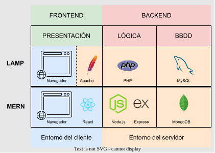
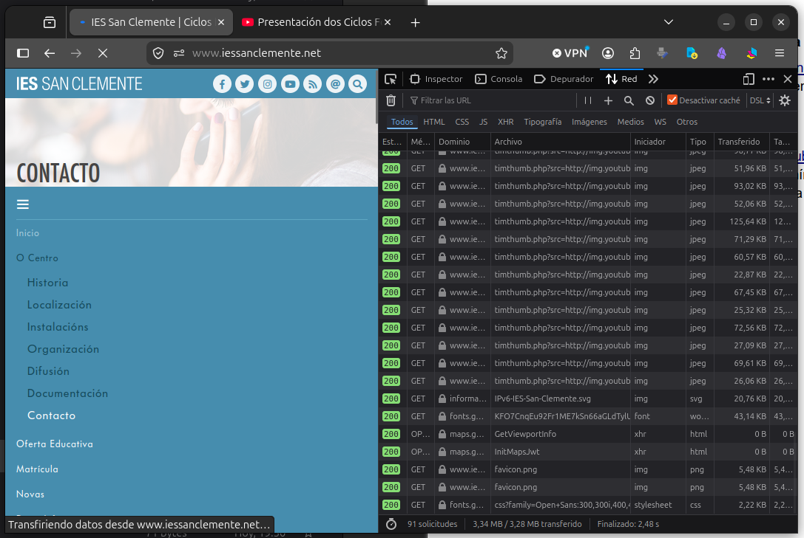
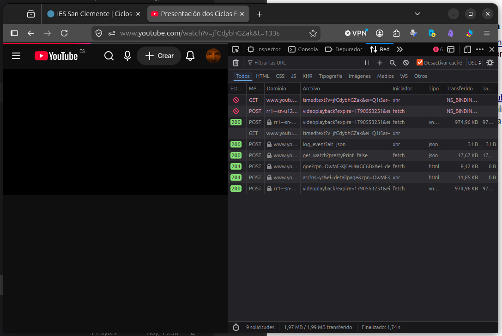

# Actividad 1 — Arquitectura cliente-servidor

**Objetivo:**

Conocer el modelo cliente-servidor, la división en capas de una aplicación web y la evolución de las arquitecturas.

**Desarrollo:**

- Estudio del material de la unidad relativo a los apartados 5 y 6.
- Elaborar un esquema propio (con draw.io, Excalidraw o herramienta equivalente) de una aplicación web de tres capas, indicando qué software concreto ocuparía cada capa en una pila LAMP y en una pila MERN.
- Redactar una comparativa breve de ventajas e inconvenientes entre una arquitectura monolítica y una de tres capas, desde el punto de vista del despliegue.
- Localizar en Internet dos aplicaciones web reales y deducir, a partir de su comportamiento en el navegador, qué modelo de arquitectura utilizan. Justificar la respuesta.

**Entregable:**

Documento en formato Markdown o PDF con el esquema, la comparativa y el análisis de las dos aplicaciones (máximo 3 páginas).

---

## Aplicaciones Web de 3 Capas

Las aplicaciones web pueden implementarse mediante arquitecturas con un diferente número de capas lógicas. Lo habitual es emplear, como mínimo, el patrón de 3 capas, cada una de las cuales tiene una responsabilidad independiente y desacoplada de las otras:

- **Presentación**: Interfaz de interacción del usuario.
- **Lógica de negocio**: Encargada de procesar los datos y peticiones.
- **Datos**: Gestiona el almacenamiento y recuperación de la información.

Se identifica como **frontend** la parte de la aplicación que funciona en el lado del cliente, mientras que la parte de la que se encarga el servidor es el **backend**.

Este sistema de capas puede desarrollarse usando diferentes conjuntos de software que interactúan entre sí conformando una pila. En el caso de las aplicaciones web, son típicas las pilas **LAMP** y **MERN**, las cuales se pueden ver en este gráfico:

El esquema muestra el software que se usa en cada pila.

En la pila **LAMP** (**L**inux, **A**pache, **M**ySQL, **P**HP) tenemos como sistema operativo base Linux, pero podría ser otro, como Windows (WAMP). De la presentación de los contenidos se encarga el servidor web **Apache** que los envía al cliente, y por esta razón lo vinculo al entorno servidor. De la lógica de las operaciones se encarga **PHP** y los datos se guardan en una base de datos relacional gestionada por **MySQL**.

En la pila **MERN** (**M**ongoDB, **E**xpress, **R**eact, **N**ode.js), la presentación se genera en el propio cliente mediante **React**, librería de JavaScript que trabaja con componentes y se basa en el uso de un DOM virtual que modifica en base a los datos recibidos de peticiones al backend, actualizando solo las partes de la página que necesita porque tras recibir unos archivos estáticos que envía Node.js, los enriquece y trabaja sobre ellos de forma dinámica. La lógica de negocio se ejecuta mediante **Node.js** que habilita la ejecución de JavaScript en el backend, unido al framework **Express** que habilita la funcionalidad del API que gestiona las peticiones y envía respuestas en formato JSON al cliente. En cuanto al almacenamiento y recuperación de datos, se encarga de ello una base de datos NoSQL como **MongoDB**, la cual gestiona datos en un formato similar al JSON, facilitando al comunicación con las otras capas.

## Ejemplos de Arquitectura Web monolítica y de 3 capas

- **Arquitectura monolítica**: [https://www.iessanclemente.net](https://www.iessanclemente.net/). Se puede observar que es de este tipo porque cada vez que se hace click en un enlace o sección de la página, se recarga la página completa, siendo reconstruida en su totalidad en el servidor y se envían todos los recursos. Además, durante la carga, la web queda sin capacidad de respuesta: hacer click en enlaces y opciones no funciona.

  

- **Arquitectura de 3 capas**: [https://www.youtube.com](https://www.youtube.com/). Se observa que tras cargar el contenido inicial que estructura la página, al navegar e interactuar con las diferentes partes de la aplicación se solicitan los recursos mínimos, mediante peticiones asíncronas, para poder actualizar la interfaz de forma fluida. Esto permite que la navegación del usuario no se vea interrumpida y pueda manipular otras opciones aunque no se hayan completado las peticiones al API.

  
