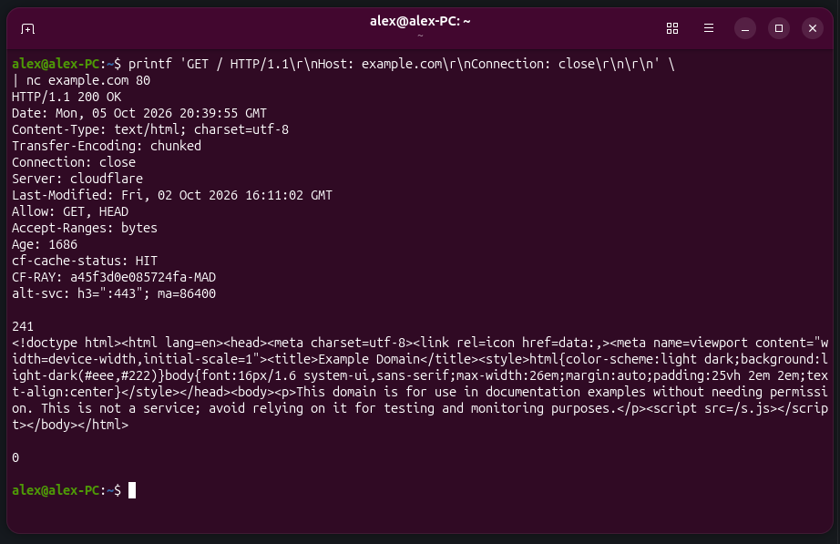
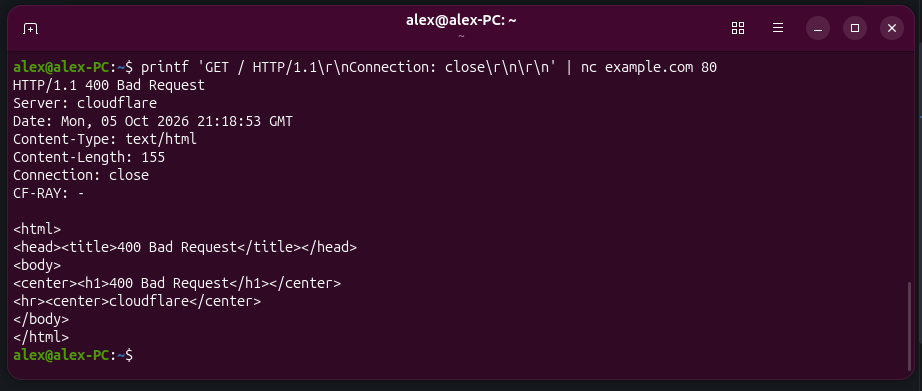
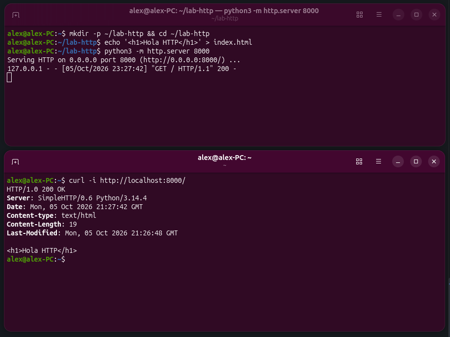
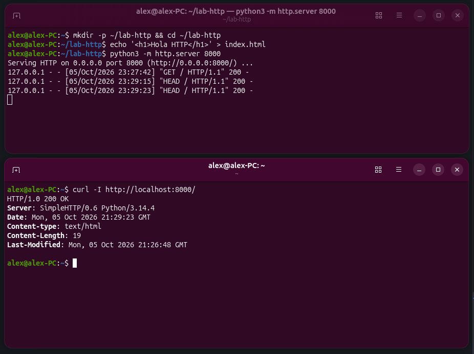
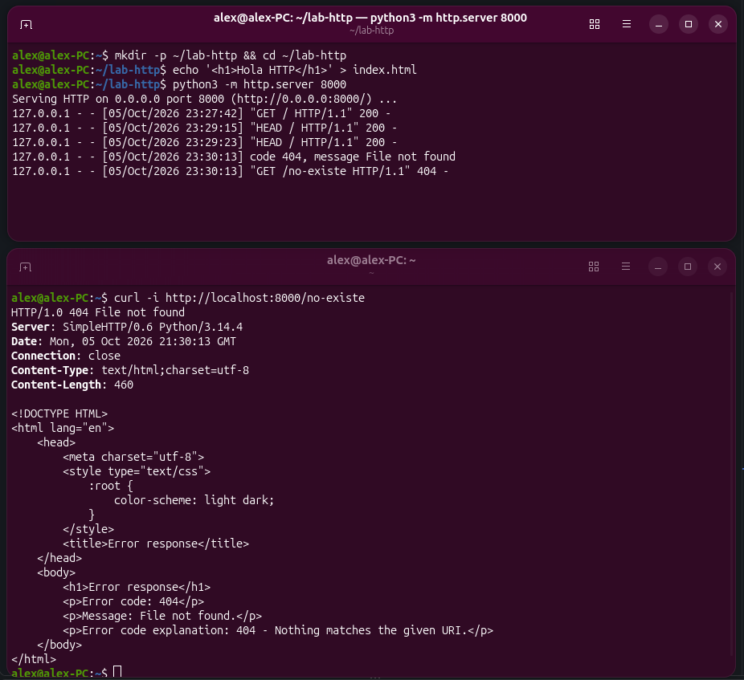
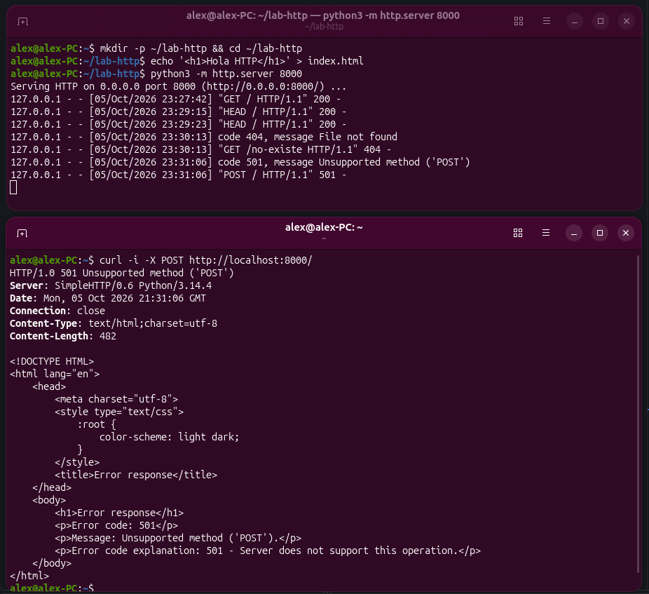
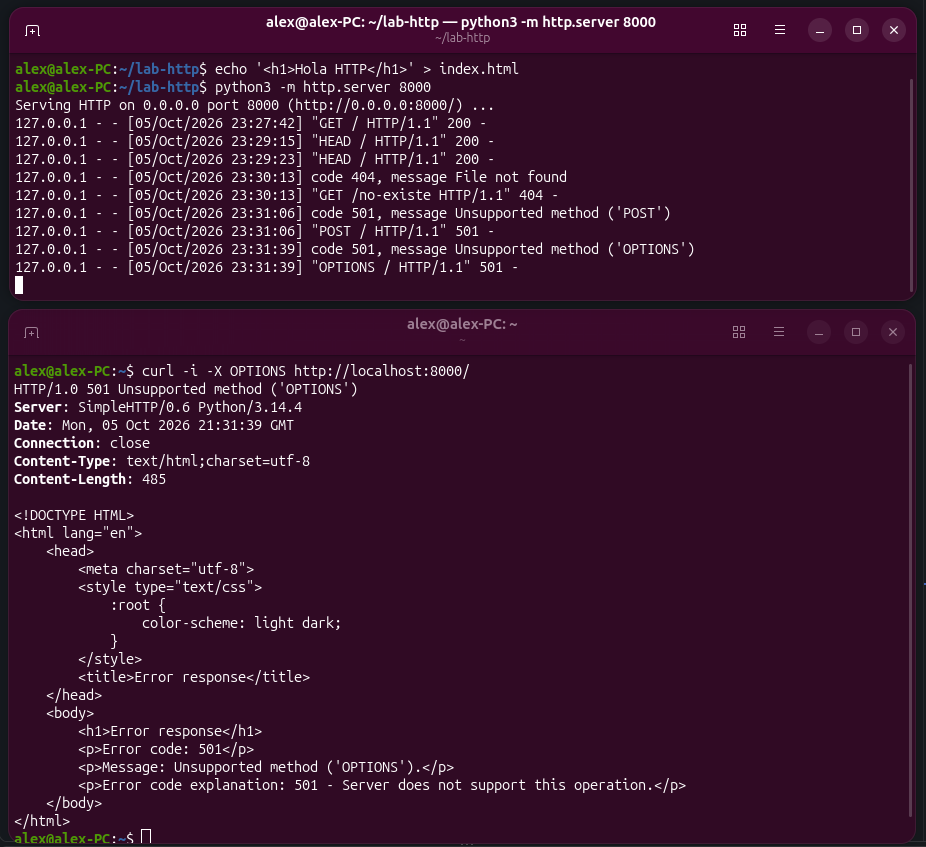

# Práctica 1 — HTTP a pelo

## Paso 1. Hablar HTTP a mano

Abre una conexión directa al puerto 80 de un servidor y escribe tú mismo la petición. Con netcat en modo interactivo:

```bash
nc example.com 80
GET / HTTP/1.1
Host: example.com
Connection: close
                    <- línea en blanco: aquí termina la petición
```
La misma petición en una sola orden, para poder repetirla cómodamente:

```bash
printf 'GET / HTTP/1.1\r\nHost: example.com\r\nConnection: close\r\n\r\n' \
| nc example.com 80
```

Identifica en la respuesta las tres partes estudiadas en el apartado 7.2: la línea de estado, el bloque de cabeceras y, tras la línea en blanco, el cuerpo. Anota qué servidor responde y qué tipo de contenido declara.


### Respuesta


La respuesta es:

```bash
HTTP/1.1 200 OK                             
Date: Mon, 05 Oct 2026 20:39:55 GMT
Content-Type: text/html; charset=utf-8
Transfer-Encoding: chunked
Connection: close
Server: cloudflare
Last-Modified: Fri, 02 Oct 2026 16:11:02 GMT
Allow: GET, HEAD
Accept-Ranges: bytes
Age: 1686
cf-cache-status: HIT
CF-RAY: a45f3d0e085724fa-MAD
alt-svc: h3=":443"; ma=86400

241
<!doctype html><html lang=en><head><meta charset=utf-8><link rel=icon href=data:,><meta name=viewport content="width=device-width,initial-scale=1"><title>Example Domain</title><style>html{color-scheme:light dark;background:light-dark(#eee,#222)}body{font:16px/1.6 system-ui,sans-serif;max-width:26em;margin:auto;padding:25vh 2em 2em;text-align:center}</style></head><body><p>This domain is for use in documentation examples without needing permission. This is not a service; avoid relying on it for testing and monitoring purposes.</p><script src=/s.js></script></body></html>

0
```

1. Línea de estado
```bash
HTTP/1.1 200 OK 
```
Indica:
- HTTP/1.1: Versión del protocolo HTTP.
- 200 OK: Estado. La petición se procesó de forma exitosa.

2. Bloque de cabeceras (Metadatos)
```bash
Date: Mon, 05 Oct 2026 20:39:55 GMT
Content-Type: text/html; charset=utf-8
Transfer-Encoding: chunked
Connection: close
Server: cloudflare
Last-Modified: Fri, 02 Oct 2026 16:11:02 GMT
Allow: GET, HEAD
Accept-Ranges: bytes
Age: 1686
cf-cache-status: HIT
CF-RAY: a45f3d0e085724fa-MAD
alt-svc: h3=":443"; ma=86400
        <- Espacio en blanco
```

Indica:
- Date: Fecha y hora UTC en la que el servidor generó la respuesta.
- Content-Type: Tipo de contenido multimedia (MIME) que se envía en el cuerpo de respuesta y codificación.
- Transfer-Encoding: Mecanismo de transferencia utilizado. "chunked" indica que el cuerpo se envía en fragmentos de tamaño variable.
- Connection: Control de la conexión de red. "close" indica que el servidor cerrará el socket TCP tras enviar la respuesta.
- Server: Identificador del servidor o infraestructura que generó la respuesta.
- Last-Modified: Fecha y hora de la última modificación del recurso solicitado (el index.html).
- Allow: Métodos permitidos por el servidor para el recurso solicitado.
- Accept-Ranges: Indica que el servidor acepta peticiones parciales (descargas por rangos)
- Age: Tiempo en segundos que el recurso lleva almacenado en la caché de la CDN antes de ser servido.
- cf-cache-status: Estado de la caché. "HIT" indica que el contenido se sirvió directamtne de la caché sin consultar al servidor de origen.
- CF-RAY: Identificador interno y único del servidor para la petición realizada. Se usa para depuración.
- alt-svc: Anuncio de servicios alternativos al cliente. En este caso indica que puede usar en futuras conexiones protocolos más avanzados como HTTP3 en el puerto 443. Con ma (max-age) se indica durante cuánto timepo el cleitne recordará el uso del servicio alternativo antes de volver a consultar o renegociar el protocolo con el servidor principal.


3. Cuerpo (Body)
```bash
241
<!doctype html><html lang=en><head><meta charset=utf-8><link rel=icon href=data:,><meta name=viewport content="width=device-width,initial-scale=1"><title>Example Domain</title><style>html{color-scheme:light dark;background:light-dark(#eee,#222)}body{font:16px/1.6 system-ui,sans-serif;max-width:26em;margin:auto;padding:25vh 2em 2em;text-align:center}</style></head><body><p>This domain is for use in documentation examples without needing permission. This is not a service; avoid relying on it for testing and monitoring purposes.</p><script src=/s.js></script></body></html>
        <- Espacio en blanco
0
```
Indica:
- 241: Tamaño del bloque de datos del cuerpo en hexadecimal. Debido a que la información se envía como "chunked".
- Bloque del contenido HTML.
- 0: Bloque ue indica fin de la transmisión de datos.

---

## Paso 2. Por qué la cabecera Host es obligatoria
Repite la petición anterior eliminando la línea Host. Documenta el código de estado obtenido y relaciónalo con lo estudiado sobre hosts virtuales en el apartado 7.7.

### Respuesta


El servidor responde con un estado de `400 Bad Request`porque rechaza la petición al no estar completa de acuerdo a los requisitos del protocolo HTTP/1.1.
Hoy en día un servidor puede alojar múltiples páginas web y servirlas desde la misma dirección IP.
El protocolo HTTP/1.1 obliga a que se incluya la cabecera Host para que el servidor sepa a qué dominio web se dirige la petición.
Al no incluir la cabecera Host, el servidor no sabe a qué sitio se está realizando la petición y la bloquea. Esto no sucedía con HTTP/1.0 porque entonces los servidores solñian tener un único sitio por IP.

---

## Paso 3. Un servidor propio para experimentar
Levanta un servidor estático en tu equipo; te permitirá provocar respuestas sin depender de servicios ajenos:
```bash
mkdir -p ~/lab-http && cd ~/lab-http
echo '<h1>Hola HTTP</h1>' > index.html
python3 -m http.server 8000
```

Desde otra terminal, prueba los métodos estudiados en el apartado 7.3 y anota el código de estado de cada uno:
```bash
curl -i http://localhost:8000/
curl -I http://localhost:8000/              # solo cabeceras (HEAD)
curl -i http://localhost:8000/no-existe     # recurso inexistente
curl -i -X POST http://localhost:8000/      # método no implementado
curl -i -X OPTIONS http://localhost:8000/
```
---
### curl -i http://localhost:8000/


- Respuesta:
```bash
HTTP/1.0 200 OK
Server: SimpleHTTP/0.6 Python/3.14.4
Date: Mon, 05 Oct 2026 21:35:56 GMT
Content-type: text/html
Content-Length: 19
Last-Modified: Mon, 05 Oct 2026 21:26:48 GMT

<h1>Hola HTTP</h1>
```
- Código de estado: `200 OK`
- Explicación: Se trata de una petición GET estándar que se resuleve correctamtne y el servidor devuelve las cabeceras y en el cuerpo el recurso solicitado que es el index.html.


### curl -I http://localhost:8000/

- Respuesta:
```bash
HTTP/1.0 200 OK
Server: SimpleHTTP/0.6 Python/3.14.4
Date: Mon, 05 Oct 2026 21:37:16 GMT
Content-type: text/html
Content-Length: 19
Last-Modified: Mon, 05 Oct 2026 21:26:48 GMT

```
- Código de estado: `200 OK`
- Explicación: Se trata de una petición HEAD por lo que devuelve las cabeceras como en el método anterior del GET, pero omite el body en la respuesta.

### curl -i http://localhost:8000/no-existe 

- Respuesta:
```bash
HTTP/1.0 404 File not found
Server: SimpleHTTP/0.6 Python/3.14.4
Date: Mon, 05 Oct 2026 21:47:08 GMT
Connection: close
Content-Type: text/html;charset=utf-8
Content-Length: 460

<!DOCTYPE HTML>
<html lang="en">
    <head>
        <meta charset="utf-8">
        <style type="text/css">
            :root {
                color-scheme: light dark;
            }
        </style>
        <title>Error response</title>
    </head>
    <body>
        <h1>Error response</h1>
        <p>Error code: 404</p>
        <p>Message: File not found.</p>
        <p>Error code explanation: 404 - Nothing matches the given URI.</p>
    </body>
</html>
```
- Código de estado: `404 File not found`
- Explicación: Se solicitó un recurso inexistente en el servidor. Se indica que se trata de un error del cliente (4XX) y se envía el código html de una página de error donde se explica que la URL proporcionada no corresponde a ningún fichero existente en el servidor.

### curl -i -X POST http://localhost:8000/ 

- Respuesta:
```bash
HTTP/1.0 501 Unsupported method ('POST')
Server: SimpleHTTP/0.6 Python/3.14.4
Date: Mon, 05 Oct 2026 21:47:44 GMT
Connection: close
Content-Type: text/html;charset=utf-8
Content-Length: 482

<!DOCTYPE HTML>
<html lang="en">
    <head>
        <meta charset="utf-8">
        <style type="text/css">
            :root {
                color-scheme: light dark;
            }
        </style>
        <title>Error response</title>
    </head>
    <body>
        <h1>Error response</h1>
        <p>Error code: 501</p>
        <p>Message: Unsupported method ('POST').</p>
        <p>Error code explanation: 501 - Server does not support this operation.</p>
    </body>
</html>
```
- Código de estado: `501 Unsupported method ('POST')`
- Explicación: Se realizó una petición usando el método POST. Devuelve un error de servidor (5XX) porque el servidor levantado para pruebas de Python está diseñado para servir archivos estáticos con GET y, por tanto, no implementa este método. Se devuelve en el body el contenido de una página de error indicando que no soporta la operación.

### curl -i -X OPTIONS http://localhost:8000/

- Respuesta:
```bash
HTTP/1.0 501 Unsupported method ('OPTIONS')
Server: SimpleHTTP/0.6 Python/3.14.4
Date: Mon, 05 Oct 2026 21:48:33 GMT
Connection: close
Content-Type: text/html;charset=utf-8
Content-Length: 485

<!DOCTYPE HTML>
<html lang="en">
    <head>
        <meta charset="utf-8">
        <style type="text/css">
            :root {
                color-scheme: light dark;
            }
        </style>
        <title>Error response</title>
    </head>
    <body>
        <h1>Error response</h1>
        <p>Error code: 501</p>
        <p>Message: Unsupported method ('OPTIONS').</p>
        <p>Error code explanation: 501 - Server does not support this operation.</p>
    </body>
</html>
```
- Código de estado: `501 Unsupported method ('OPTIONS')`
- Explicación: Se está enviando un método OPTIONS para consultar los métodos admitidos por el servidor. Sucede como el caso anterior: el servidor básico de Python no tiene este método soportado, y envía una página de error explicativa.

---

## Paso 4. Anatomía de curl -v

```bash
curl -v http://localhost:8000/ > /dev/null
```
En la salida, las líneas que empiezan por > son lo que envía tu cliente y las que empiezan por < lo que devuelve el servidor. Copia ambos bloques en la memoria y explica cada cabecera que aparezca.

- Comando:
```bash
alex@alex-PC:~$ curl -v http://localhost:8000/ > /dev/null
* Host localhost:8000 was resolved.
* IPv6: ::1
* IPv4: 127.0.0.1
  % Total    % Received % Xferd  Average Speed  Time    Time    Time   Current
                                 Dload  Upload  Total   Spent   Left   Speed
  0      0   0      0   0      0      0      0                              0*   Trying [::1]:8000...
* connect to ::1 port 8000 from ::1 port 57220 failed: Conexión rehusada
*   Trying 127.0.0.1:8000...
* Established connection to localhost (127.0.0.1 port 8000) from 127.0.0.1 port 44468 
* using HTTP/1.x
> GET / HTTP/1.1
> Host: localhost:8000
> User-Agent: curl/8.18.0
> Accept: */*
> 
* Request completely sent off
* HTTP 1.0, assume close after body
< HTTP/1.0 200 OK
< Server: SimpleHTTP/0.6 Python/3.14.4
< Date: Mon, 05 Oct 2026 22:02:35 GMT
< Content-type: text/html
< Content-Length: 19
< Last-Modified: Mon, 05 Oct 2026 21:26:48 GMT
< 
{ [19 bytes data]
100     19 100     19   0      0   5675      0                              0
* shutting down connection #0
alex@alex-PC:~$ 
``` 

En esta interacción entre el cleinte y el servidor tenemos 3 fases:

1. Fase de Resolución y Conexión
```bash
* Host localhost:8000 was resolved.
* IPv6: ::1
* IPv4: 127.0.0.1
  % Total    % Received % Xferd  Average Speed  Time    Time    Time   Current
                                 Dload  Upload  Total   Spent   Left   Speed
  0      0   0      0   0      0      0      0                              0*   Trying [::1]:8000...
* connect to ::1 port 8000 from ::1 port 57220 failed: Conexión rehusada
*   Trying 127.0.0.1:8000...
* Established connection to localhost (127.0.0.1 port 8000) from 127.0.0.1 port 44468 
* using HTTP/1.x
```

Los "*" indican líneas informativas.
