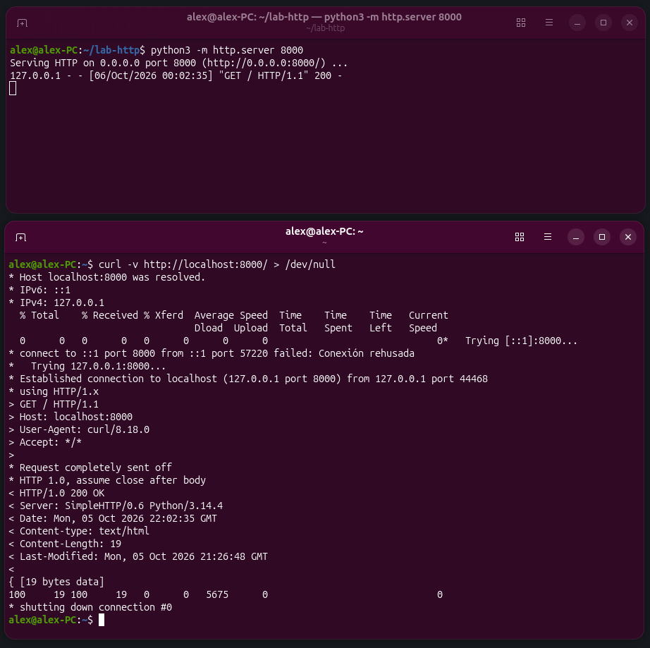
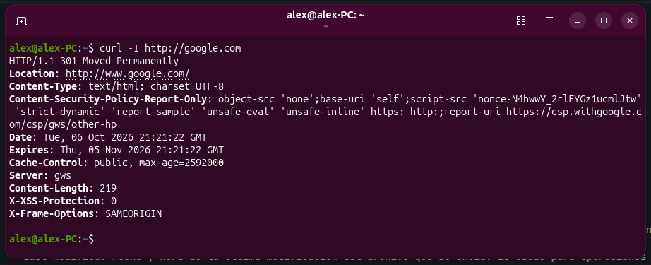
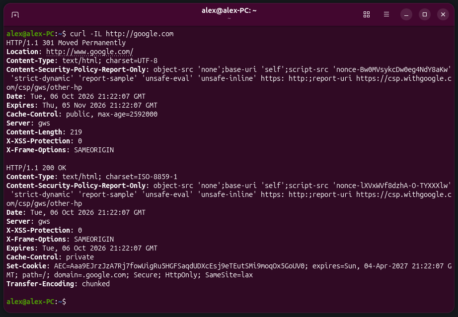
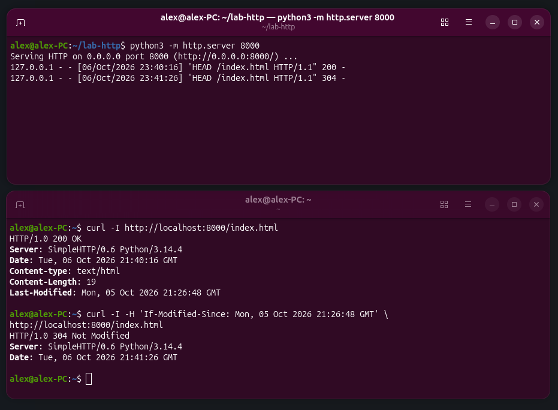
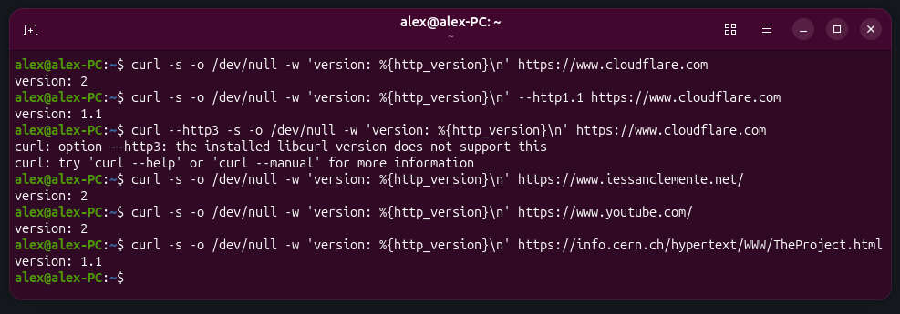
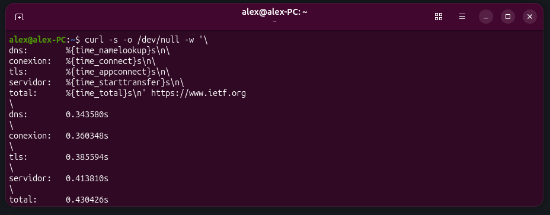
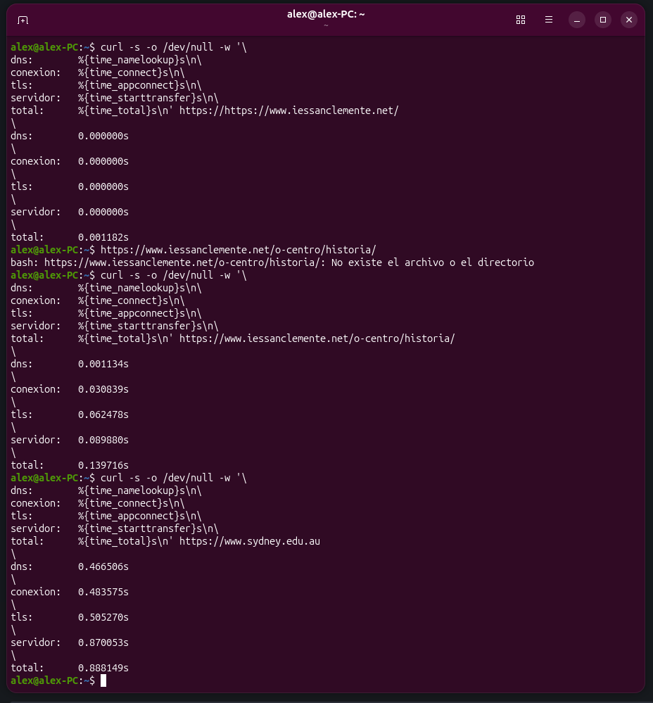
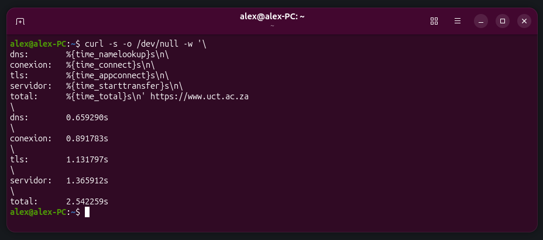
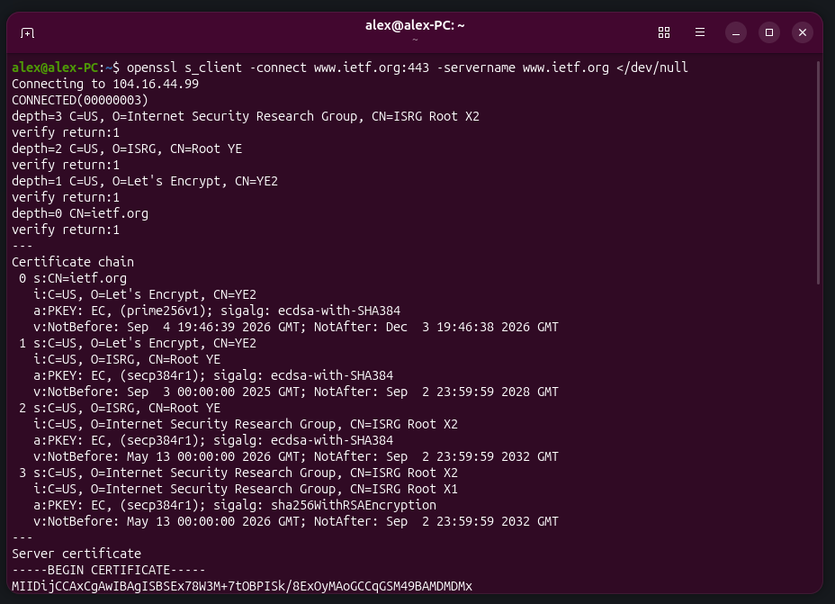

# Práctica 1 — HTTP a pelo

| **Alumno** | Alejandro Martínez Corral |
|---|---|
| **Módulo** | Despliegue de Aplicaciones Web |
| **Unidad** | UD1 Arquitecturas Web |

---

## Paso 1. Hablar HTTP a mano

> Abre una conexión directa al puerto 80 de un servidor y escribe tú mismo la petición. Con netcat en modo interactivo:
>
> ```bash
> nc example.com 80
> GET / HTTP/1.1
> Host: example.com
> Connection: close
>                     <- línea en blanco: aquí termina la petición
> ```
>
> La misma petición en una sola orden, para poder repetirla cómodamente:
>
> ```bash
> printf 'GET / HTTP/1.1\r\nHost: example.com\r\nConnection: close\r\n\r\n' \
> | nc example.com 80
> ```
>
> Identifica en la respuesta las tres partes estudiadas en el apartado 7.2: la línea de estado, el bloque de cabeceras y, tras la línea en blanco, el cuerpo. Anota qué servidor responde y qué tipo de contenido declara.

### Respuesta


- **Servidor que responde:** Cloudflare (`Server: cloudflare`), una **CDN** que sirve la página desde su caché (`HIT`) en un nodo de Madrid (`-MAD` en `CF-RAY`).
- **Tipo de contenido declarado:** `text/html; charset=utf-8`.

La respuesta completa es:

```http
HTTP/1.1 200 OK
Date: Mon, 05 Oct 2026 20:39:55 GMT
Content-Type: text/html; charset=utf-8
Transfer-Encoding: chunked
Connection: close
Server: cloudflare
Last-Modified: Fri, 02 Oct 2026 16:11:02 GMT
Allow: GET, HEAD
Accept-Ranges: bytes
Age: 1686
cf-cache-status: HIT
CF-RAY: a45f3d0e085724fa-MAD
alt-svc: h3=":443"; ma=86400

241
<!doctype html><html lang=en><head><meta charset=utf-8><link rel=icon href=data:,><meta name=viewport content="width=device-width,initial-scale=1"><title>Example Domain</title><style>html{color-scheme:light dark;background:light-dark(#eee,#222)}body{font:16px/1.6 system-ui,sans-serif;max-width:26em;margin:auto;padding:25vh 2em 2em;text-align:center}</style></head><body><p>This domain is for use in documentation examples without needing permission. This is not a service; avoid relying on it for testing and monitoring purposes.</p><script src=/s.js></script></body></html>

0
```

#### 1. Línea de estado

```http
HTTP/1.1 200 OK
```

Indica:

- **`HTTP/1.1`:** versión del protocolo HTTP.
- **`200 OK`:** estado. La petición se procesó de forma exitosa.

#### 2. Bloque de cabeceras (metadatos)

```http
Date: Mon, 05 Oct 2026 20:39:55 GMT
Content-Type: text/html; charset=utf-8
Transfer-Encoding: chunked
Connection: close
Server: cloudflare
Last-Modified: Fri, 02 Oct 2026 16:11:02 GMT
Allow: GET, HEAD
Accept-Ranges: bytes
Age: 1686
cf-cache-status: HIT
CF-RAY: a45f3d0e085724fa-MAD
alt-svc: h3=":443"; ma=86400
        <- línea en blanco
```

Indica:

- **`Date`:** fecha y hora UTC en la que el servidor generó la respuesta.
- **`Content-Type`:** tipo de contenido multimedia (MIME) que se envía en el cuerpo de la respuesta y su codificación.
- **`Transfer-Encoding`:** mecanismo de transferencia utilizado. `chunked` indica que el cuerpo se envía en fragmentos de tamaño variable.
- **`Connection`:** control de la conexión de red. `close` indica que el servidor cerrará el socket TCP tras enviar la respuesta.
- **`Server`:** identificador del servidor o infraestructura que generó la respuesta.
- **`Last-Modified`:** fecha y hora de la última modificación del recurso solicitado (el `index.html`).
- **`Allow`:** métodos permitidos por el servidor para el recurso solicitado.
- **`Accept-Ranges`:** indica que el servidor acepta peticiones parciales (descargas por rangos).
- **`Age`:** tiempo en segundos que el recurso lleva almacenado en la caché de la CDN antes de ser servido.
- **`cf-cache-status`:** estado de la caché. `HIT` indica que el contenido se sirvió directamente de la caché sin consultar al servidor de origen. La lista de estados es variada y puede consultarse en la [documentación de Cloudflare](https://developers.cloudflare.com/cache/concepts/cache-responses/).
- **`CF-RAY`:** identificador interno y único del servidor para la petición realizada. Se usa para depuración.
- **`alt-svc`:** anuncio de servicios alternativos al cliente. En este caso indica que en futuras conexiones puede usar protocolos más avanzados como HTTP/3 en el puerto `443`. Con `ma` (*max-age*) se indica durante cuánto tiempo el cliente recordará el uso del servicio alternativo antes de volver a consultar o renegociar el protocolo con el servidor principal.

///

#### 3. Cuerpo (*body*)

```http
241
<!doctype html><html lang=en><head><meta charset=utf-8><link rel=icon href=data:,><meta name=viewport content="width=device-width,initial-scale=1"><title>Example Domain</title><style>html{color-scheme:light dark;background:light-dark(#eee,#222)}body{font:16px/1.6 system-ui,sans-serif;max-width:26em;margin:auto;padding:25vh 2em 2em;text-align:center}</style></head><body><p>This domain is for use in documentation examples without needing permission. This is not a service; avoid relying on it for testing and monitoring purposes.</p><script src=/s.js></script></body></html>
        <- línea en blanco
0
```

Indica:

- **`241`:** tamaño del bloque de datos del cuerpo en hexadecimal (0x241 = 577 bytes), ya que la información se envía como `chunked` (por eso no hay `Content-Length`).
- **Bloque de contenido:** el código HTML de la página.
- **`0`:** bloque que indica el fin de la transmisión de datos.

---

## Paso 2. Por qué la cabecera `Host` es obligatoria

> Repite la petición anterior eliminando la línea `Host`. Documenta el código de estado obtenido y relaciónalo con lo estudiado sobre hosts virtuales en el apartado 7.7.

### Respuesta


El servidor responde con un estado `400 Bad Request` porque rechaza la petición al no estar completa de acuerdo con los requisitos del protocolo HTTP/1.1.

Hoy en día un servidor puede alojar múltiples páginas web y servirlas desde la misma dirección IP. El protocolo HTTP/1.1 obliga a incluir la cabecera `Host` para que el servidor sepa a qué dominio web se dirige la petición.

Al no incluir la cabecera `Host`, el servidor no sabe a qué sitio se está realizando la petición y la bloquea. Esto no sucedía con HTTP/1.0 porque entonces los servidores solían tener un único sitio por IP.

---

## Paso 3. Un servidor propio para experimentar

> Levanta un servidor estático en tu equipo; te permitirá provocar respuestas sin depender de servicios ajenos:
>
> ```bash
> mkdir -p ~/lab-http && cd ~/lab-http
> echo '<h1>Hola HTTP</h1>' > index.html
> python3 -m http.server 8000
> ```
>
> Desde otra terminal, prueba los métodos estudiados en el apartado 7.3 y anota el código de estado de cada uno:
>
> ```bash
> curl -i http://localhost:8000/
> curl -I http://localhost:8000/              # solo cabeceras (HEAD)
> curl -i http://localhost:8000/no-existe     # recurso inexistente
> curl -i -X POST http://localhost:8000/      # método no implementado
> curl -i -X OPTIONS http://localhost:8000/
> ```

### Respuesta

En estos comandos, `-i` muestra las cabeceras junto con el cuerpo de la respuesta; `-I` realiza una petición `HEAD` y muestra solo las cabeceras; y `-X` permite indicar el método HTTP, como `POST` u `OPTIONS`. Si no se indica otro método, `curl` usa `GET`.

///

#### `curl -i http://localhost:8000/`


- **Respuesta:**

```http
HTTP/1.0 200 OK
Server: SimpleHTTP/0.6 Python/3.14.4
Date: Mon, 05 Oct 2026 21:35:56 GMT
Content-type: text/html
Content-Length: 19
Last-Modified: Mon, 05 Oct 2026 21:26:48 GMT

<h1>Hola HTTP</h1>
```

- **Código de estado:** `200 OK`
- **Explicación:** la petición `GET` se completa correctamente y devuelve el contenido de `index.html`.

///

#### `curl -I http://localhost:8000/`


- **Respuesta:**

```http
HTTP/1.0 200 OK
Server: SimpleHTTP/0.6 Python/3.14.4
Date: Mon, 05 Oct 2026 21:37:16 GMT
Content-type: text/html
Content-Length: 19
Last-Modified: Mon, 05 Oct 2026 21:26:48 GMT

```

- **Código de estado:** `200 OK`
- **Explicación:** la petición `HEAD` devuelve las cabeceras, pero no el cuerpo de la respuesta.

///

#### `curl -i http://localhost:8000/no-existe`


- **Respuesta:**

```http
HTTP/1.0 404 File not found
Server: SimpleHTTP/0.6 Python/3.14.4
Date: Mon, 05 Oct 2026 21:47:08 GMT
Connection: close
Content-Type: text/html;charset=utf-8
Content-Length: 460

<!DOCTYPE HTML>
<html lang="en">
    <head>
        <meta charset="utf-8">
        <style type="text/css">
            :root {
                color-scheme: light dark;
            }
        </style>
        <title>Error response</title>
    </head>
    <body>
        <h1>Error response</h1>
        <p>Error code: 404</p>
        <p>Message: File not found.</p>
        <p>Error code explanation: 404 - Nothing matches the given URI.</p>
    </body>
</html>
```

- **Código de estado:** `404 File not found`
- **Explicación:** se solicitó un recurso inexistente en el servidor. Se indica que se trata de un error del cliente (`4xx`) y se envía el código HTML de una página de error donde se explica que la URL proporcionada no corresponde a ningún fichero existente en el servidor.

#### `curl -i -X POST http://localhost:8000/`


- **Respuesta:**

```http
HTTP/1.0 501 Unsupported method ('POST')
Server: SimpleHTTP/0.6 Python/3.14.4
Date: Mon, 05 Oct 2026 21:47:44 GMT
Connection: close
Content-Type: text/html;charset=utf-8
Content-Length: 482

<!DOCTYPE HTML>
<html lang="en">
    <head>
        <meta charset="utf-8">
        <style type="text/css">
            :root {
                color-scheme: light dark;
            }
        </style>
        <title>Error response</title>
    </head>
    <body>
        <h1>Error response</h1>
        <p>Error code: 501</p>
        <p>Message: Unsupported method ('POST').</p>
        <p>Error code explanation: 501 - Server does not support this operation.</p>
    </body>
</html>
```

- **Código de estado:** `501 Unsupported method ('POST')`
- **Explicación:** se realizó una petición usando el método `POST`. Devuelve un error de servidor (`5xx`) porque el servidor de pruebas de Python está diseñado para servir archivos estáticos con `GET` y, por tanto, no implementa este método. En el cuerpo se devuelve una página de error indicando que no soporta la operación.

///

#### `curl -i -X OPTIONS http://localhost:8000/`


- **Respuesta:**

```http
HTTP/1.0 501 Unsupported method ('OPTIONS')
Server: SimpleHTTP/0.6 Python/3.14.4
Date: Mon, 05 Oct 2026 21:48:33 GMT
Connection: close
Content-Type: text/html;charset=utf-8
Content-Length: 485

<!DOCTYPE HTML>
<html lang="en">
    <head>
        <meta charset="utf-8">
        <style type="text/css">
            :root {
                color-scheme: light dark;
            }
        </style>
        <title>Error response</title>
    </head>
    <body>
        <h1>Error response</h1>
        <p>Error code: 501</p>
        <p>Message: Unsupported method ('OPTIONS').</p>
        <p>Error code explanation: 501 - Server does not support this operation.</p>
    </body>
</html>
```

- **Código de estado:** `501 Unsupported method ('OPTIONS')`
- **Explicación:** aunque `OPTIONS` sirve para consultar los métodos admitidos, este servidor no lo implementa y responde con `501`.

---

## Paso 4. Anatomía de `curl -v`

> ```bash
> curl -v http://localhost:8000/ > /dev/null
> ```
>
> En la salida, las líneas que empiezan por `>` son lo que envía tu cliente y las que empiezan por `<` lo que devuelve el servidor. Copia ambos bloques en la memoria y explica cada cabecera que aparezca.

///

### Respuesta



```bash
alex@alex-PC:~$ curl -v http://localhost:8000/ > /dev/null
* Host localhost:8000 was resolved.
* IPv6: ::1
* IPv4: 127.0.0.1
  % Total    % Received % Xferd  Average Speed  Time    Time    Time   Current
                                 Dload  Upload  Total   Spent   Left   Speed
  0      0   0      0   0      0      0      0                              0*   Trying [::1]:8000...
* connect to ::1 port 8000 from ::1 port 57220 failed: Conexión rehusada
*   Trying 127.0.0.1:8000...
* Established connection to localhost (127.0.0.1 port 8000) from 127.0.0.1 port 44468 
* using HTTP/1.x
> GET / HTTP/1.1
> Host: localhost:8000
> User-Agent: curl/8.18.0
> Accept: */*
> 
* Request completely sent off
* HTTP 1.0, assume close after body
< HTTP/1.0 200 OK
< Server: SimpleHTTP/0.6 Python/3.14.4
< Date: Mon, 05 Oct 2026 22:02:35 GMT
< Content-type: text/html
< Content-Length: 19
< Last-Modified: Mon, 05 Oct 2026 21:26:48 GMT
< 
{ [19 bytes data]
100     19 100     19   0      0   5675      0                              0
* shutting down connection #0
alex@alex-PC:~$ 
```

El comando permite obtener una traza completa de la interacción entre el cliente y el servidor. Los símbolos al inicio de las líneas indican el tipo de información:

- **`*`:** mensajes informativos generados por la herramienta `curl`; no forman parte del protocolo HTTP.
- **`>`:** datos enviados por el cliente al servidor en la petición HTTP.
- **`<`:** datos recibidos por el cliente procedentes del servidor en la respuesta HTTP.

Se distinguen tres fases:

#### 1. Fase de resolución y conexión

```bash
* Host localhost:8000 was resolved.
* IPv6: ::1
* IPv4: 127.0.0.1
  % Total    % Received % Xferd  Average Speed  Time    Time    Time   Current
                                 Dload  Upload  Total   Spent   Left   Speed
  0      0   0      0   0      0      0      0                              0*   Trying [::1]:8000...
* connect to ::1 port 8000 from ::1 port 57220 failed: Conexión rehusada
*   Trying 127.0.0.1:8000...
* Established connection to localhost (127.0.0.1 port 8000) from 127.0.0.1 port 44468 
* using HTTP/1.x
```

Esta parte muestra cómo el cliente encuentra el servidor y se conecta a él.

Indica que `curl` ha traducido el nombre `localhost` a sus direcciones IPv6 e IPv4.

Luego muestra una barra de progreso en tiempo real con métricas como el porcentaje de descarga o la velocidad media de transferencia. Como la salida del comando se redirige a `/dev/null` para que el código HTML de la respuesta no se imprima en la terminal, se desactiva automáticamente la animación de la barra de progreso y por eso aparece a 0, pero sí se imprime el resumen al final de la salida del comando.

A continuación aparece información sobre el establecimiento de la conexión. Primero intenta conectar usando IPv6, pero la conexión se rechaza porque no hay ningún servicio escuchando en ese puerto. Luego intenta la conexión con IPv4 y la establece entre el puerto `8000` del servidor y el puerto efímero `44468` del cliente.

Por último, indica que se usará HTTP/1.x.

#### 2. Petición HTTP del cliente

```bash
> GET / HTTP/1.1
> Host: localhost:8000
> User-Agent: curl/8.18.0
> Accept: */*
> 
* Request completely sent off
* HTTP 1.0, assume close after body
```

Indica que se realiza una petición `GET` del recurso raíz `/` usando el protocolo HTTP/1.1, y se muestran las cabeceras de la petición:

- **`Host`:** es obligatoria para indicar el dominio de destino.
- **`User-Agent`:** identifica el software cliente usado en la petición.
- **`Accept`:** indica que el cliente acepta cualquier tipo de respuesta (`*/*`).
- **Línea en blanco:** indica el fin de las cabeceras.

Luego aparecen mensajes informativos de `curl` indicando que todos los datos de la petición se enviaron y que asume que la conexión se cerrará automáticamente tras recibir el cuerpo de la respuesta, porque el servidor usa el protocolo HTTP/1.0.

#### 3. Respuesta HTTP del servidor

```bash
< HTTP/1.0 200 OK
< Server: SimpleHTTP/0.6 Python/3.14.4
< Date: Mon, 05 Oct 2026 22:02:35 GMT
< Content-type: text/html
< Content-Length: 19
< Last-Modified: Mon, 05 Oct 2026 21:26:48 GMT
< 
{ [19 bytes data]
100     19 100     19   0      0   5675      0                              0
* shutting down connection #0
```

Comienza con la línea de estado, que indica que responde usando HTTP/1.0 y que el resultado es exitoso (`200 OK`).

Luego devuelve las cabeceras de la respuesta:

- **`Server`:** identifica el software usado por el servidor web.
- **`Date`:** fecha y hora UTC en que se generó y envió la respuesta.
- **`Content-Type`:** tipo MIME del contenido que se transmite en el cuerpo de la respuesta. En este caso es un documento HTML.
- **`Content-Length`:** tamaño del cuerpo de la respuesta en bytes.
- **`Last-Modified`:** fecha y hora de la última modificación del archivo que se envía. Se usa para operaciones de caché.
- **Línea en blanco:** marca el fin de las cabeceras.

Tras la línea en blanco viene el cuerpo del mensaje. En este caso se muestra `{ [19 bytes data]`, que es la forma en que `curl` indica que leyó 19 bytes de datos, que no se muestran por estar redirigidos a `/dev/null`.

También se muestra la línea del resumen final de la barra de progreso de la fase 1 y un mensaje informativo donde `curl` procede a cerrar la conexión (`#0` es el identificador interno que `curl` asigna a la conexión, no un dato de TCP).

---

## Paso 5. Provocar una redirección

> ```bash
> curl -I http://google.com   # observa el 3xx y la cabecera Location
> curl -IL http://google.com  # -L sigue la redirección hasta el final
> ```
>
> Indica cuántos saltos se producen, qué código devuelve cada uno y en qué se diferencia un 301 de un 302.

### Respuesta

La opción `-I` (`--head`) de `curl` realiza una petición `HEAD` para solicitar solo las cabeceras de la respuesta del servidor, omitiendo el cuerpo.

La opción `-L` (`--location`) indica a `curl` que debe seguir las redirecciones en caso de que el servidor responda con un código de estado `3xx` acompañado de una cabecera `Location`. Seguirá las sucesivas redirecciones hasta llegar al destino final, que responde `200 OK`.

#### `curl -I http://google.com`



```http
HTTP/1.1 301 Moved Permanently
Location: http://www.google.com/
Content-Type: text/html; charset=UTF-8
Content-Security-Policy-Report-Only: object-src 'none';base-uri 'self';script-src 'nonce-08Cw5ez2bMRZXDU7LIABPA' 'strict-dynamic' 'report-sample' 'unsafe-eval' 'unsafe-inline' https: http:;report-uri https://csp.withgoogle.com/csp/gws/other-hp
Date: Tue, 06 Oct 2026 21:25:14 GMT
Expires: Thu, 05 Nov 2026 21:25:14 GMT
Cache-Control: public, max-age=2592000
Server: gws
Content-Length: 219
X-XSS-Protection: 0
X-Frame-Options: SAMEORIGIN

```

Sin `-L`, `curl` no sigue la redirección: se queda con la primera respuesta, `301 Moved Permanently`, cuya cabecera `Location` indica que la dirección oficial es `http://www.google.com/` (solo añade el `www`; no fuerza HTTPS). `Cache-Control: max-age=2592000` permite guardar la redirección en caché 30 días.

#### `curl -IL http://google.com`



```http
HTTP/1.1 301 Moved Permanently
Location: http://www.google.com/
Content-Type: text/html; charset=UTF-8
Content-Security-Policy-Report-Only: object-src 'none';base-uri 'self';script-src 'nonce-Bw0MVsykcDw0eg4NdY8aKw' 'strict-dynamic' 'report-sample' 'unsafe-eval' 'unsafe-inline' https: http:;report-uri https://csp.withgoogle.com/csp/gws/other-hp
Date: Tue, 06 Oct 2026 21:22:07 GMT
Expires: Thu, 05 Nov 2026 21:22:07 GMT
Cache-Control: public, max-age=2592000
Server: gws
Content-Length: 219
X-XSS-Protection: 0
X-Frame-Options: SAMEORIGIN

HTTP/1.1 200 OK
Content-Type: text/html; charset=ISO-8859-1
Content-Security-Policy-Report-Only: object-src 'none';base-uri 'self';script-src 'nonce-lXVxWVf8dzhA-O-TYXXXlw' 'strict-dynamic' 'report-sample' 'unsafe-eval' 'unsafe-inline' https: http:;report-uri https://csp.withgoogle.com/csp/gws/other-hp
Date: Tue, 06 Oct 2026 21:22:07 GMT
Server: gws
X-XSS-Protection: 0
X-Frame-Options: SAMEORIGIN
Expires: Tue, 06 Oct 2026 21:22:07 GMT
Cache-Control: private
Set-Cookie: AEC=Aaa9EJrzJzA7Rj7fowUigRu5HGFSaqdUDXcEsj9eTEutSMi9moqOx5GoUV0; expires=Sun, 04-Apr-2027 21:22:07 GMT; path=/; domain=.google.com; Secure; HttpOnly; SameSite=lax
Transfer-Encoding: chunked

```

Con `-L` se produce **1 salto**: `http://google.com` responde `301` y `curl` sigue el `Location` hasta `http://www.google.com/`, que responde `200 OK`.

Los códigos `301` y `302` pertenecen al bloque `3xx`, referido a redirecciones. Se diferencian en su permanencia y en cómo los memorizan los navegadores:

- **`301 Moved Permanently`:** redirección permanente. Los navegadores la guardan en caché y van directamente a la nueva URL en futuras peticiones; los buscadores actualizan su índice.
- **`302 Found`:** redirección temporal. Por defecto no se guarda en caché, así que el navegador vuelve a preguntar cada vez a la URL original, que es la que mantienen los buscadores.

---

///

## Paso 6. Caché: conseguir un 304

> Sobre tu servidor local, pide el recurso y quédate con la fecha de la cabecera `Last-Modified`; después repite la petición declarando que ya tienes esa versión:
>
> ```bash
> curl -I http://localhost:8000/index.html
> curl -I -H 'If-Modified-Since: <pega aquí el Last-Modified>' \
> http://localhost:8000/index.html
> ```
>
> Explica qué código obtienes en la segunda petición, por qué el cuerpo viaja vacío y qué ahorro supone esto en un sitio con muchas imágenes.

### Respuesta



#### `curl -I http://localhost:8000/index.html`

```http
HTTP/1.0 200 OK
Server: SimpleHTTP/0.6 Python/3.14.4
Date: Tue, 06 Oct 2026 21:40:16 GMT
Content-type: text/html
Content-Length: 19
Last-Modified: Mon, 05 Oct 2026 21:26:48 GMT

```

#### `curl -I -H 'If-Modified-Since: Mon, 05 Oct 2026 21:26:48 GMT' http://localhost:8000/index.html`

```http
HTTP/1.0 304 Not Modified
Server: SimpleHTTP/0.6 Python/3.14.4
Date: Tue, 06 Oct 2026 21:41:26 GMT

```

La segunda petición usa la opción `-H` (`--header`), que permite añadir cabeceras personalizadas a la petición HTTP o modificar las que genera automáticamente `curl`. Se envuelven entre comillas si contienen espacios, como en este caso.

La cabecera `If-Modified-Since` permite la **validación de caché**. El cliente indica al servidor que ya tiene una versión del recurso que fue modificada por última vez en la fecha indicada, de forma que solo se lo vuelva a enviar si hay modificaciones más recientes.

El servidor responde con `304 Not Modified` en lugar de `200 OK` cuando la versión del cliente está actualizada, para que use esa copia local y no vuelva a descargarla. Por tanto, en el cuerpo no se envía nada (un `304` nunca lleva cuerpo) y el cliente usa la copia de su caché. En el registro del servidor de la captura se ven las dos peticiones: `200` y `304` porque en la primera ocasión se envió el recurso al cliente, y en la segunda ya estaba disponible en caché y no se había modificado en el servidor.

Este sistema supone un gran ahorro de ancho de banda: en un sitio con muchas imágenes, cada imagen sin cambios no es necesario reenviarla. Esto acelera la carga de la página y reduce el trabajo del servidor, que solo comprueba la fecha del fichero en vez de leerlo y enviarlo.

---

## Paso 7. Versiones del protocolo

> ```bash
> curl -s -o /dev/null -w 'version: %{http_version}\n' https://www.cloudflare.com
> curl -s -o /dev/null -w 'version: %{http_version}\n' --http1.1 https://www.cloudflare.com
> curl --http3 -s -o /dev/null -w 'version: %{http_version}\n' https://www.cloudflare.com
> ```
>
> Comprueba qué versión se negocia por defecto contra varios sitios de tu elección y relaciona el resultado con los datos de adopción del apartado 7.7. Si tu `curl` no admite `--http3`, indícalo en la memoria.

### Respuesta

Opciones del comando:

- **`-s` (`--silent`):** modo silencioso. Oculta mensajes informativos como la barra de progreso o los errores de conexión.
- **`-o /dev/null`:** redirige la respuesta del comando (el HTML de la página) a `/dev/null` para no imprimir nada en pantalla.
- **`-w '...'` (`--write-out`):** imprime información personalizada al terminar la transferencia. Admite variables internas como la usada en este ejemplo, `%{http_version}`, para conocer el protocolo HTTP que se negoció y utilizó en la conexión.
- **`--httpX`:** fuerza a que `curl` use la versión del protocolo HTTP indicada. Si no se indica, la herramienta negocia con el servidor la mejor versión disponible.



```bash
alex@alex-PC:~$ curl -s -o /dev/null -w 'version: %{http_version}\n' https://www.cloudflare.com
version: 2
alex@alex-PC:~$ curl -s -o /dev/null -w 'version: %{http_version}\n' --http1.1 https://www.cloudflare.com
version: 1.1
alex@alex-PC:~$ curl --http3 -s -o /dev/null -w 'version: %{http_version}\n' https://www.cloudflare.com
curl: option --http3: the installed libcurl version does not support this
curl: try 'curl --help' or 'curl --manual' for more information
alex@alex-PC:~$ curl -s -o /dev/null -w 'version: %{http_version}\n' https://www.iessanclemente.net/
version: 2
alex@alex-PC:~$ curl -s -o /dev/null -w 'version: %{http_version}\n' https://www.youtube.com/
version: 2
alex@alex-PC:~$ curl -s -o /dev/null -w 'version: %{http_version}\n' https://info.cern.ch/hypertext/WWW/TheProject.html
version: 1.1
```

En las pruebas con el sitio de Cloudflare se observa que por defecto se usa la versión 2 del protocolo y que se puede forzar el uso de la 1.1. La versión 3 no se pudo probar porque el `curl` instalado está compilado sin soporte para HTTP/3 (QUIC).

Las páginas actuales (como las del ejemplo: Cloudflare, IES San Clemente, YouTube y otras) usan por defecto la versión 2. Para encontrar un uso de la versión 1.1, se recurrió a la réplica de una página muy antigua, en este caso la página original del CERN, que fue la primera web existente.

La versión negociada es la mejor que comparten cliente y servidor. Cloudflare admite HTTP/3: ya en el [paso 1](#paso-1-hablar-http-a-mano), al pedir `example.com` (servido por la CDN de Cloudflare), la respuesta incluía `alt-svc: h3=":443"; ma=86400`, que anuncia HTTP/3 en el puerto 443 durante 24 h. Aun así se negocia HTTP/2 porque este `curl` no soporta HTTP/3; un navegador moderno sí lo usaría en las conexiones siguientes.

Estos resultados son coherentes con los datos de adopción del apartado 7.7. Según W3Techs, entre el 34 % y el 39 % de los sitios más visitados **anuncian** HTTP/3, pero en el tráfico real solo se **negocia** en el 20-35 % de las peticiones. Las pruebas muestran esa diferencia: revisando la cabecera `alt-svc` de cada sitio (`curl -sI <url> | grep -i alt-svc`), Cloudflare y YouTube anuncian `h3`, y aun así se negoció HTTP/2. El motivo es que este `curl` no soporta HTTP/3 (aunque más del 90 % de los navegadores sí) y que el anuncio llega en una respuesta HTTP/2, así que la primera visita nunca usa HTTP/3.

---

## Paso 8. Medir las fases de una petición

> ```bash
> curl -s -o /dev/null -w '\
> dns:        %{time_namelookup}s\n\
> conexion:   %{time_connect}s\n\
> tls:        %{time_appconnect}s\n\
> servidor:   %{time_starttransfer}s\n\
> total:      %{time_total}s\n' https://www.ietf.org
> ```
>
> Repite la medición sobre un sitio nacional y otro alojado lejos. ¿Qué fase domina el tiempo total en cada caso? Relaciónalo con lo que aportan una CDN y el establecimiento de conexión en 0-RTT de HTTP/3.

### Respuesta





```bash
alex@alex-PC:~$ curl -s -o /dev/null -w '\
dns:        %{time_namelookup}s\n\
conexion:   %{time_connect}s\n\
tls:        %{time_appconnect}s\n\
servidor:   %{time_starttransfer}s\n\
total:      %{time_total}s\n' https://www.ietf.org
\
dns:        0.343580s
\
conexion:   0.360348s
\
tls:        0.385594s
\
servidor:   0.413810s
\
total:      0.430426s

alex@alex-PC:~$ curl -s -o /dev/null -w '\
dns:        %{time_namelookup}s\n\
conexion:   %{time_connect}s\n\
tls:        %{time_appconnect}s\n\
servidor:   %{time_starttransfer}s\n\
total:      %{time_total}s\n' https://https://www.iessanclemente.net/
\
dns:        0.000000s
\
conexion:   0.000000s
\
tls:        0.000000s
\
servidor:   0.000000s
\
total:      0.001182s

alex@alex-PC:~$ curl -s -o /dev/null -w '\
dns:        %{time_namelookup}s\n\
conexion:   %{time_connect}s\n\
tls:        %{time_appconnect}s\n\
servidor:   %{time_starttransfer}s\n\
total:      %{time_total}s\n' https://www.iessanclemente.net/o-centro/historia/
\
dns:        0.001134s
\
conexion:   0.030839s
\
tls:        0.062478s
\
servidor:   0.089880s
\
total:      0.139716s

alex@alex-PC:~$ curl -s -o /dev/null -w '\
dns:        %{time_namelookup}s\n\
conexion:   %{time_connect}s\n\
tls:        %{time_appconnect}s\n\
servidor:   %{time_starttransfer}s\n\
total:      %{time_total}s\n' https://www.sydney.edu.au
\
dns:        0.466506s
\
conexion:   0.483575s
\
tls:        0.505270s
\
servidor:   0.870053s
\
total:      0.888149s
```

En estas peticiones se muestra el valor de estas variables:

- **`%{time_namelookup}` (DNS):** tiempo desde el inicio de la petición hasta que el servidor DNS resuelve la dirección IP.
- **`%{time_connect}` (TCP):** tiempo acumulado hasta completar la conexión TCP con el servidor (*handshake*).
- **`%{time_appconnect}` (TLS):** tiempo acumulado hasta completar la negociación de seguridad TLS.
- **`%{time_starttransfer}` (servidor):** tiempo acumulado hasta que se recibe el primer byte de la respuesta (**TTFB**, *Time To First Byte*).
- **`%{time_total}`:** tiempo total que tardó la operación completa.

Se denomina **RTT** (*Round Trip Time*) al tiempo de ida y vuelta: el tiempo total que tarda un paquete de datos en viajar desde un dispositivo de origen hasta un destino y regresar con la respuesta.

Duración de cada fase en las tres mediciones válidas:

| Fase | `iessanclemente.net` (cercano) | `sydney.edu.au` (lejano, con CDN) | `uct.ac.za` (lejano, sin CDN) |
|---|---|---|---|
| DNS | 1 ms | **467 ms** | **659 ms** |
| Conexión TCP | 30 ms | 17 ms | 232 ms |
| TLS | 32 ms | 22 ms | 240 ms |
| Servidor (hasta el primer byte) | 27 ms | **365 ms** | 234 ms |
| Descarga del cuerpo | 50 ms | 18 ms | **1176 ms** |
| **Total** | **140 ms** | **888 ms** | **2542 ms** |

#### 1. Petición a un sitio cercano: `www.iessanclemente.net`

Se observan tiempos muy bajos: el establecimiento de conexión es de unos 30 ms y el DNS es casi instantáneo. El mayor tiempo corresponde a la descarga del contenido de la página.

#### 2. Petición a un sitio lejano con CDN: `www.sydney.edu.au`

Se visita el sitio de la Universidad de Sídney (Australia). Las cabeceras confirman que la web se sirve a través de la CDN Amazon CloudFront desde un nodo de Madrid; por tanto, el tiempo de conexión es bajo:

```bash
alex@alex-PC:~$ curl -sI https://www.sydney.edu.au | grep -iE '^(server|via|x-cache|x-amz-cf-pop)'
server: Apache
x-cache: Miss from cloudfront
via: 1.1 1be6f92719e2dda11aae73fdcd5ce2b4.cloudfront.net (CloudFront)
x-amz-cf-pop: MAD53-P6
```

Dominan dos fases:

- **DNS (467 ms):** la resolución recorre la cadena de servidores DNS hasta el de la CDN, que elige el nodo más cercano.
- **Servidor (365 ms):** `x-cache: Miss from cloudfront` indica que el nodo de Madrid no tenía la página en caché y tuvo que pedirla al servidor de origen en Australia.

#### 3. Petición a un sitio lejano sin CDN: `www.uct.ac.za`

Medición contra la Universidad de Ciudad del Cabo (Sudáfrica), que sirve su web desde su propio servidor, sin CDN:



```bash
alex@alex-PC:~$ curl -s -o /dev/null -w '\
dns:        %{time_namelookup}s\n\
conexion:   %{time_connect}s\n\
tls:        %{time_appconnect}s\n\
servidor:   %{time_starttransfer}s\n\
total:      %{time_total}s\n' https://www.uct.ac.za
\
dns:        0.659290s
\
conexion:   0.891783s
\
tls:        1.131797s
\
servidor:   1.365912s
\
total:      2.542259s
```

La conexión, el TLS y la respuesta del servidor cuestan un viaje de ida y vuelta cada una, lo que hace que esos tiempos sean elevados debido a la distancia.

#### Relación con las CDN y el 0-RTT de HTTP/3

Para evitar estos problemas de latencia, las CDN (*Content Delivery Networks*) replican el contenido de las webs en servidores distribuidos por todo el mundo, de forma que sea posible conectarse a uno más próximo.

En HTTP/3 existe el **0-RTT** (*Zero Round-Trip Time Resumption*): si el cliente ya se había conectado previamente al servidor, puede enviar la petición en el propio paquete de conexión, sin esperar a ningún *handshake*. En `uct.ac.za` esto ahorraría unos 460 ms (los 2 RTT de TCP + TLS). Ambas técnicas se complementan: la CDN acorta cada RTT y HTTP/3 reduce cuántos se necesitan.

---

///

## Ampliación opcional: inspeccionar el certificado

> ```bash
> openssl s_client -connect www.ietf.org:443 -servername www.ietf.org </dev/null
> ```
>
> Localiza en la salida la versión de TLS negociada, el conjunto de cifrado y la cadena de certificación. Anota la autoridad emisora y las fechas de validez.

### Respuesta



```bash
alex@alex-PC:~$ openssl s_client -connect www.ietf.org:443 -servername www.ietf.org </dev/null
Connecting to 104.16.44.99
CONNECTED(00000003)
depth=3 C=US, O=Internet Security Research Group, CN=ISRG Root X2
verify return:1
depth=2 C=US, O=ISRG, CN=Root YE
verify return:1
depth=1 C=US, O=Let's Encrypt, CN=YE2
verify return:1
depth=0 CN=ietf.org
verify return:1
---
Certificate chain
 0 s:CN=ietf.org
   i:C=US, O=Let's Encrypt, CN=YE2
   a:PKEY: EC, (prime256v1); sigalg: ecdsa-with-SHA384
   v:NotBefore: Sep  4 19:46:39 2026 GMT; NotAfter: Dec  3 19:46:38 2026 GMT
 1 s:C=US, O=Let's Encrypt, CN=YE2
   i:C=US, O=ISRG, CN=Root YE
   a:PKEY: EC, (secp384r1); sigalg: ecdsa-with-SHA384
   v:NotBefore: Sep  3 00:00:00 2025 GMT; NotAfter: Sep  2 23:59:59 2028 GMT
 2 s:C=US, O=ISRG, CN=Root YE
   i:C=US, O=Internet Security Research Group, CN=ISRG Root X2
   a:PKEY: EC, (secp384r1); sigalg: ecdsa-with-SHA384
   v:NotBefore: May 13 00:00:00 2026 GMT; NotAfter: Sep  2 23:59:59 2032 GMT
 3 s:C=US, O=Internet Security Research Group, CN=ISRG Root X2
   i:C=US, O=Internet Security Research Group, CN=ISRG Root X1
   a:PKEY: EC, (secp384r1); sigalg: sha256WithRSAEncryption
   v:NotBefore: May 13 00:00:00 2026 GMT; NotAfter: Sep  2 23:59:59 2032 GMT
---
Server certificate
-----BEGIN CERTIFICATE-----
MIIDijCCAxCgAwIBAgISBSEx78W3M+7tOBPISk/8ExOyMAoGCCqGSM49BAMDMDMx
CzAJBgNVBAYTAlVTMRYwFAYDVQQKEw1MZXQncyBFbmNyeXB0MQwwCgYDVQQDEwNZ
RTIwHhcNMjYwOTA0MTk0NjM5WhcNMjYxMjAzMTk0NjM4WjATMREwDwYDVQQDEwhp
ZXRmLm9yZzBZMBMGByqGSM49AgEGCCqGSM49AwEHA0IABD9kYVuRvdb1BZ1KpnG6
No+RWpZjkH/isH0rAkXOvoioAKouJQ7DhzNh6LZQMhOIa3ATOXUaSt0Dedc2IqrI
dDyjggIiMIICHjAOBgNVHQ8BAf8EBAMCB4AwEwYDVR0lBAwwCgYIKwYBBQUHAwEw
DAYDVR0TAQH/BAIwADAdBgNVHQ4EFgQU3mOCn+XHJ6kN69AFvk95b3gUf5IwHwYD
VR0jBBgwFoAUuVnyjs8i8IbTN0j/dhQYuoLYVYcwMwYIKwYBBQUHAQEEJzAlMCMG
CCsGAQUFBzAChhdodHRwOi8veWUyLmkubGVuY3Iub3JnLzAfBgNVHREEGDAWggoq
LmlldGYub3JngghpZXRmLm9yZzATBgNVHSAEDDAKMAgGBmeBDAECATAuBgNVHR8E
JzAlMCOgIaAfhh1odHRwOi8veWUyLmMubGVuY3Iub3JnLzUxLmNybDCCAQwGCisG
AQQB1nkCBAIEgf0EgfoA+AB2AMs49xWJfIShRF9bwd37yW7ymlnNRwppBYWwyxTD
FFjnAAABoG4rCpMAAAQDAEcwRQIgb1M2QLVn/5gIf/c3Nez4wlHAegDInSFOcdxe
y43H2X4CIQDzVXAsK1zbCYiGvFXiH7iay/Ik33pJlWczyWZfAUhMswB+AGz+UBlD
qF6pFrxS0TPk3Mke8UEcfSWEINFzgJ4YGOs6AAABoG4rDBAACAAABQAttgidBAMA
RzBFAiEA5EgiMDYOHMoMtEncrQV9Cf5rORQqgjhHl25PVeMLrN8CIE/D5l9ukh3k
DOE7sop98yoyanNV09lr+4B6zBB0ycgyMAoGCCqGSM49BAMDA2gAMGUCMGa+gui/
KhZahLViJxSsIrot6K6yMPNfMs7GirgZWroonRdLOaPRUWTbJ8tC+KaF8gIxAKza
d8wbBJsc3ZSM9gaLzKsTU0adM+TkkrRSmndK+FHkpRz8n6hgXMgiva0iy6pYjg==
-----END CERTIFICATE-----
subject=CN=ietf.org
issuer=C=US, O=Let's Encrypt, CN=YE2
---
No client certificate CA names sent
Peer signing digest: SHA256
Peer signature type: ecdsa_secp256r1_sha256
Negotiated TLS1.3 group: X25519MLKEM768
---
SSL handshake has read 4799 bytes and written 1634 bytes
Verification: OK
---
New, TLSv1.3, Cipher is TLS_AES_256_GCM_SHA384
Protocol: TLSv1.3
Server public key is 256 bit
This TLS version forbids renegotiation.
Compression: NONE
Expansion: NONE
No ALPN negotiated
Early data was not sent
Verify return code: 0 (ok)
---
DONE
alex@alex-PC:~$ 
```

`openssl s_client` es una herramienta de diagnóstico integrada en OpenSSL que funciona como cliente genérico SSL/TLS. Permite conectarse a un servidor y establecer un túnel cifrado, así como comprobar certificados, cadenas de confianza, etc.

En las opciones de conexión se indica el dominio (o IP) y el puerto con `-connect` y, a continuación, con `-servername`, el **SNI** (*Server Name Indication*). El SNI es el equivalente en TLS de la cabecera `Host` del paso 2: indica el dominio al inicio del *handshake*, antes de cifrar, para que un servidor que aloja muchos sitios en la misma IP (como en este ejemplo, Cloudflare) presente el certificado correcto.

Se recibe esta información:

#### 1. Versión de TLS negociada y conjunto de cifrado

```bash
New, TLSv1.3, Cipher is TLS_AES_256_GCM_SHA384
Protocol: TLSv1.3
```

- **Versión:** TLS 1.3.
- **Conjunto de cifrado:** `TLS_AES_256_GCM_SHA384`: cifrado AES de 256 bits en modo GCM.

#### 2. Cadena de certificación y autoridad emisora (*issuer*)

```bash
Certificate chain
 0 s:CN=ietf.org
 ...
subject=CN=ietf.org
issuer=C=US, O=Let's Encrypt, CN=YE2
```

El certificado final (profundidad 0) pertenece al dominio `ietf.org` y su autoridad emisora es **Let's Encrypt** (certificado intermedio `YE2`).

La cadena completa de confianza es:

| Profundidad | Sujeto (`s:`) | Emitido por (`i:`) | Validez |
|---|---|---|---|
| 0 | `ietf.org` | Let's Encrypt YE2 | 04/09/2026 – 03/12/2026 |
| 1 | Let's Encrypt YE2 (intermedia) | ISRG Root YE | 03/09/2025 – 02/09/2028 |
| 2 | ISRG Root YE | ISRG Root X2 | 13/05/2026 – 02/09/2032 |
| 3 | ISRG Root X2 | ISRG Root X1 | 13/05/2026 – 02/09/2032 |

Cada certificado está firmado por el del nivel superior hasta llegar a una raíz de ISRG (la organización detrás de Let's Encrypt) en la que confía el sistema.

#### 3. Fechas de validez del certificado del servidor

```bash
v:NotBefore: Sep  4 19:46:39 2026 GMT; NotAfter: Dec  3 19:46:38 2026 GMT
```

El certificado es válido del 4 de septiembre al 3 de diciembre de 2026: 90 días.

---

## Cuestiones

### 1. ¿Por qué es imprescindible la línea en blanco al final de la petición escrita a mano?

Es un delimitador definido por el protocolo HTTP para que el servidor sepa dónde terminan las cabeceras y comienza el cuerpo (*body*) del mensaje.

### 2. ¿Qué ocurre si se omite la cabecera `Host` y por qué no pasaba esto en HTTP/1.0?

El servidor devuelve un código de error `400 Bad Request`. Esto no sucedía en las primeras versiones de HTTP porque en ese momento cada dirección IP correspondía a un único sitio web en un servidor dedicado. Hoy en día se utiliza **alojamiento virtual** (*virtual hosting*), en el que un servidor con una sola dirección IP aloja múltiples dominios diferentes. Por tanto, es necesaria la cabecera `Host` para saber a cuál de dichos sitios se envía la petición.

### 3. Reúne en una tabla todos los códigos de estado que has provocado, indicando cómo los has conseguido.

| Código HTTP | Significado | Acción que lo provocó | Paso |
|---|---|---|---|
| `200 OK` | Éxito | Solicitando un recurso existente con `GET` o `HEAD`. | 1, 3, 4, 5 |
| `301 Moved Permanently` | Redirección permanente | Solicitando un dominio sin normalizar, sin el `www` (`http://google.com`). | 5 |
| `304 Not Modified` | No modificado (caché) | Pidiendo de nuevo un recurso con `If-Modified-Since` cuando no ha cambiado desde esa fecha. | 6 |
| `400 Bad Request` | Petición incorrecta | Enviando una petición HTTP/1.1 sin la cabecera `Host`. | 2 |
| `404 File not found` | No encontrado | Solicitando un fichero inexistente (`/no-existe`). | 3 |
| `501 Unsupported method` | No implementado | Usando métodos HTTP que el servidor web no implementa. | 3 |

### 4. ¿Qué diferencia observas entre la respuesta a `GET` y a `HEAD` sobre el mismo recurso?

La diferencia está en el cuerpo (*body*) de la respuesta. Con el método `GET` el servidor incluye el cuerpo en la respuesta (por ejemplo, el código de la página HTML). Con `HEAD` se omite el cuerpo y solo se reciben las cabeceras. Esto es útil cuando solo interesa consultar los metadatos y reducir la transferencia de datos que no necesitamos.

### 5. A partir de las mediciones del paso 8, ¿dónde intervendrías primero para acelerar un sitio lento? Justifícalo.

Depende de dónde se genere la mayor latencia, que las mediciones permiten localizar:

- **Conexión, TLS y descarga (red):** intervendría primero con una CDN, que acorta el tiempo de todas esas fases, y después con HTTP/3 para reducir el número de mensajes a intercambiar con el servidor.
- **Servidor (TTFB):** ajustaría `Cache-Control` para que la CDN guarde más tiempo las páginas y mejoraría el *backend*: consultas a la base de datos, sistemas de caché, código de procesamiento, y balanceadores de carga si hay muchas peticiones concurrentes.
- **DNS:** usaría un proveedor DNS rápido y aumentaría el TTL de los registros para aprovechar las cachés.
