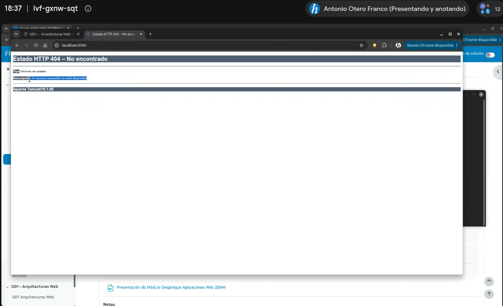
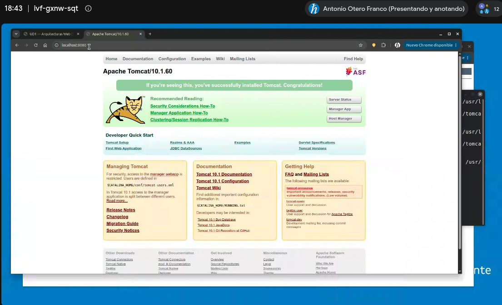
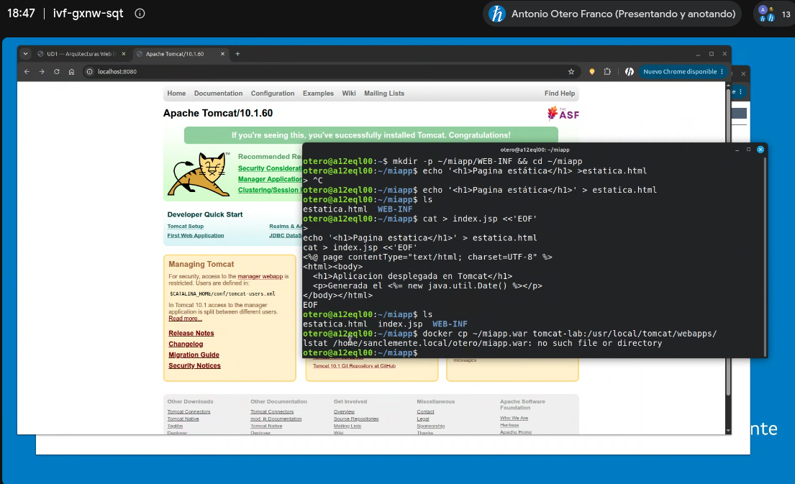
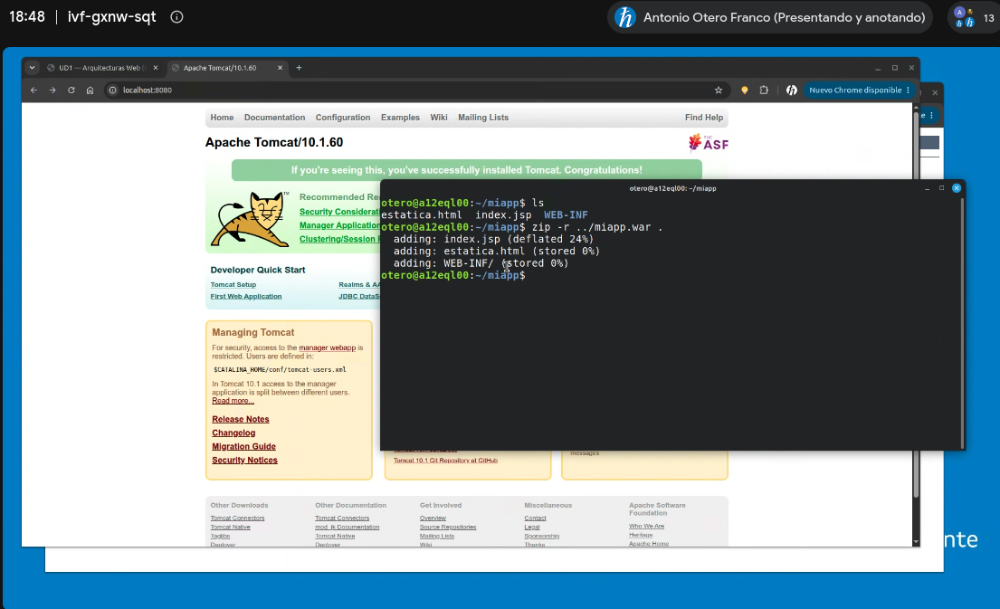
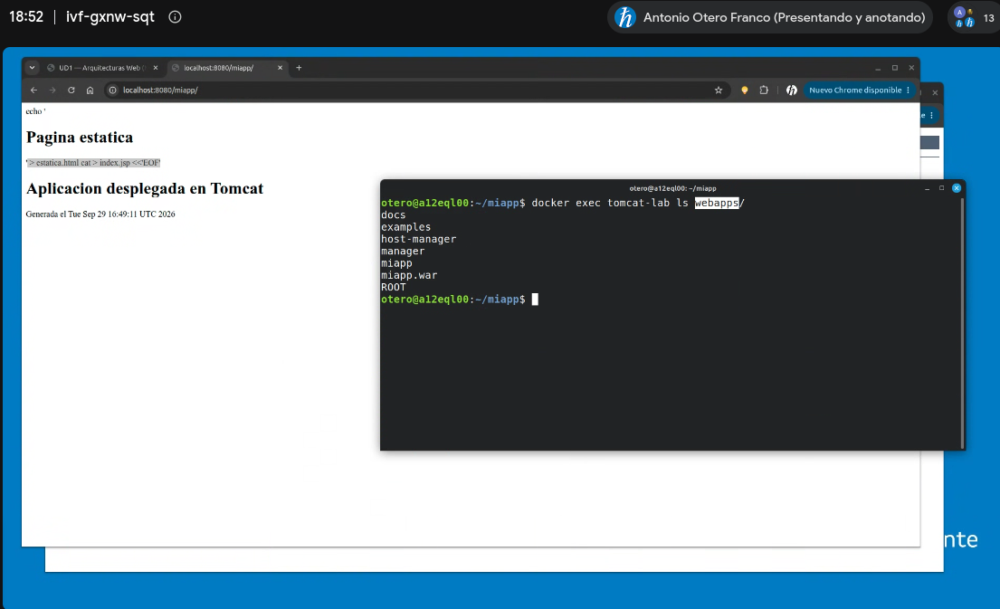
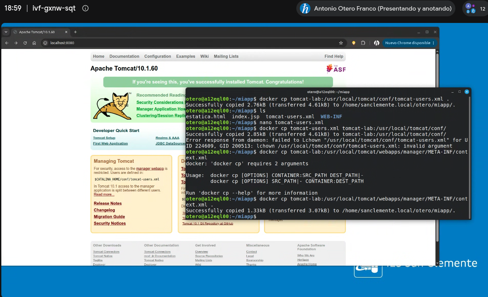
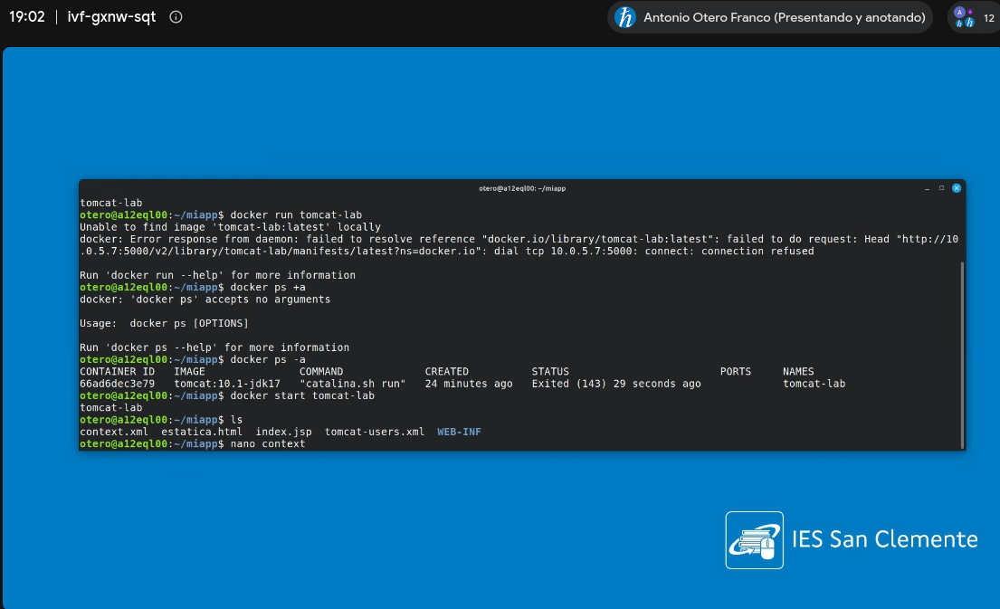
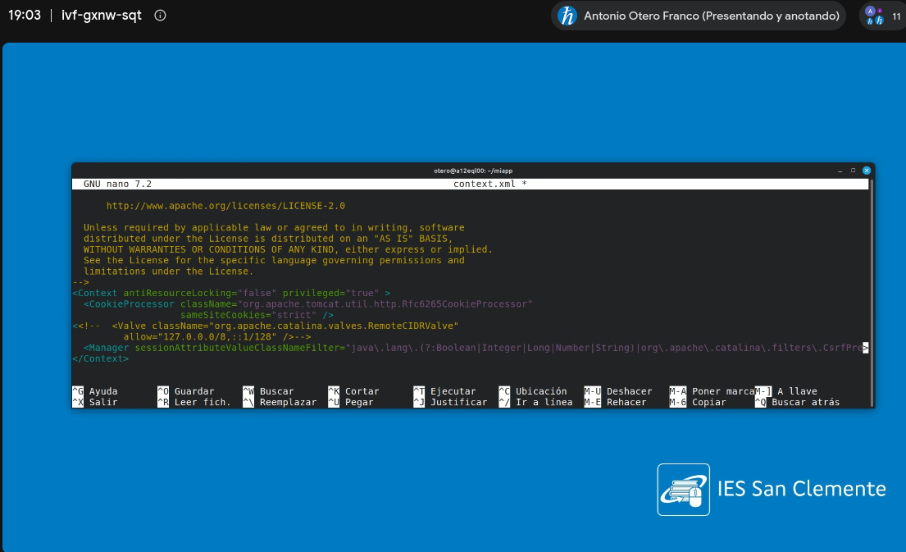

# Práctica 02 — Servidor de aplicaciones Tomcat en Docker

Resumen de los pasos seguidos para instalar Tomcat en un contenedor Docker, desplegar una aplicación propia (página estática + JSP) y habilitar la consola de administración (*Manager App*).

- **Imagen:** `tomcat:10.1-jdk17`
- **Nombre del contenedor:** `tomcat-lab`
- **Puerto:** `8080` del anfitrión → `8080` del contenedor

---

## 1. Instalación de Tomcat (lanzar el contenedor)

Se lanza el contenedor en **modo demonio** (segundo plano) a partir de la imagen oficial:

```bash
docker run -d --name tomcat-lab -p 8080:8080 tomcat:10.1-jdk17
```

Al abrir `http://localhost:8080` aparece un **error 404**. Es un comportamiento esperable: la imagen oficial, por seguridad, deja el directorio `webapps/` vacío y guarda las aplicaciones de ejemplo (ROOT, docs, examples, manager, host-manager) en `webapps.dist/`, donde Tomcat no las despliega.



## 2. Copiar las aplicaciones por defecto a `webapps/`

```bash
docker exec tomcat-lab sh -c 'cp -r /usr/local/tomcat/webapps.dist/* /usr/local/tomcat/webapps/'
```

Tomcat detecta las nuevas carpetas y las despliega automáticamente. Ahora `http://localhost:8080` ya muestra la página de bienvenida de Tomcat.



> Se usa `sh -c '...'` para que el comodín `*` lo expanda el shell **dentro** del contenedor y no el de nuestra máquina.

## 3. Problema: no se puede acceder a la consola de administración

Al pulsar en *Manager App* (`http://localhost:8080/manager/html`) se deniega el acceso por dos motivos:

1. **No hay ningún usuario** con el rol `manager-gui` definido en `conf/tomcat-users.xml`.
2. **Restricción por IP**: el Manager solo admite conexiones desde `localhost` *dentro del contenedor*. Nuestras peticiones llegan desde la red de Docker (p. ej. `172.17.0.1`), así que se rechazan.

Se soluciona en los pasos 5 y 6.

## 4. Despliegue de una aplicación propia (WAR)

### 4.1. Crear la estructura de la aplicación

```bash
mkdir -p ~/miapp/WEB-INF && cd ~/miapp
```

**Página estática** (`estatica.html`):

```bash
echo '<h1>Pagina estatica</h1>' > estatica.html
```

**Página dinámica con Java** (`index.jsp`):

```bash
cat > index.jsp <<'EOF'
<%@ page contentType="text/html; charset=UTF-8" %>
<html><body>
<h1>Aplicacion desplegada en Tomcat</h1>
<p>Generada el <%= new java.util.Date() %></p>
<p>Servidor: <%= application.getServerInfo() %></p>
</body></html>
EOF
```

> **Ojo al pegar en la terminal:** si aparecen caracteres raros como `^[[200~` (*bracketed paste*) o el `EOF` final no está solo en su línea, el *heredoc* no se cierra bien. En ese caso, cancelar con `Ctrl+C` y volver a pegarlo, o crear el archivo con `nano`.



### Concepto: ¿qué es un servlet? ¿y un JSP?

Un **servlet** es una clase Java que se ejecuta dentro de un servidor de aplicaciones (como Tomcat) y que atiende peticiones HTTP: recibe la petición (`HttpServletRequest`), ejecuta la lógica que haga falta y escribe la respuesta (`HttpServletResponse`), normalmente HTML generado dinámicamente. Tomcat actúa como **contenedor de servlets**: gestiona su ciclo de vida (creación, `init()`, atención de peticiones con `doGet()`/`doPost()`, `destroy()`) y decide qué servlet responde a cada URL.

Un **JSP** (*JavaServer Pages*) es una página HTML con fragmentos de código Java incrustados:

- `<% ... %>` → *scriptlet*: bloque de código Java.
- `<%= ... %>` → *expresión*: su valor se inserta en el HTML (es lo que usa nuestro `index.jsp`).
- `<%! ... %>` → *declaración*: variables o métodos de la clase.
- `<%@ ... %>` → *directiva*: configuración de la página (p. ej. `contentType`).

La clave es que **un JSP acaba siendo un servlet**: la primera vez que se pide, Tomcat (con su compilador Jasper) traduce el `.jsp` a una clase Java servlet, la compila y la ejecuta. El navegador nunca recibe código Java, solo el HTML resultante. Por eso escribir JSP es más cómodo para generar HTML, pero por debajo es la misma tecnología.

Más información y ejemplos: [¿Qué es JSP? ¿Qué son los Servlets? — Arquitectura Java](Qu%C3%A9%20es%20JSP%20-%20Que%20son%20los%20Servlets.html) ([original](https://www.arquitecturajava.com/que-es-jsp-como-se-relaciona-con-los-servlets/)).

### Estructura resultante

```
miapp/
├── WEB-INF/        (vacío; aquí iría web.xml, classes/, lib/…)
├── estatica.html
└── index.jsp
```

### 4.2. Empaquetar en un WAR

Un `.war` es simplemente un ZIP con la estructura de una aplicación web Java:

```bash
zip -r ../miapp.war .
```

> `zip` necesita el nombre del archivo de salida; `zip -` a secas falla con *"cannot write zip file to terminal"*.



### 4.3. Desplegar (despliegue automático)

Basta con copiar el WAR a `webapps/`:

```bash
docker cp ~/miapp.war tomcat-lab:/usr/local/tomcat/webapps/
```

Tomcat detecta el WAR y lo **despliega automáticamente** (*autoDeploy*), descomprimiéndolo en una carpeta con el mismo nombre:

```bash
docker exec tomcat-lab ls /usr/local/tomcat/webapps
# docs  examples  host-manager  manager  miapp  miapp.war  ROOT
```

Comprobación en el navegador:

- `http://localhost:8080/miapp/` → `index.jsp` (fecha y versión del servidor generadas en cada petición)
- `http://localhost:8080/miapp/estatica.html` → página estática



> En la captura, la página muestra texto sobrante (`echo '...`, `cat > index.jsp <<'EOF'`) porque el *heredoc* se pegó mal y esas líneas acabaron dentro del fichero: es justo el problema descrito en el aviso del apartado 4.1.

El nombre del WAR (`miapp`) determina la ruta de contexto (`/miapp`).

## 5. Crear un usuario administrador (`tomcat-users.xml`)

1. Copiar el fichero del contenedor al anfitrión:

   ```bash
   docker cp tomcat-lab:/usr/local/tomcat/conf/tomcat-users.xml .
   ```

2. Editarlo (`nano tomcat-users.xml`) y añadir, **dentro** de `<tomcat-users> ... </tomcat-users>` y fuera de los bloques comentados `<!-- -->`:

   ```xml
   <role rolename="manager-gui"/>
   <user username="admin" password="1234" roles="manager-gui"/>
   ```

3. Devolver el fichero al contenedor:

   ```bash
   docker cp tomcat-users.xml tomcat-lab:/usr/local/tomcat/conf/
   ```



> Contraseña `1234` solo válida para un entorno de pruebas.

## 6. Permitir el acceso al Manager desde cualquier IP (`context.xml`)

1. Copiar el `context.xml` de la aplicación *manager*:

   ```bash
   docker cp tomcat-lab:/usr/local/tomcat/webapps/manager/META-INF/context.xml .
   ```

   > Si el contenedor aparece parado (`docker ps -a` muestra `Exited`), se arranca de nuevo con `docker start tomcat-lab`; conserva todos los cambios hechos hasta ahora. Ojo: `docker run tomcat-lab` **no** sirve, porque `run` espera el nombre de una **imagen**, no de un contenedor.

   

2. Editarlo y **comentar** la válvula que limita el acceso a `localhost`:

   ```xml
   <!--
   <Valve className="org.apache.catalina.valves.RemoteCIDRValve"
          allow="127.0.0.0/8,::1/128" />
   -->
   ```

   (En versiones anteriores de Tomcat la válvula es `RemoteAddrValve` con una expresión regular; se comenta igual.)

   

3. Devolverlo al contenedor:

   ```bash
   docker cp context.xml tomcat-lab:/usr/local/tomcat/webapps/manager/META-INF/context.xml
   ```

## 7. Reiniciar Tomcat y comprobar

Los cambios en `tomcat-users.xml` se leen al arrancar, así que hay que reiniciar el contenedor:

```bash
docker restart tomcat-lab
```

Ahora en `http://localhost:8080/manager/html` pide usuario y contraseña (`admin` / `1234`) y muestra la lista de aplicaciones desplegadas, incluida `/miapp`. Desde aquí también se pueden desplegar WAR, pararlos, recargarlos o eliminarlos.

---

## Nota: comandos de Docker usados

| Acción | Comando | Explicación |
|---|---|---|
| Crear y arrancar un contenedor | `docker run -d --name tomcat-lab -p 8080:8080 tomcat:10.1-jdk17` | `-d` modo demonio (segundo plano), `--name` nombre del contenedor, `-p anfitrión:contenedor` publica el puerto. Si la imagen no está en local, la descarga. |
| Ver contenedores en ejecución | `docker ps` | Añadir `-a` para ver también los parados. |
| Ejecutar un comando dentro | `docker exec tomcat-lab ls /usr/local/tomcat/webapps` | Ejecuta el comando en el contenedor en marcha. |
| Ejecutar con comodines/tuberías | `docker exec tomcat-lab sh -c 'cp -r a/* b/'` | `sh -c` hace que el shell del contenedor interprete `*`, `|`, `>`… |
| Abrir una terminal dentro | `docker exec -it tomcat-lab bash` | `-i` interactivo, `-t` pseudo-terminal. Salir con `exit`. |
| Copiar anfitrión → contenedor | `docker cp fichero tomcat-lab:/ruta/destino/` | Formato `contenedor:ruta`. |
| Copiar contenedor → anfitrión | `docker cp tomcat-lab:/ruta/fichero .` | `.` = directorio actual. |
| Ver los logs | `docker logs -f tomcat-lab` | `-f` sigue el log en directo (útil para ver el despliegue del WAR). `Ctrl+C` para salir. |
| Reiniciar | `docker restart tomcat-lab` | Para y arranca el mismo contenedor; **conserva** los cambios hechos dentro. |
| Parar / arrancar | `docker stop tomcat-lab` / `docker start tomcat-lab` | Igual que reiniciar, en dos pasos. |
| Eliminar el contenedor | `docker rm -f tomcat-lab` | Borra el contenedor y **todos los cambios** hechos dentro (apps copiadas, usuarios…). La imagen sigue en local. |
| Ver imágenes descargadas | `docker images` | |

> **Importante:** los cambios hechos con `docker cp` y `docker exec` viven en la capa del contenedor. Sobreviven a `restart`/`stop`/`start`, pero se pierden con `docker rm`. Para que fueran persistentes habría que usar volúmenes (`-v`) o crear una imagen propia con un `Dockerfile`.

## Nota: eliminar todo para repetir la práctica desde cero

```bash
# 1. Parar y eliminar el contenedor (-f lo para si está en marcha)
docker rm -f tomcat-lab

# 2. (Opcional) Eliminar la imagen para forzar que se vuelva a descargar
docker rmi tomcat:10.1-jdk17

# 3. Borrar los ficheros de trabajo del anfitrión
rm -rf ~/miapp ~/miapp.war

# 4. Comprobar que no queda nada
docker ps -a        # no debe aparecer tomcat-lab
docker images       # tomcat:10.1-jdk17 solo si no se borró en el paso 2
```

Después se vuelve a empezar por el paso 1 (`docker run ...`). El nuevo contenedor parte limpio: `webapps/` vacío, sin usuarios y con la restricción de IP activa.

> Si en `docker run` aparece el error *"The container name "/tomcat-lab" is already in use"*, es que el contenedor antiguo sigue existiendo (aunque esté parado): hay que eliminarlo con `docker rm -f tomcat-lab`.
