# Práctica 2 — Despliegue en Tomcat

| **Alumno** | Alejandro Martínez Corral |
|---|---|
| **Módulo** | Despliegue de Aplicaciones Web |
| **Unidad** | UD1 Arquitecturas Web |

---

## Paso 1. Levantar Tomcat

> ```bash
> docker run -d --name tomcat-lab -p 8080:8080 tomcat:10.1-jdk17
> docker ps
> curl -I http://localhost:8080/
> ```
>
> Obtendrás un 404, no un error de conexión: el servidor funciona, pero las imágenes oficiales vienen sin aplicaciones desplegadas. Restaura las que trae de serie y vuelve a comprobar:
>
> ```bash
> docker exec tomcat-lab sh -c 'cp -r /usr/local/tomcat/webapps.dist/* /usr/local/tomcat/webapps/'
> curl -I http://localhost:8080/
> ```
>
> Explica en la memoria por qué un 404 y un «conexión rehusada» apuntan a problemas completamente distintos.

### Respuesta

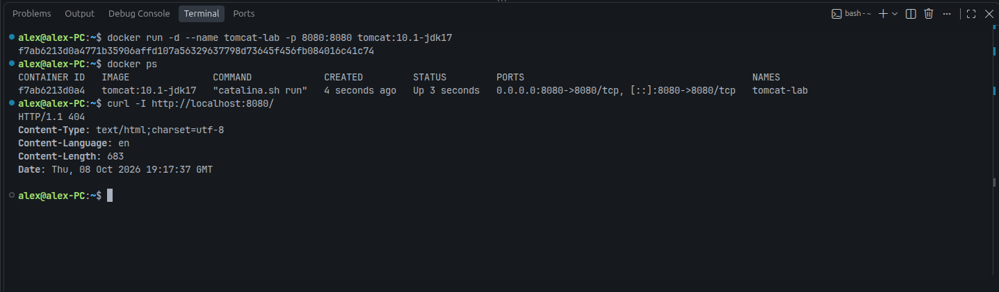

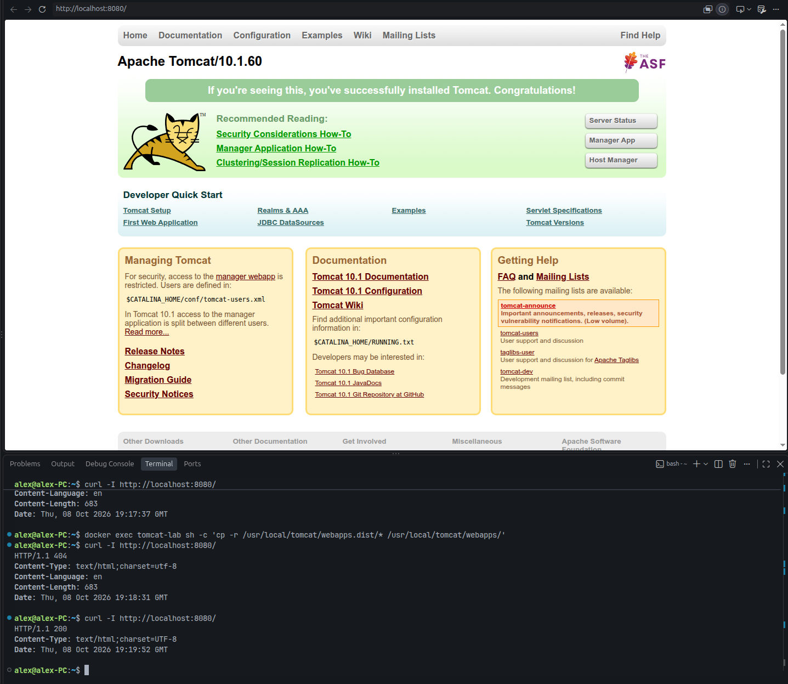

El error `404 Not Found` y el error `Connection refused` se producen en capas diferentes del modelo de red:

- **Error `404 Not Found`:** se produce en la **capa de aplicación**. Indica que la conexión con el servidor se ha completado correctamente, pero el recurso solicitado no existe. Fue el error recibido tras levantar Tomcat, porque el directorio `webapps/` viene vacío por defecto y, por tanto, no hay ninguna página raíz que servir. Se corrigió copiando las aplicaciones que vienen de serie en `webapps.dist/`. De esta forma, al cargar `http://localhost:8080/` se muestra la página principal de Tomcat.

- **Error `Connection refused`:** se produce en la **capa de transporte**. El cliente intentó conectar con una IP y un puerto concretos, pero no había ningún proceso escuchando. En este ejemplo podría ocurrir porque Tomcat estuviera detenido, el contenedor no se hubiera levantado, el mapeo de puertos (`-p 8080:8080`) fuera incorrecto o un cortafuegos rechazara el tráfico. El paquete llega a la máquina, pero el sistema operativo rechaza la conexión al no haber nadie atendiendo ese puerto. Si el cortafuegos descartara los paquetes sin responder (`DROP` en lugar de `REJECT`), el cliente obtendría un *timeout* en lugar de un `Connection refused`.

---

///

## Paso 2. Recorrer la estructura

> ```bash
> docker exec -it tomcat-lab ls -l /usr/local/tomcat
> docker exec -it tomcat-lab ls /usr/local/tomcat/conf
> docker exec -it tomcat-lab ls /usr/local/tomcat/webapps
> ```
>
> Contrasta lo que ves con la tabla del apartado 11.3 y localiza en `conf/server.xml` el conector HTTP y el puerto de parada:
>
> ```bash
> docker exec tomcat-lab grep -n 'Connector port' /usr/local/tomcat/conf/server.xml
> docker exec tomcat-lab grep -n '<Server port' /usr/local/tomcat/conf/server.xml
> ```

### Respuesta

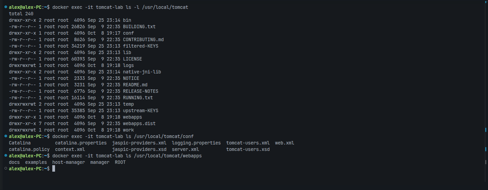

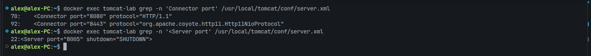

Los directorios principales de Tomcat se encuentran en `/usr/local/tomcat`:

- **`bin/`:** scripts de control, como `startup.sh` y `shutdown.sh`.
- **`conf/`:** ficheros de configuración global. Destacan `server.xml`, para los parámetros de red y los conectores, y `tomcat-users.xml`, para el control de acceso y los roles.
- **`webapps/`:** directorio en el que se despliegan automáticamente las aplicaciones web, ya sea como directorios o como ficheros `.war`.
- **`lib/`:** librerías comunes compartidas por todas las aplicaciones.
- **`logs/`:** registros de actividad del servidor.
- **`temp/` y `work/`:** directorios de ficheros temporales y de almacenamiento de las JSP compiladas como servlets.

Dentro de `server.xml` se configuran los puertos y los conectores:

- **Conector HTTP (`<Connector port="8080" protocol="HTTP/1.1">`):** define el puerto `8080`, en el que Tomcat recibe las peticiones de los clientes.
- **Puerto de parada (`<Server port="8005" shutdown="SHUTDOWN">`):** puerto de control interno. Al ejecutar una orden de apagado (como `shutdown.sh`), Tomcat envía la cadena `SHUTDOWN` a este puerto y realiza un **apagado controlado**: deja de aceptar nuevas conexiones, termina de procesar las peticiones pendientes, guarda el estado de las sesiones activas y libera los recursos. Solo escucha en `localhost` y puede desactivarse con `port="-1"`.

---

## Paso 3. Construir una aplicación y empaquetarla como WAR

> Un WAR no es más que un fichero comprimido con una estructura convenida. Créalo a mano:
>
> ```bash
> mkdir -p ~/miapp/WEB-INF
> cd ~/miapp
> echo '<h1>Pagina estatica</h1>' > estatica.html
> ```
>
> Añade una página generada en el servidor, para ver la diferencia con la anterior:
>
> ```bash
> cat > index.jsp <<'EOF'
> <%@ page contentType="text/html; charset=UTF-8" %>
> <html><body>
>   <h1>Aplicacion desplegada en Tomcat</h1>
>   <p>Generada el <%= new java.util.Date() %></p>
>   <p>Servidor: <%= application.getServerInfo() %></p>
> </body></html>
> EOF
> zip -r ../miapp.war .      # también vale: jar -cvf ../miapp.war .
> ```

### Respuesta

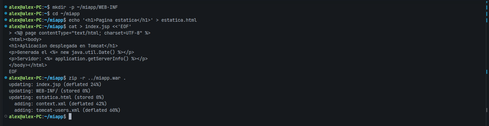

El WAR se genera comprimiendo en ZIP el contenido de `~/miapp`: las páginas en la raíz y el directorio `WEB-INF/`, que es la estructura que Tomcat espera encontrar al desplegarlo.

---

///

## Paso 4. Desplegar y observar el despliegue automático

> ```bash
> docker cp ~/miapp.war tomcat-lab:/usr/local/tomcat/webapps/
> docker logs --tail 20 tomcat-lab   # busca la línea de deployment
> docker exec tomcat-lab ls /usr/local/tomcat/webapps
> curl http://localhost:8080/miapp/
> curl http://localhost:8080/miapp/estatica.html
> ```
>
> **Qué observar en este paso**
>
> - Tomcat ha descomprimido el WAR en un directorio con el mismo nombre: ese nombre es el que determina la ruta de acceso.
> - Recarga `index.jsp` varias veces: la fecha cambia en cada petición. Haz lo mismo con `estatica.html`: el contenido es siempre idéntico. Ahí está, en una línea, la diferencia entre servidor web y servidor de aplicaciones.
> - Mira en `work/` las clases que Tomcat ha generado al compilar la JSP la primera vez que se solicitó.

### Respuesta

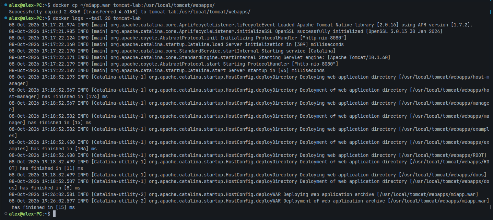

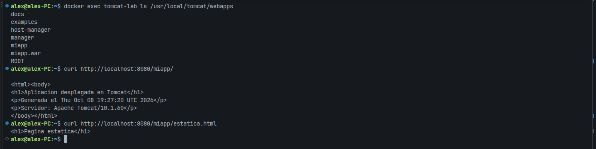

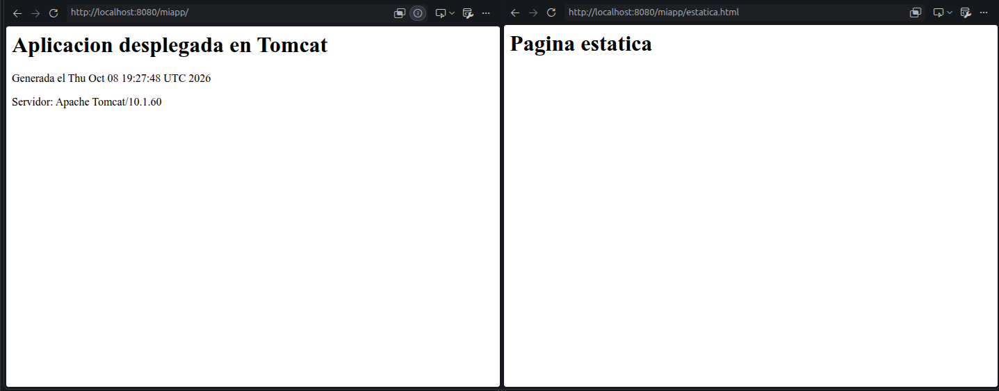

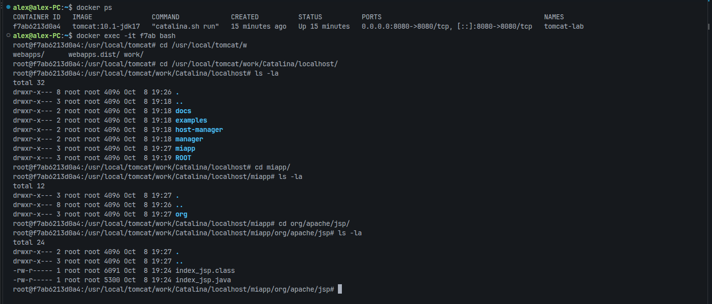

Al copiar el fichero `.war` en el directorio `webapps/`, el **despliegue automático** de Tomcat (`autoDeploy`) lo detecta, lo descomprime en un directorio con el mismo nombre y despliega la aplicación (mensajes de *deployment* del log).

La ruta de acceso (*context path*) la determina el nombre del directorio, de forma que la URL base de la aplicación es, en este ejemplo, `http://localhost:8080/miapp/`. `index.jsp` es una **página dinámica** que el servidor de aplicaciones procesa en cada petición; como la fecha se obtiene con una expresión Java, muestra la hora actual cada vez. En cambio, `estatica.html` es una **página estática** y muestra siempre el mismo contenido.

Cuando se solicita la página JSP por primera vez, Tomcat la traduce a código fuente Java y la compila a **bytecode**. Estos ficheros se guardan en `work/` para evitar repetir la traducción en peticiones posteriores, lo que mejora el rendimiento.

Esto ocurre porque Tomcat no puede interpretar una página JSP tal cual. Su motor de JSP, **Jasper**, lee el fichero `.jsp` (que mezcla HTML y código Java), lo traduce a un **servlet** Java estándar en un fichero `.java` e inmediatamente lo compila a `.class` para que la máquina virtual de Java (**JVM**) pueda ejecutarlo. Cuando se solicita `index.jsp`, la JVM ejecuta el `.class` para generar el HTML final que se envía al cliente.

Contenido del `.java` generado:

///

```java
/*
 * Generated by the Jasper component of Apache Tomcat
 * Version: Apache Tomcat/10.1.60
 * Generated at: 2026-10-08 19:27:20 UTC
 * Note: The last modified time of this file was set to
 *       the last modified time of the source file after
 *       generation to assist with modification tracking.
 */
package org.apache.jsp;

import jakarta.servlet.*;
import jakarta.servlet.http.*;
import jakarta.servlet.jsp.*;

public final class index_jsp extends org.apache.jasper.runtime.HttpJspBase
    implements org.apache.jasper.runtime.JspSourceDependent,
                 org.apache.jasper.runtime.JspSourceImports,
                 org.apache.jasper.runtime.JspSourceDirectives {

  private static final jakarta.servlet.jsp.JspFactory _jspxFactory =
          jakarta.servlet.jsp.JspFactory.getDefaultFactory();

  private static java.util.Map<java.lang.String,java.lang.Long> _jspx_dependants;

  private static final java.util.Set<java.lang.String> _jspx_imports_packages;

  private static final java.util.Set<java.lang.String> _jspx_imports_classes;

  static {
    _jspx_imports_packages = new java.util.LinkedHashSet<>(4);
    _jspx_imports_packages.add("jakarta.servlet");
    _jspx_imports_packages.add("jakarta.servlet.http");
    _jspx_imports_packages.add("jakarta.servlet.jsp");
    _jspx_imports_classes = null;
  }

  private volatile jakarta.el.ExpressionFactory _el_expressionfactory;
  private volatile org.apache.tomcat.InstanceManager _jsp_instancemanager;

  public java.util.Map<java.lang.String,java.lang.Long> getDependants() {
    return _jspx_dependants;
  }

  public java.util.Set<java.lang.String> getPackageImports() {
    return _jspx_imports_packages;
  }

  public java.util.Set<java.lang.String> getClassImports() {
    return _jspx_imports_classes;
  }

  public boolean getErrorOnELNotFound() {
    return false;
  }

  public jakarta.el.ExpressionFactory _jsp_getExpressionFactory() {
    if (_el_expressionfactory == null) {
      synchronized (this) {
        if (_el_expressionfactory == null) {
          _el_expressionfactory = _jspxFactory.getJspApplicationContext(getServletConfig().getServletContext()).getExpressionFactory();
        }
      }
    }
    return _el_expressionfactory;
  }

  public org.apache.tomcat.InstanceManager _jsp_getInstanceManager() {
    if (_jsp_instancemanager == null) {
      synchronized (this) {
        if (_jsp_instancemanager == null) {
          _jsp_instancemanager = org.apache.jasper.runtime.InstanceManagerFactory.getInstanceManager(getServletConfig());
        }
      }
    }
    return _jsp_instancemanager;
  }

  public void _jspInit() {
  }

  public void _jspDestroy() {
  }

  public void _jspService(final jakarta.servlet.http.HttpServletRequest request, final jakarta.servlet.http.HttpServletResponse response)
      throws java.io.IOException, jakarta.servlet.ServletException {

    if (!jakarta.servlet.DispatcherType.ERROR.equals(request.getDispatcherType())) {
      final java.lang.String _jspx_method = request.getMethod();
      if ("OPTIONS".equals(_jspx_method)) {
        response.setHeader("Allow","GET, HEAD, POST, OPTIONS");
        return;
      }
      if (!"GET".equals(_jspx_method) && !"POST".equals(_jspx_method) && !"HEAD".equals(_jspx_method)) {
        response.setHeader("Allow","GET, HEAD, POST, OPTIONS");
        response.sendError(HttpServletResponse.SC_METHOD_NOT_ALLOWED, "JSPs only permit GET, POST or HEAD. Jasper also permits OPTIONS");
        return;
      }
    }

    final jakarta.servlet.jsp.PageContext pageContext;
    jakarta.servlet.http.HttpSession session = null;
    final jakarta.servlet.ServletContext application;
    final jakarta.servlet.ServletConfig config;
    jakarta.servlet.jsp.JspWriter out = null;
    final java.lang.Object page = this;
    jakarta.servlet.jsp.JspWriter _jspx_out = null;
    jakarta.servlet.jsp.PageContext _jspx_page_context = null;


    try {
      response.setContentType("text/html; charset=UTF-8");
      pageContext = _jspxFactory.getPageContext(this, request, response,
                        null, true, 8192, true);
      _jspx_page_context = pageContext;
      application = pageContext.getServletContext();
      config = pageContext.getServletConfig();
      session = pageContext.getSession();
      out = pageContext.getOut();
      _jspx_out = out;

      out.write("\n");
      out.write("<html><body>\n");
      out.write("<h1>Aplicacion desplegada en Tomcat</h1>\n");
      out.write("<p>Generada el ");
      out.print( new java.util.Date() );
      out.write("</p>\n");
      out.write("<p>Servidor: ");
      out.print( application.getServerInfo() );
      out.write("</p>\n");
      out.write("</body></html>\n");
    } catch (java.lang.Throwable t) {
      if (!(t instanceof jakarta.servlet.jsp.SkipPageException)){
        out = _jspx_out;
        if (out != null && out.getBufferSize() != 0)
          try {
            if (response.isCommitted()) {
              out.flush();
            } else {
              out.clearBuffer();
            }
          } catch (java.io.IOException e) {}
        if (_jspx_page_context != null) _jspx_page_context.handlePageException(t);
        else throw new ServletException(t);
      }
    } finally {
      _jspxFactory.releasePageContext(_jspx_page_context);
    }
  }
}
```

> **Nota:** el fichero `.war` no se debe eliminar, porque el despliegue automático de Tomcat replegaría la aplicación y borraría el directorio descomprimido.

---

## Paso 5. La consola de administración

> Habilita un usuario con permisos de gestión editando `conf/tomcat-users.xml`:
>
> ```xml
> <role rolename="manager-gui"/>
> <user username="admin" password="1234" roles="manager-gui"/>
> ```
>
> Por defecto la aplicación de gestión solo admite conexiones desde la propia máquina, así que desde un contenedor hay que permitir el acceso externo en `webapps/manager/META-INF/context.xml`. Documenta qué válvula lo restringe y por qué esa restricción existe. Después reinicia el contenedor, accede a <http://localhost:8080/manager/html> y comprueba que puedes ver, parar y volver a arrancar tu aplicación desde la consola.

### Respuesta

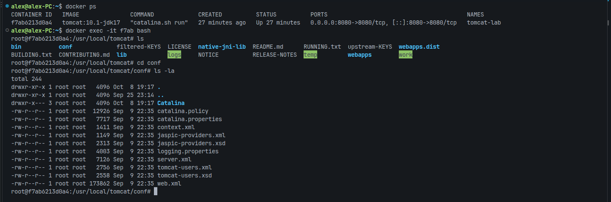

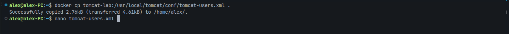

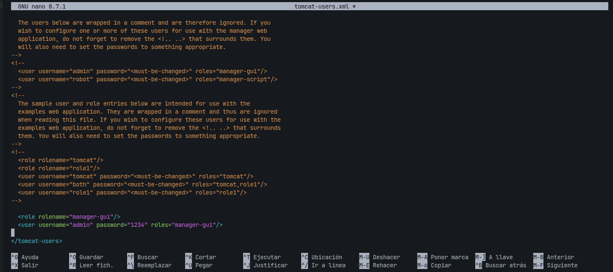

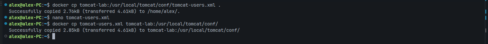

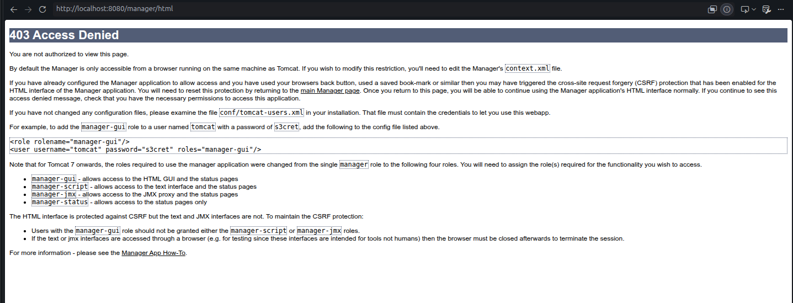

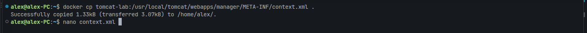

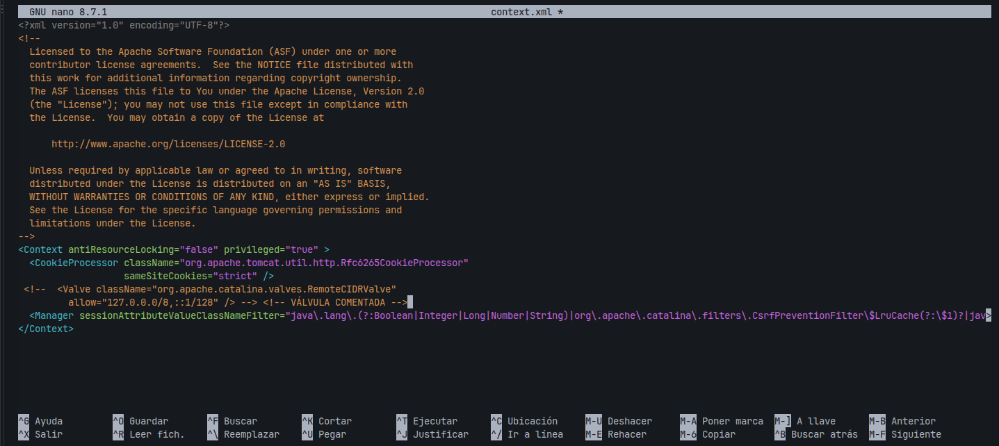

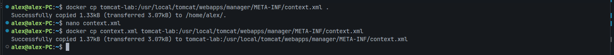

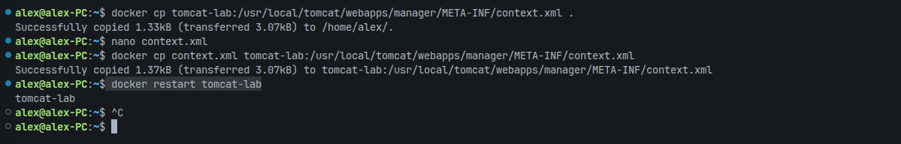

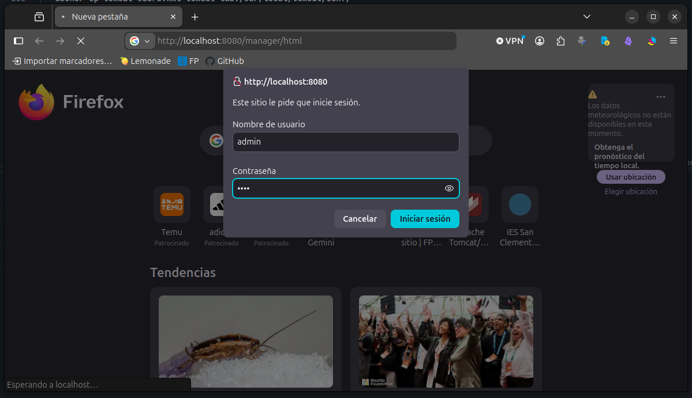

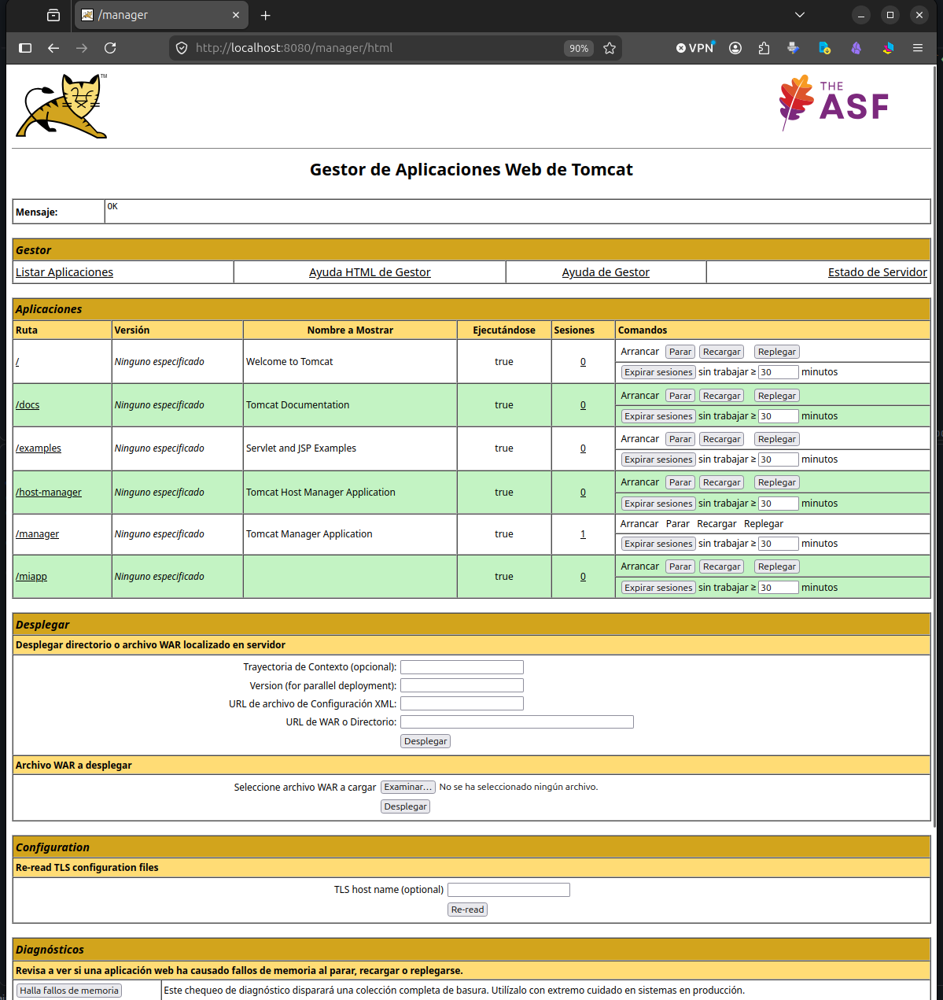

La restricción la aplica la válvula `RemoteCIDRValve` del fichero `webapps/manager/META-INF/context.xml`, que solo admite peticiones desde `127.0.0.0/8` y `::1/128` (la propia máquina). Como las peticiones al contenedor llegan desde la red de Docker (`172.17.0.1`), se comentó la válvula para permitir el acceso. Esta restricción existe porque el **Manager** permite desplegar y ejecutar código en el servidor y, si las credenciales no son robustas, cualquiera podría hacerlo desde la red.

En esta imagen se observa cómo es posible detener la aplicación `miapp` desde la consola de administración, así como volver a arrancarla o replegarla:

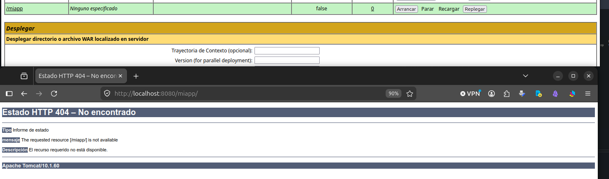

---

## Paso 6. Registros y diagnóstico

> ```bash
> docker exec tomcat-lab ls /usr/local/tomcat/logs
> curl -I http://localhost:8080/miapp/no-existe
> docker exec tomcat-lab tail -n 10 /usr/local/tomcat/logs/localhost_access_log.*.txt
> ```
>
> Identifica tu petición fallida en el registro de acceso y explica cada campo de la línea.

### Respuesta

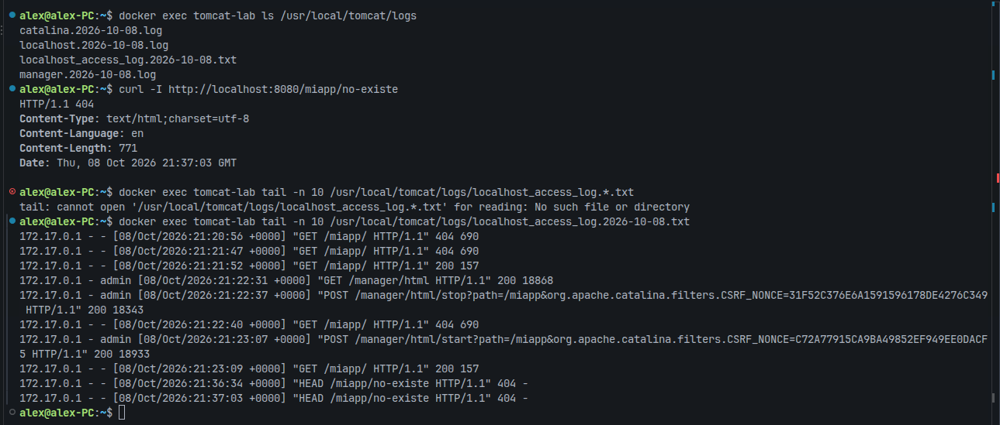

Dentro de `logs/` hay varios ficheros de registro de la actividad del servidor. En `localhost_access_log.*.txt` se registran las peticiones HTTP recibidas. Al pedir un recurso que no existe se genera un error `404 Not Found`, que queda reflejado en el registro de acceso así:

```
172.17.0.1 - - [08/Oct/2026:21:37:03 +0000] "HEAD /miapp/no-existe HTTP/1.1" 404 -
```

- **`172.17.0.1`:** dirección IP del cliente que realiza la petición.
- **`-`:** identificador remoto del cliente. No suele usarse, así que aparece `-`.
- **`-`:** usuario autenticado, si la página requiere credenciales. Si el acceso es anónimo, se muestra `-`.
- **`[08/Oct/2026:21:37:03 +0000]`:** fecha, hora y zona horaria en que el servidor recibió la petición.
- **`"HEAD /miapp/no-existe HTTP/1.1"`:** **línea de petición** enviada por el cliente, formada por el método HTTP (`HEAD`), la ruta solicitada (`/miapp/no-existe`) y la versión del protocolo.
- **`404`:** código de estado HTTP devuelto por el servidor.
- **`-`:** tamaño en bytes del cuerpo de la respuesta. Aparece `-` (0 bytes) porque una respuesta a `HEAD` no lleva cuerpo.

---

///

## Paso 7. Replegar la aplicación

> ```bash
> docker exec tomcat-lab rm /usr/local/tomcat/webapps/miapp.war
> sleep 5 && docker exec tomcat-lab ls /usr/local/tomcat/webapps
> curl -I http://localhost:8080/miapp/
> ```
>
> Comprueba que al eliminar el WAR desaparece también el directorio desplegado. Explica qué implicaciones tiene este comportamiento en un despliegue real.

### Respuesta

Al borrar el fichero `.war` se comprueba que también desaparece el directorio de la aplicación. Es necesario esperar (de ahí el `sleep 5`) antes de listar `webapps/`, porque Tomcat tiene un hilo que revisa ese directorio en segundo plano y, cuando detecta que se ha eliminado el `.war`, detiene la aplicación, libera la memoria y, finalmente, borra su directorio.

A continuación se hace una petición `HEAD` a la aplicación. Como la ruta ya no existe, devuelve un `404 Not Found`.

En un entorno de producción, este comportamiento tiene la **ventaja** de que una aplicación se actualiza fácilmente: los cambios hechos al borrar o reemplazar el `.war` se aplican automáticamente sin reiniciar el servidor. Sin embargo, también tiene un **inconveniente**: se pierden los datos guardados dentro del directorio de la aplicación, como los ficheros subidos por los usuarios. Para evitarlo, los datos persistentes deben almacenarse fuera de la estructura del `.war`, en volúmenes o bases de datos externos.

---

## Paso 8. Requisitos de implantación

> A partir de todo lo anterior, redacta la tabla de requisitos previos que habría exigido desplegar esta aplicación sobre una máquina real y no sobre un contenedor, siguiendo las categorías del apartado 10.1: sistema operativo, dependencias, recursos, red y puertos, seguridad y observabilidad.

### Respuesta

| Requisito | Qué exigiría esta aplicación en una máquina real |
|---|---|
| **Sistema operativo** | Linux de 64 bits, recomendado para servidores (Ubuntu Server 24.04 LTS o Debian 12). Tomcat también funciona en Windows y macOS. Si los repositorios de la distribución no ofrecen Tomcat 10.1, se instala desde el paquete oficial de Apache. |
| **Dependencias de software** | Java 11 o superior (JDK o JRE), el mínimo de Tomcat 10.1. Para igualar el contenedor (`tomcat:10.1-jdk17`) se instala OpenJDK 17 y se define `JAVA_HOME`. No hace falta cliente de base de datos, porque la aplicación no usa ninguna. |
| **Recursos de hardware** | 1 núcleo y 2 GB de RAM para desarrollo; 2 núcleos y 4 GB para producción. Al menos 1 GB de disco libre para Java, Tomcat, el `.war` y los directorios `logs/` y `work/`. |
| **Red y puertos** | IP fija, nombre de dominio y registro DNS. Abrir en el cortafuegos el `8080` (HTTP) y, si se configura TLS, el `8443` (HTTPS), o bien el `80` y el `443` de un proxy inverso delante de Tomcat. El puerto de parada `8005` solo escucha en `localhost` y no se abre al exterior. |
| **Seguridad** | Ejecutar Tomcat con un usuario propio sin privilegios de `root`. Quitar las aplicaciones de ejemplo, limitar el **Manager** por IP con contraseñas robustas, servir por HTTPS y mantener actualizados el sistema, Java y Tomcat. Hacer copias de seguridad de `conf/` y del `.war`. |
| **Observabilidad** | Revisar los registros de `logs/` y configurar su rotación con `logrotate` para que no llenen el disco. |

---

## Cuestiones

### 1. Enumera cinco servicios que proporciona un servidor de aplicaciones y que un servidor web no ofrece. Señala cuáles has podido observar en la práctica.

1. **Entorno de ejecución:** ofrece una plataforma capaz de ejecutar programas y realizar operaciones complejas que un servidor web no permite. Así puede generar contenido dinámico, actualizado en tiempo real y personalizado para cada usuario.

2. **Conexión a bases de datos:** gestiona las conexiones para operar con bases de datos de forma segura. Las operaciones críticas se manejan mediante **transacciones**, que se completan solo si todos los pasos son correctos y se revierten en caso contrario (por ejemplo, una compra en línea).

3. **Gestión de sesiones:** conserva los datos de sesión del usuario durante su interacción con el sitio.

4. **Seguridad y autenticación:** administra los permisos de acceso, la verificación de identidad, el cifrado, el control del despliegue de la aplicación, etc.

5. **Servicios de comunicación:** a diferencia de los servidores web, que trabajan fundamentalmente con HTTP, permiten intercambiar datos mediante otros protocolos y tecnologías, como gRPC o servicios REST con JSON.

En esta práctica se pudieron observar:

- **Punto 1:** `index.jsp` genera la fecha en cada petición, y Tomcat la traduce a un servlet y la compila a `.class` en `work/` para ejecutarla en la JVM (paso 4).
- **Punto 4:** el acceso al **Manager** exige un usuario con el rol `manager-gui` definido en `tomcat-users.xml` y queda restringido por IP con la válvula `RemoteCIDRValve` (respuesta `403`). Desde la consola se controla el despliegue de la aplicación: pararla, arrancarla y replegarla (paso 5).

---

### 2. ¿Qué contiene realmente un fichero WAR? Descríbelo a partir del que has construido.

Un fichero `.war` (*Web Application Archive*) es un fichero comprimido estándar, en formato ZIP, que empaqueta una aplicación web Java con una estructura de directorios estandarizada, observable en el artefacto desplegado:

- **Raíz:** las páginas y recursos accesibles públicamente.
- **Directorio protegido `WEB-INF/`:** no es accesible desde el navegador y contiene:
  - **`web.xml`:** descriptor de despliegue con la configuración y el mapeo de la aplicación.
  - **`classes/`:** clases compiladas de la aplicación y JavaBeans.
  - **`lib/`:** librerías externas y dependencias necesarias para la ejecución.

El WAR construido solo contiene `index.jsp` y `estatica.html` en la raíz y un `WEB-INF/` vacío: `web.xml` es opcional desde Servlet 3.0 y la JSP la compila Tomcat al desplegarla.

---

### 3. ¿Por qué `index.jsp` cambia en cada recarga y `estatica.html` no?

Porque `estatica.html` es un fichero **HTML estático**: no cambia y se lee y transmite tal cual al cliente que lo solicita. En cambio, `index.jsp` es una **página dinámica** basada en JSP, cuyo código procesa el motor de Tomcat en el servidor. En este caso, el código incluye una llamada que imprime la fecha y hora actuales. Como ese contenido se genera en tiempo de ejecución, el resultado que se envía al cliente varía cada vez que se solicita la página.

---

### 4. ¿Qué ventaja tiene el despliegue automático por copia del artefacto y qué riesgo introduce en producción?

La **ventaja** es que facilita el **despliegue continuo** (*continuous deployment*): la aplicación se actualiza en caliente y de forma rápida reemplazando el fichero `.war`, sin reiniciar el servidor.

También supone **riesgos**: si al reemplazar el fichero se produce un error o se borra el `.war`, la aplicación se repliega de inmediato. Además, se pierde cualquier información almacenada dentro del directorio de la aplicación.

---

### 5. Si esta aplicación recibiera mucho tráfico de imágenes y hojas de estilo, ¿cómo reorganizarías el despliegue? Relaciónalo con el apartado 11.4.

Lo adecuado sería situar un servidor web, como Nginx o Apache, delante del servidor de aplicaciones, actuando como **proxy inverso**. Esto aporta varias ventajas:

- **Optimización de recursos estáticos:** el servidor web es muy eficiente sirviendo contenido estático y libera a Tomcat de esa tarea, de modo que este se encarga solo de la lógica dinámica.
- **Seguridad:** Tomcat no queda expuesto directamente a la red, lo que lo protege y oculta la estructura interna del servidor de aplicaciones.
- **Escalabilidad:** el proxy permite balancear la carga entre varias instancias de Tomcat en momentos de mucho tráfico.

---
