# Práctica 01 — Primeros pasos con Git

## Parte 1: Configuración y creación del repositorio

### 1. Configurar Git

La configuración global (`--global`) se guarda en `~/.gitconfig` y se aplica a todos los repositorios del equipo.

1. **Identidad**: indicamos quiénes somos para que cada commit quede firmado con su autor.
   ```bash
   git config --global user.name "Nombre Apellido"
   git config --global user.email "correo@ejemplo.net"
   ```
2. **Colores**: para ver la salida de Git en colores en la consola.
   ```bash
   git config --global color.ui auto
   ```
3. **Rama principal**: hacemos que la rama inicial de los repositorios nuevos se llame `main`.
   ```bash
   git config --global init.defaultBranch main
   ```
4. **Comprobar la configuración** con `--list`:
   ```bash
   git config --list
   ```

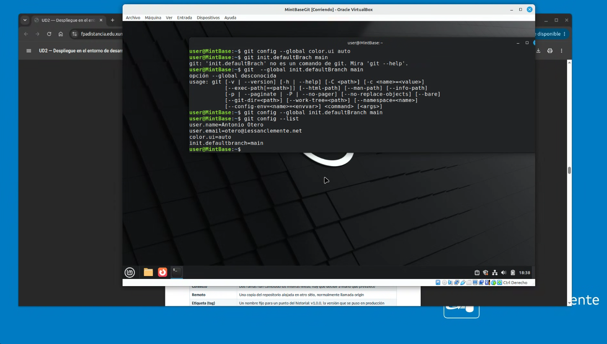

### 2. Crear la carpeta del proyecto

Creamos la carpeta `repos/tienda` para el proyecto de la tienda online.

```bash
cd Documentos
mkdir -p repos/tienda
cd repos/tienda
```

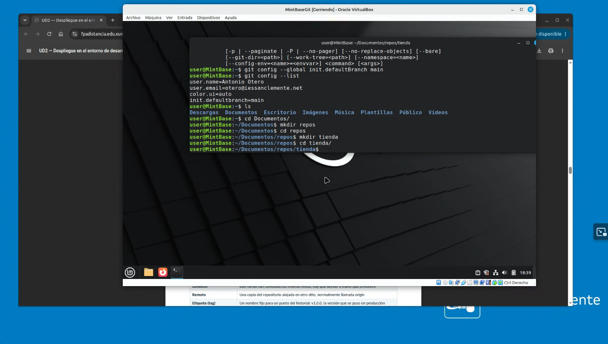

### 3. Inicializar el repositorio

`git init` convierte la carpeta en un repositorio (crea la carpeta oculta `.git`). Con `git status` vemos el estado: estamos en la rama `main` y todavía no hay commits.

```bash
git init
ls -a
git status
```

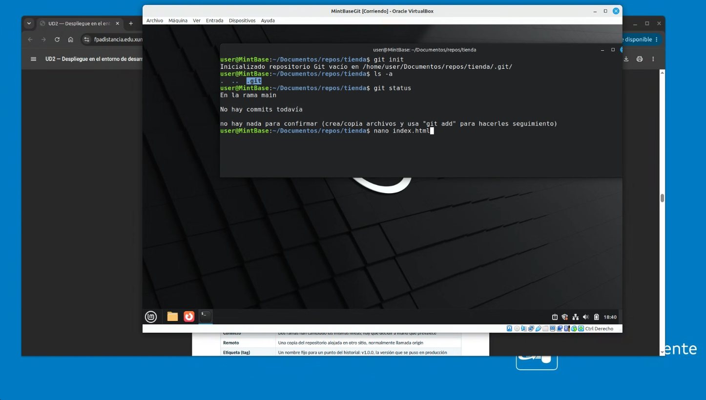

### 4. Crear `index.html`

Creamos la página principal de la tienda con `nano index.html`.

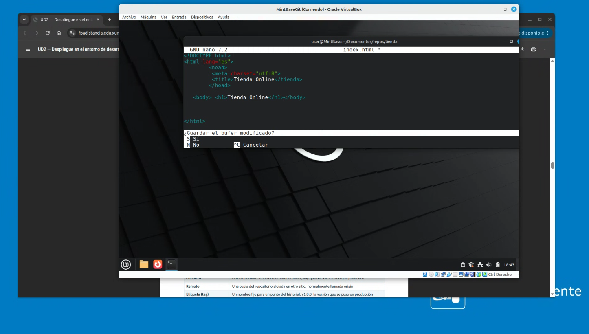

### 5. Añadir el archivo al área de preparación (staging)

`git status` muestra `index.html` en rojo como **archivo sin seguimiento**: Git lo ve, pero no lo controla todavía.


Con `git add` lo pasamos al área de preparación (*staging*) y ya aparece en verde como "cambios a ser confirmados".

```bash
git add index.html
git status
```


### 6. Primer commit

El commit guarda los cambios en el repositorio **local**, con un mensaje que describe lo que se ha hecho. (Para enviarlo a un servidor remoto se usaría `git push`.)

```bash
git commit -m "Añadimos el landing page de nuestra tienda"
```

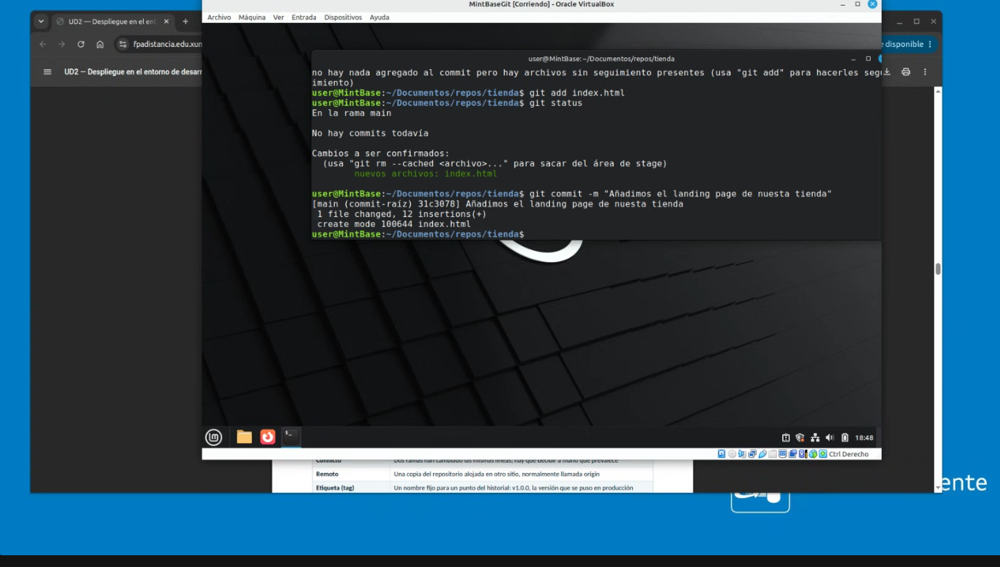

### 7. Ver el historial

`git log` muestra los commits: su identificador (hash), autor, fecha y mensaje. `HEAD -> main` indica el commit en el que estamos.

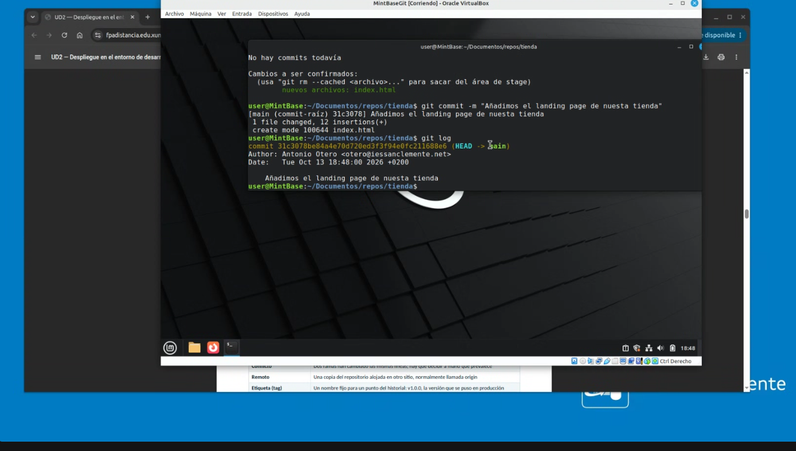

### 8. Modificar un archivo y ver las diferencias

Cambiamos el título de la página a "Tienda Online de Deportes".

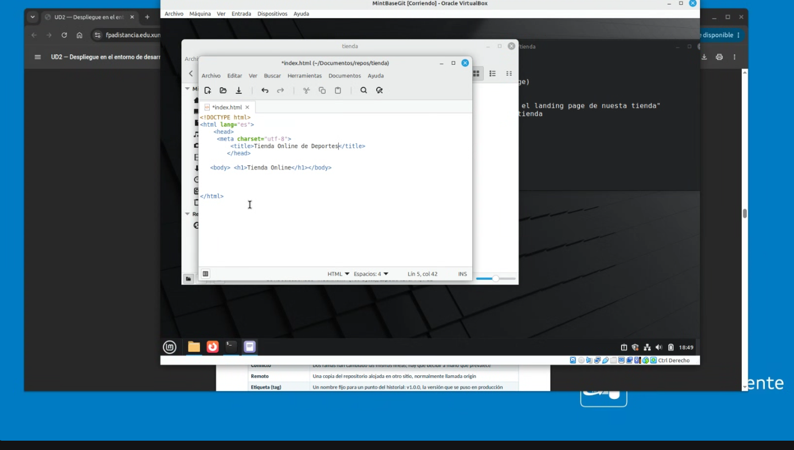

`git diff` muestra las diferencias entre el archivo modificado y la última versión guardada. Gracias a `color.ui auto`, las líneas eliminadas salen en rojo (`-`) y las añadidas en verde (`+`).

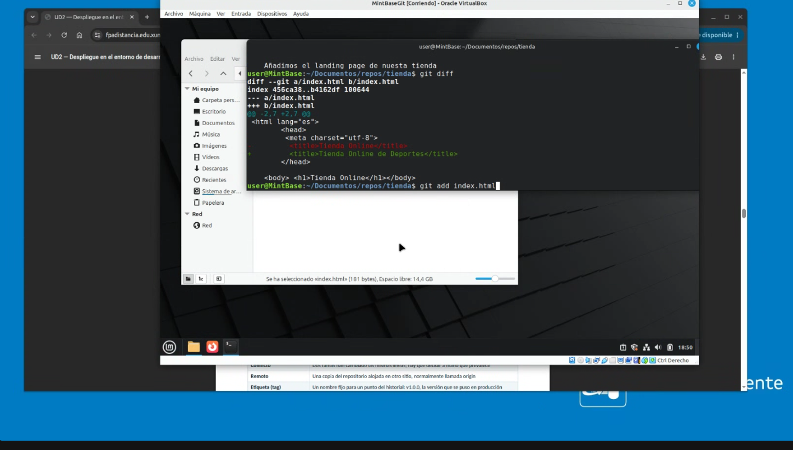

Tras volver a hacer `git add`, `git diff` queda vacío, porque el cambio ya está en staging. Para ver lo que está preparado y pendiente de confirmar se usa `git diff --staged`.

```bash
git add index.html
git diff            # vacío
git diff --staged   # muestra el cambio preparado
```


Confirmamos el cambio:

```bash
git commit -m "Cambiamos el título de la página"
```


### 9. Ver un commit con `git show`

`git show` muestra el último commit con sus cambios. Diferencia con `diff`:
- `git show` mira **hacia atrás**: lo que ya está en el historial.
- `git diff` mira **hacia delante**: lo que todavía no se ha confirmado.

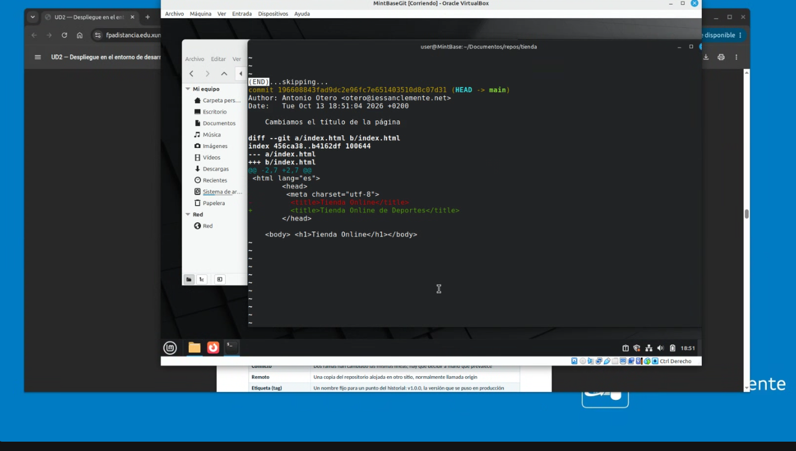

### 10. Añadir una hoja de estilos

Creamos `style.css` y la enlazamos desde `index.html` con `<link rel="stylesheet" href="style.css">`.

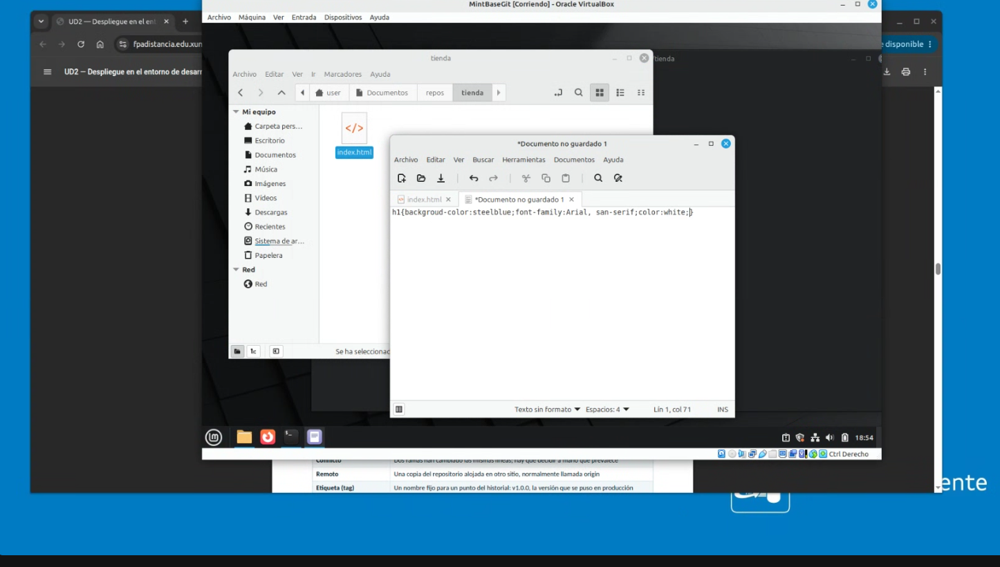

Añadimos los dos archivos y hacemos commit:

```bash
git add index.html style.css
git commit -m "Añadida hoja de estilos"
```

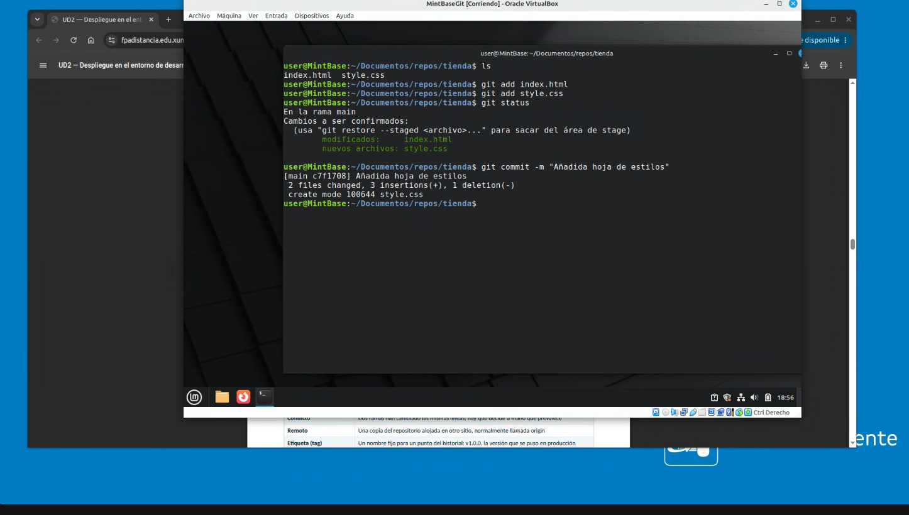

Con `git show` vemos los cambios de ese commit en ambos archivos.

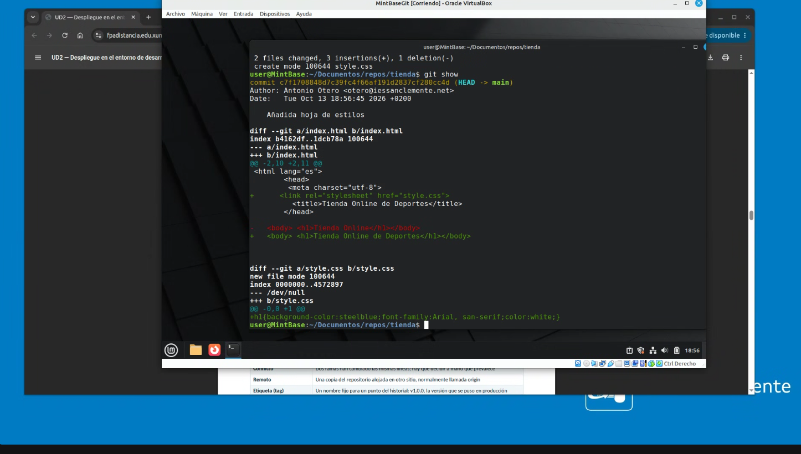

### 11. Ver quién cambió cada línea con `git blame`

`git blame` muestra, para cada línea de un archivo, el commit, el autor y la fecha del último cambio.

```bash
git blame index.html
```

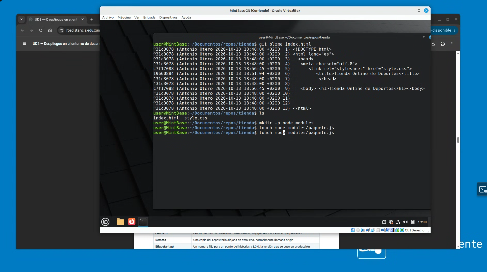

### 12. Ignorar archivos con `.gitignore`

En el repositorio se guarda el código fuente, pero no cosas como configuraciones del equipo o secretos (contraseñas, claves...). En el archivo `.gitignore` se indica qué archivos y carpetas del proyecto **no** se guardan en el repositorio.

Para probarlo, creamos la carpeta `node_modules` con un archivo que simula contener una contraseña:

```bash
mkdir -p node_modules
touch node_modules/paquete.js
nano node_modules/paquete.js
```

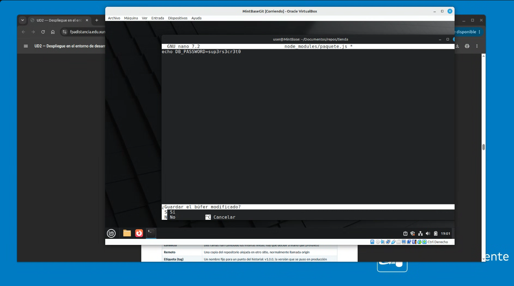

Creamos `.gitignore` con `nano .gitignore`. Se suele organizar por bloques:
- **Dependencias**: `node_modules/`, `vendor/`.
- **Configuración y secretos**: variables de entorno (`.env`) y archivos locales (`*.local`).
- **Artefactos de construcción**: carpetas generadas al compilar (`build/`, `dist/`).
- **Sistema operativo y editor**: `.DS_Store`, `.vscode/`.

Los directorios se escriben con barra al final. Existen plantillas de `.gitignore` para casos comunes (lenguajes, IDEs...).

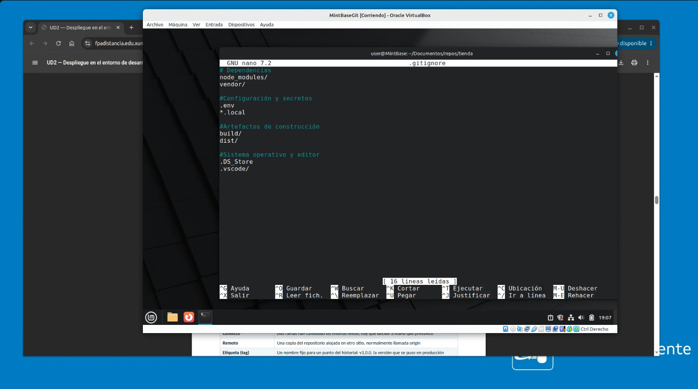

Al hacer `git status` solo aparece `.gitignore`: la carpeta `node_modules` ya no se muestra porque está ignorada.

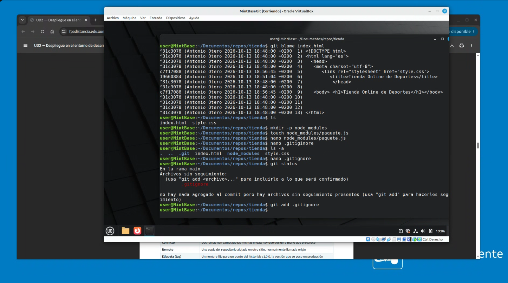

```bash
git add .gitignore
git commit -m "Añadido .gitignore del proyecto"
```

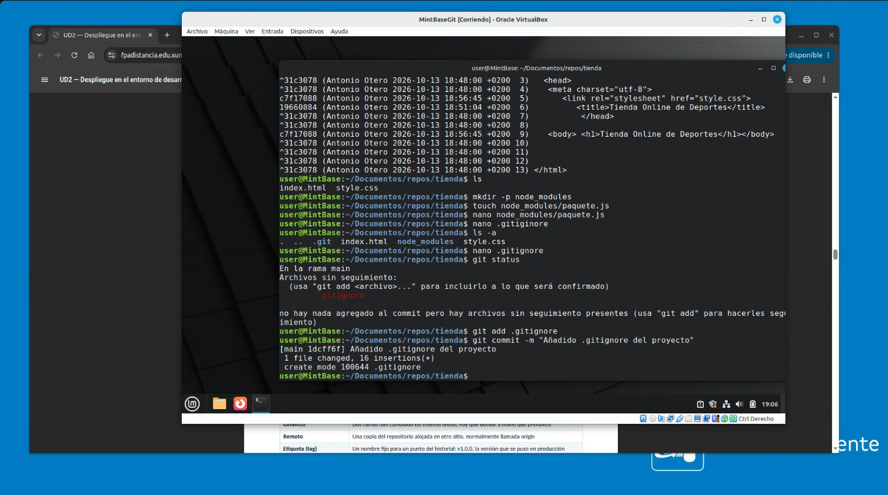

---

Hasta aquí la configuración del repositorio. Ahora veremos funcionalidades para **corregir errores**.

## Parte 2: Deshacer cambios

### 1. Descartar cambios sin confirmar con `git restore`

Añadimos una línea errónea al final de `index.html`:

```bash
echo "linea de codigo errónea" >> index.html
```

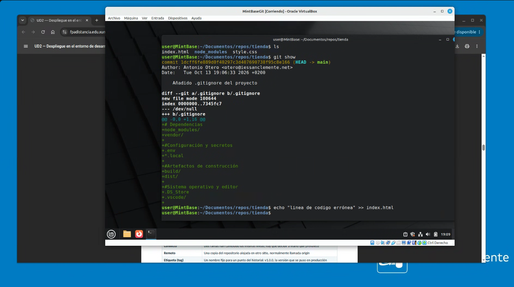

`git status` muestra el archivo como modificado y sugiere `git restore` para descartar los cambios.


`git restore` devuelve el archivo a su estado del último commit (si el cambio estuviera en staging, con `git restore --staged` lo sacaríamos del área de preparación).

```bash
git restore index.html
```

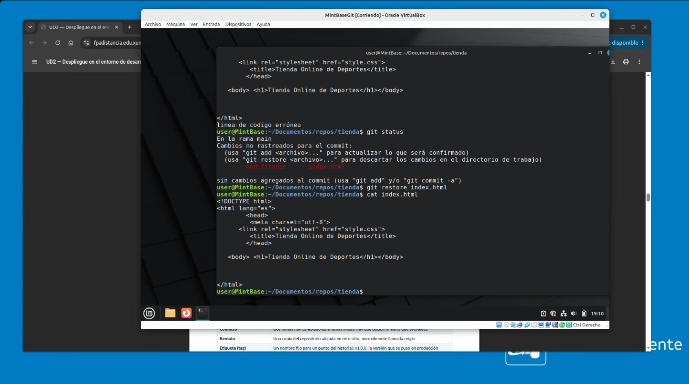

### 2. Corregir el mensaje del último commit con `--amend`

Añadimos un comentario con el autor y hacemos commit. Con `-a` se añaden automáticamente todos los archivos ya seguidos que estén modificados, sin necesidad de `git add`.

```bash
echo '<!-- autor: nombre -->' >> index.html
git commit -a -m "Añade el autor y su correo"
```


El mensaje no es correcto (no se ha añadido ningún correo), así que lo editamos con `--amend`, que reemplaza el último commit por uno nuevo (cambia su hash):

```bash
git commit --amend -m "Añade el autor"
```

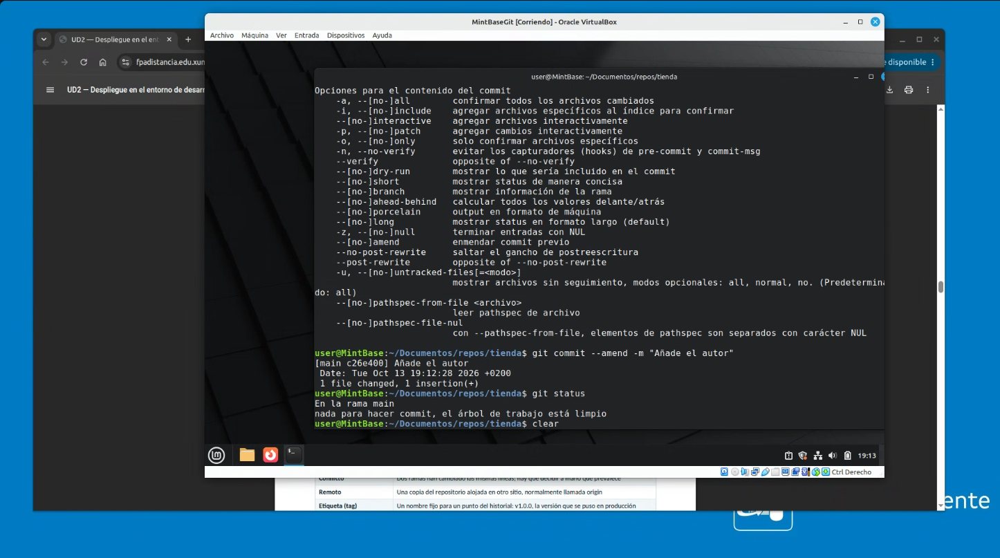

### 3. Volver atrás con `git reset`

`git log --oneline` muestra el historial resumido. `HEAD` es el commit donde estamos y con `HEAD~n` nos referimos a `n` commits atrás (con `~`, no con `-`: `HEAD-1` da error).

```bash
git log --oneline
git reset --soft HEAD~1
git reset --soft HEAD~2
```

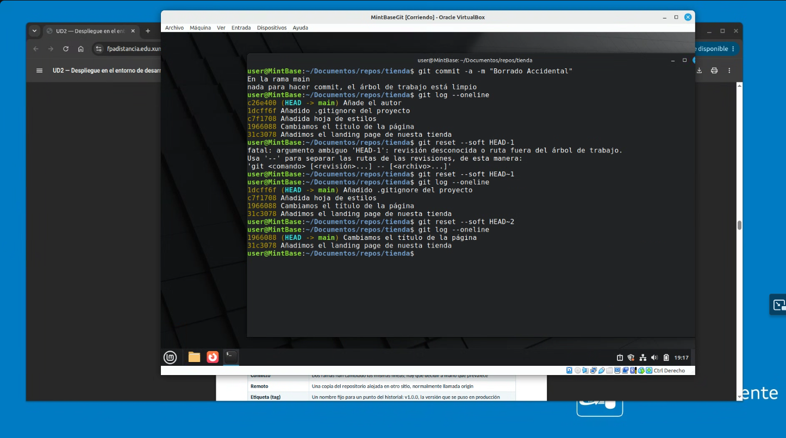

- `--soft`: deshace el commit pero conserva los cambios en staging.
- `--hard`: deshace el commit y **borra** el trabajo.

> `git reset` reescribe el historial, así que solo debe usarse con commits que aún no han salido de nuestra máquina. Si el error ya está publicado, se usa `git revert`, que crea un commit nuevo que deshace los cambios sin reescribir el historial.
