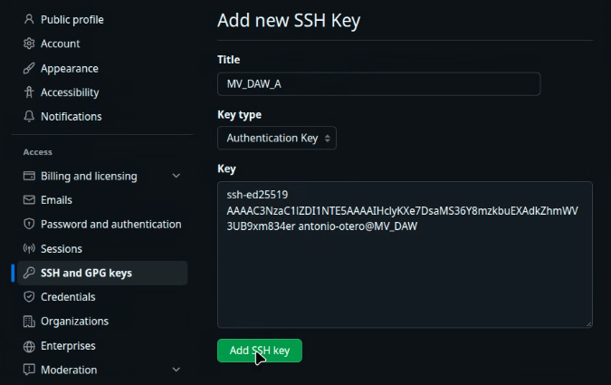
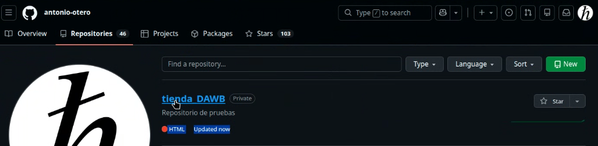
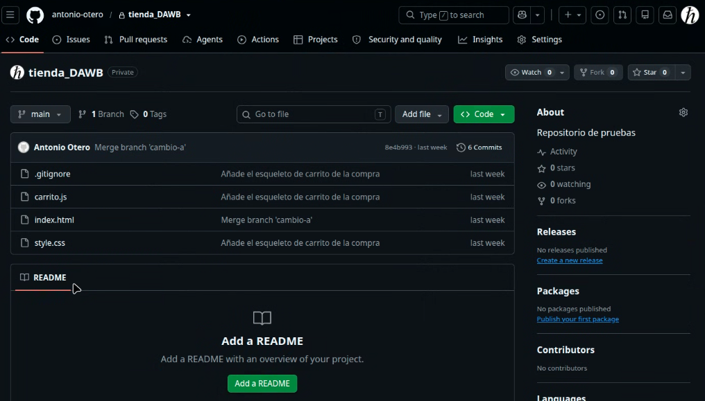
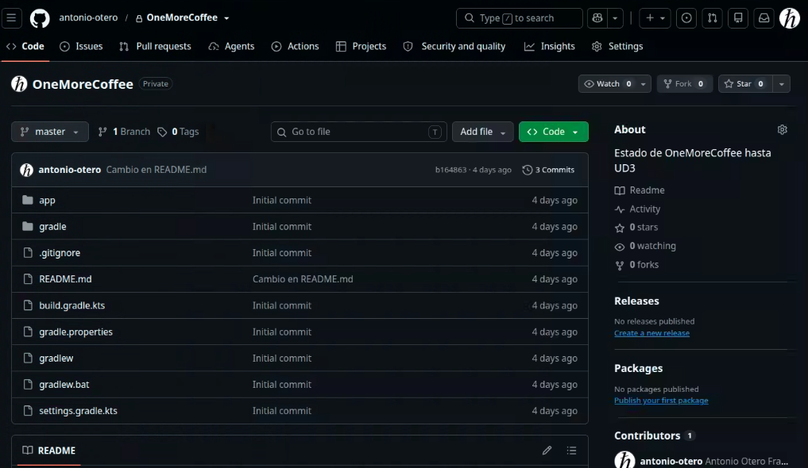
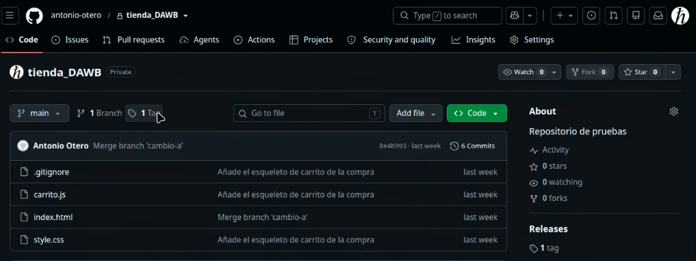
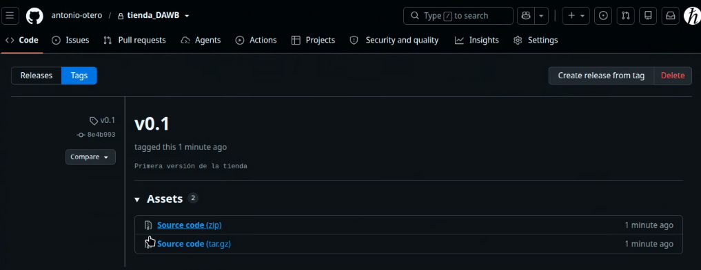
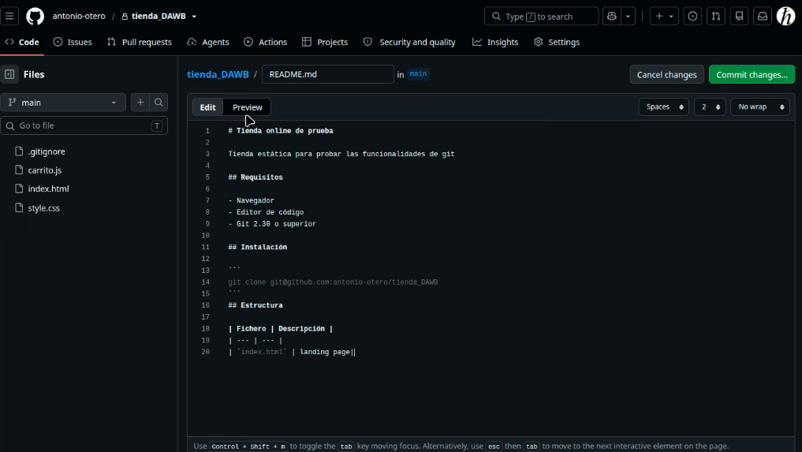
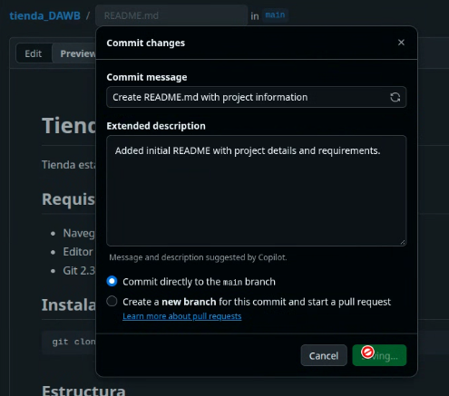

# Práctica 01 — Primeros pasos con Git

## Parte 1: Configuración y creación del repositorio

En las transcripciones, la línea verde con el símbolo `$` representa el comando escrito. La respuesta aparece a continuación, sin prompt y en gris, salvo los colores propios de Git. Los bloques `bash` que no tienen una salida asociada se mantienen como comandos copiables.

### 1. Configurar Git

La configuración global (`--global`) se guarda en `~/.gitconfig` y se aplica a todos los repositorios del equipo.

1. **Identidad**: indicamos quiénes somos para que cada commit quede firmado con su autor.
   ```bash
   git config --global user.name "Nombre Apellido"
   git config --global user.email "correo@ejemplo.net"
   ```
2. **Colores**: para ver la salida de Git en colores en la consola.
   ```bash
   git config --global color.ui auto
   ```
3. **Rama principal**: hacemos que la rama inicial de los repositorios nuevos se llame `main`.
   ```bash
   git config --global init.defaultBranch main
   ```
4. **Comprobar la configuración** con `--list`:
<pre style="display:block;background:#111214;border:1px solid #44474d;color:#d4d4d4;padding:0.55em 0.75em;margin:0.6em 0;border-radius:4px;overflow-x:auto;white-space:pre-wrap">
<span style="color:#89d185">$ git config --list</span>
<span style="color:#ce9178">user.name=Nombre Apellido</span>
<span style="color:#ce9178">user.email=correo@ejemplo.net</span>
<span style="color:#ce9178">color.ui=auto</span>
<span style="color:#ce9178">init.defaultbranch=main</span></pre>

### 2. Crear la carpeta del proyecto

Creamos la carpeta `repos/tienda` para el proyecto de la tienda online.

<pre style="display:block;background:#111214;border:1px solid #44474d;color:#d4d4d4;padding:0.55em 0.75em;margin:0.6em 0;border-radius:4px;overflow-x:auto;white-space:pre-wrap">
<span style="color:#89d185">$ cd Documentos</span>
<span style="color:#89d185">$ mkdir -p repos/tienda</span>
<span style="color:#89d185">$ cd repos/tienda</span>
</pre>

### 3. Inicializar el repositorio

`git init` convierte la carpeta en un repositorio (crea la carpeta oculta `.git`). Con `git status` vemos el estado: estamos en la rama `main` y todavía no hay commits.

<pre style="display:block;background:#111214;border:1px solid #44474d;color:#d4d4d4;padding:0.55em 0.75em;margin:0.6em 0;border-radius:4px;overflow-x:auto;white-space:pre-wrap">
<span style="color:#89d185">$ git init</span>
Repositorio Git vacío inicializado.
<span style="color:#89d185">$ ls -a</span>
<span style="color:#569cd6">.  ..  .git</span>
<span style="color:#89d185">$ git status</span>
En la rama <span style="color:#6a9955">main</span>
Todavía no hay commits.</pre>

### 4. Crear `index.html`

Creamos la página principal de la tienda con `nano index.html`.

<pre style="display:block;background:#111214;border:1px solid #44474d;color:#d4d4d4;padding:0.55em 0.75em;margin:0.6em 0;border-radius:4px;overflow-x:auto;white-space:pre-wrap"><span style="color:#6a9955">&lt;!DOCTYPE html&gt;</span>
&lt;html lang="es"&gt;
   &lt;head&gt;
      &lt;meta charset="utf-8"&gt;
      &lt;title&gt;Tienda Online&lt;/title&gt;
   &lt;/head&gt;
   &lt;body&gt;
      &lt;h1&gt;Tienda Online&lt;/h1&gt;
   &lt;/body&gt;
&lt;/html&gt;</pre>

### 5. Añadir el archivo al área de preparación (staging)

`git status` muestra `index.html` en rojo como **archivo sin seguimiento**: Git lo ve, pero no lo controla todavía.

<pre style="display:block;background:#111214;border:1px solid #44474d;color:#d4d4d4;padding:0.55em 0.75em;margin:0.6em 0;border-radius:4px;overflow-x:auto;white-space:pre-wrap"><span style="color:#89d185">$ git status</span>
En la rama main
Archivos sin seguimiento:
   <span style="color:#d4d4d4">index.html</span></pre>

Con `git add` lo pasamos al área de preparación (*staging*) y ya aparece en verde como "cambios a ser confirmados".

<pre style="display:block;background:#111214;border:1px solid #44474d;color:#d4d4d4;padding:0.55em 0.75em;margin:0.6em 0;border-radius:4px;overflow-x:auto;white-space:pre-wrap">
<span style="color:#89d185">$ git add index.html</span>
<span style="color:#89d185">$ git status</span>
Cambios preparados para el commit:
   <span style="color:#6a9955">nuevo archivo: index.html</span></pre>

### 6. Primer commit

El commit guarda los cambios en el repositorio **local**, con un mensaje que describe lo que se ha hecho. (Para enviarlo a un servidor remoto se usaría `git push`.)

<pre style="display:block;background:#111214;border:1px solid #44474d;color:#d4d4d4;padding:0.55em 0.75em;margin:0.6em 0;border-radius:4px;overflow-x:auto;white-space:pre-wrap">
<span style="color:#89d185">$ git commit -m &quot;Añadimos el landing page de nuestra tienda&quot;</span>
[main <span style="color:#dcdcaa">31c3078</span>] Añadimos el landing page de nuestra tienda
 1 file changed, 13 insertions(+)
 create mode 100644 index.html</pre>

### 7. Ver el historial

`git log` muestra los commits: su identificador (hash), autor, fecha y mensaje. `HEAD -> main` indica el commit en el que estamos.

<pre style="display:block;background:#111214;border:1px solid #44474d;color:#d4d4d4;padding:0.55em 0.75em;margin:0.6em 0;border-radius:4px;overflow-x:auto;white-space:pre-wrap"><span style="color:#89d185">$ git log</span>
Author: Nombre Apellido &lt;correo@ejemplo.net&gt;
Date: 2026-10-13
<span style="color:#4ec9b0">HEAD -&gt; main</span> apunta al commit actual.</pre>

### 8. Modificar un archivo y ver las diferencias

Cambiamos el título de la página a "Tienda Online de Deportes".

<pre style="display:block;background:#111214;border:1px solid #44474d;color:#d4d4d4;padding:0.55em 0.75em;margin:0.6em 0;border-radius:4px;overflow-x:auto;white-space:pre-wrap"><span style="color:#6a9955">&lt;h1&gt;</span>Tienda Online de Deportes<span style="color:#6a9955">&lt;/h1&gt;</span></pre>

`git diff` muestra las diferencias entre el archivo modificado y la última versión guardada. Gracias a `color.ui auto`, las líneas eliminadas salen en rojo (`-`) y las añadidas en verde (`+`).

<pre style="display:block;background:#111214;border:1px solid #44474d;color:#d4d4d4;padding:0.55em 0.75em;margin:0.6em 0;border-radius:4px;overflow-x:auto;white-space:pre-wrap"><span style="color:#89d185">$ git diff</span>
<span style="color:#f48771">-    &lt;title&gt;Tienda Online&lt;/title&gt;</span>
<span style="color:#89d185">+    &lt;title&gt;Tienda Online de Deportes&lt;/title&gt;</span>
<span style="color:#f48771">-    &lt;h1&gt;Tienda Online&lt;/h1&gt;</span>
<span style="color:#89d185">+    &lt;h1&gt;Tienda Online de Deportes&lt;/h1&gt;</span></pre>

Tras volver a hacer `git add`, `git diff` queda vacío, porque el cambio ya está en staging. Para ver lo que está preparado y pendiente de confirmar se usa `git diff --staged`.

<pre style="display:block;background:#111214;border:1px solid #44474d;color:#d4d4d4;padding:0.55em 0.75em;margin:0.6em 0;border-radius:4px;overflow-x:auto;white-space:pre-wrap">
<span style="color:#89d185">$ git add index.html</span>
<span style="color:#89d185">$ git diff            # vacío</span>
<span style="color:#569cd6">git diff</span>: sin salida (cambios ya preparados)
<span style="color:#89d185">$ git diff --staged</span>
<span style="color:#569cd6">git diff --staged</span>: 1 archivo modificado; el cambio de título está preparado.</pre>

Confirmamos el cambio:

<pre style="display:block;background:#111214;border:1px solid #44474d;color:#d4d4d4;padding:0.55em 0.75em;margin:0.6em 0;border-radius:4px;overflow-x:auto;white-space:pre-wrap">
<span style="color:#89d185">$ git commit -m &quot;Cambiamos el título de la página&quot;</span>
[main <span style="color:#dcdcaa">1966088</span>] Cambiamos el título de la página
 1 file changed, 2 insertions(+), 2 deletions(-)</pre>

### 9. Ver un commit con `git show`

`git show` muestra el último commit con sus cambios. Diferencia con `diff`:
- `git show` mira **hacia atrás**: lo que ya está en el historial.
- `git diff` mira **hacia delante**: lo que todavía no se ha confirmado.

<pre style="display:block;background:#111214;border:1px solid #44474d;color:#d4d4d4;padding:0.55em 0.75em;margin:0.6em 0;border-radius:4px;overflow-x:auto;white-space:pre-wrap"><span style="color:#89d185">$ git show --stat --oneline HEAD</span>
 index.html | 4 <span style="color:#89d185">++</span><span style="color:#f48771">--</span>
 1 file changed, 2 insertions(+), 2 deletions(-)</pre>

### 10. Añadir una hoja de estilos

Creamos `style.css` y la enlazamos desde `index.html` con `<link rel="stylesheet" href="style.css">`.

<pre style="display:block;background:#111214;border:1px solid #44474d;color:#d4d4d4;padding:0.55em 0.75em;margin:0.6em 0;border-radius:4px;overflow-x:auto;white-space:pre-wrap">style.css
<span style="color:#6a9955">h1</span> {
   background-color: steelblue;
   font-family: Arial, sans-serif;
   color: white;
}</pre>

Añadimos los dos archivos y hacemos commit:

<pre style="display:block;background:#111214;border:1px solid #44474d;color:#d4d4d4;padding:0.55em 0.75em;margin:0.6em 0;border-radius:4px;overflow-x:auto;white-space:pre-wrap">
<span style="color:#89d185">$ git add index.html style.css</span>
<span style="color:#89d185">$ git commit -m &quot;Añadida hoja de estilos&quot;</span>
[main <span style="color:#dcdcaa">c7f1708</span>] Añadida hoja de estilos
 2 files changed, 5 insertions(+)</pre>

Con `git show` vemos los cambios de ese commit en ambos archivos. Aquí usamos `--stat --format=` para mostrar solo el resumen de archivos modificados:

<pre style="display:block;background:#111214;border:1px solid #44474d;color:#d4d4d4;padding:0.55em 0.75em;margin:0.6em 0;border-radius:4px;overflow-x:auto;white-space:pre-wrap"><span style="color:#89d185">$ git show --stat --format= HEAD</span>
 index.html | 1 <span style="color:#89d185">+</span>
 style.css  | 5 <span style="color:#89d185">+++++</span>
 2 files changed, 6 insertions(+)</pre>

### 11. Ver quién cambió cada línea con `git blame`

`git blame` muestra, para cada línea de un archivo, el commit, el autor y la fecha del último cambio.

<pre style="display:block;background:#111214;border:1px solid #44474d;color:#d4d4d4;padding:0.55em 0.75em;margin:0.6em 0;border-radius:4px;overflow-x:auto;white-space:pre-wrap">
<span style="color:#89d185">$ git blame index.html</span>
<span style="color:#dcdcaa">c7f1708</span> (Nombre Apellido 2026-10-13) 5) &lt;link rel="stylesheet" href="style.css"&gt;
<span style="color:#dcdcaa">1966088</span> (Nombre Apellido 2026-10-13) 6) &lt;title&gt;Tienda Online de Deportes&lt;/title&gt;
<span style="color:#dcdcaa">31c3078</span> (Nombre Apellido 2026-10-13) 9) &lt;h1&gt;Tienda Online&lt;/h1&gt;</pre>

### 12. Ignorar archivos con `.gitignore`

En el repositorio se guarda el código fuente, pero no cosas como configuraciones del equipo o secretos (contraseñas, claves...). En el archivo `.gitignore` se indica qué archivos y carpetas del proyecto **no** se guardan en el repositorio.

Para probarlo, creamos la carpeta `node_modules` con un archivo que simula contener una contraseña:

```bash
mkdir -p node_modules
touch node_modules/paquete.js
nano node_modules/paquete.js
```

<pre style="display:block;background:#111214;border:1px solid #44474d;color:#d4d4d4;padding:0.55em 0.75em;margin:0.6em 0;border-radius:4px;overflow-x:auto;white-space:pre-wrap">node_modules/paquete.js
<span style="color:#ce9178">API_KEY="valor-ficticio-no-utilizable"</span></pre>

Creamos `.gitignore` con `nano .gitignore`. Se suele organizar por bloques:
- **Dependencias**: `node_modules/`, `vendor/`.
- **Configuración y secretos**: variables de entorno (`.env`) y archivos locales (`*.local`).
- **Artefactos de construcción**: carpetas generadas al compilar (`build/`, `dist/`).
- **Sistema operativo y editor**: `.DS_Store`, `.vscode/`.

Los directorios se escriben con barra al final. Existen plantillas de `.gitignore` para casos comunes (lenguajes, IDEs...).

<pre style="display:block;background:#111214;border:1px solid #44474d;color:#d4d4d4;padding:0.55em 0.75em;margin:0.6em 0;border-radius:4px;overflow-x:auto;white-space:pre-wrap"><span style="color:#6a9955"># Dependencias</span>
node_modules/
vendor/

<span style="color:#6a9955"># Configuración y secretos</span>
.env
*.local

<span style="color:#6a9955"># Artefactos de construcción</span>
build/
dist/

<span style="color:#6a9955"># Sistema operativo y editor</span>
.DS_Store
.vscode/</pre>

Al hacer `git status` solo aparece `.gitignore`: la carpeta `node_modules` ya no se muestra porque está ignorada.

<pre style="display:block;background:#111214;border:1px solid #44474d;color:#d4d4d4;padding:0.55em 0.75em;margin:0.6em 0;border-radius:4px;overflow-x:auto;white-space:pre-wrap"><span style="color:#89d185">$ git status</span>
Archivos sin seguimiento:
   <span style="color:#d4d4d4">.gitignore</span>
<span style="color:#6a9955">node_modules/ está ignorado</span></pre>

<pre style="display:block;background:#111214;border:1px solid #44474d;color:#d4d4d4;padding:0.55em 0.75em;margin:0.6em 0;border-radius:4px;overflow-x:auto;white-space:pre-wrap">
<span style="color:#89d185">$ git add .gitignore</span>
<span style="color:#89d185">$ git commit -m &quot;Añadido .gitignore del proyecto&quot;</span>
[main <span style="color:#dcdcaa">1dcff6f</span>] Añadido .gitignore del proyecto
 1 file changed, 16 insertions(+)
 create mode 100644 .gitignore</pre>

---

Hasta aquí la configuración del repositorio. Ahora veremos funcionalidades para **corregir errores**.

## Parte 2: Deshacer cambios

### 1. Descartar cambios sin confirmar con `git restore`

Añadimos una línea errónea al final de `index.html`:

<pre style="display:block;background:#111214;border:1px solid #44474d;color:#d4d4d4;padding:0.55em 0.75em;margin:0.6em 0;border-radius:4px;overflow-x:auto;white-space:pre-wrap">
<span style="color:#89d185">$ echo &quot;linea de codigo errónea&quot; &gt;&gt; index.html</span>
<span style="color:#ce9178">linea de codigo errónea</span></pre>

`git status` muestra el archivo como modificado y sugiere `git restore` para descartar los cambios.

<pre style="display:block;background:#111214;border:1px solid #44474d;color:#d4d4d4;padding:0.55em 0.75em;margin:0.6em 0;border-radius:4px;overflow-x:auto;white-space:pre-wrap"><span style="color:#89d185">$ git status</span>
Cambios no preparados:
   <span style="color:#d4d4d4">modificado: index.html</span>
<span style="color:#6a9955">git restore puede descartar estos cambios</span></pre>

`git restore` devuelve el archivo a su estado del último commit sin mostrar una respuesta si termina correctamente (si el cambio estuviera en staging, con `git restore --staged` lo sacaríamos del área de preparación).

<pre style="display:block;background:#111214;border:1px solid #44474d;color:#d4d4d4;padding:0.55em 0.75em;margin:0.6em 0;border-radius:4px;overflow-x:auto;white-space:pre-wrap">
<span style="color:#89d185">$ git restore index.html</span></pre>

El comando no imprime nada si se completa correctamente; la línea errónea desaparece del archivo.

### 2. Corregir el mensaje del último commit con `--amend`

Añadimos un comentario con el autor y hacemos commit. Con `-a` se añaden automáticamente todos los archivos ya seguidos que estén modificados, sin necesidad de `git add`.

<pre style="display:block;background:#111214;border:1px solid #44474d;color:#d4d4d4;padding:0.55em 0.75em;margin:0.6em 0;border-radius:4px;overflow-x:auto;white-space:pre-wrap">
<span style="color:#89d185">$ echo &#x27;&lt;!-- autor: nombre --&gt;&#x27; &gt;&gt; index.html</span>
<span style="color:#89d185">$ git commit -a -m &quot;Añade el autor y su correo&quot;</span>
[main <span style="color:#dcdcaa">da4e8d9</span>] Añade el autor y su correo
 1 file changed, 1 insertion(+)</pre>

El mensaje no es correcto (no se ha añadido ningún correo), así que lo editamos con `--amend`, que reemplaza el último commit por uno nuevo (cambia su hash):

<pre style="display:block;background:#111214;border:1px solid #44474d;color:#d4d4d4;padding:0.55em 0.75em;margin:0.6em 0;border-radius:4px;overflow-x:auto;white-space:pre-wrap">
<span style="color:#89d185">$ git commit --amend -m &quot;Añade el autor&quot;</span>
[main <span style="color:#dcdcaa">c26e040</span>] Añade el autor
 1 file changed, 1 insertion(+)
<span style="color:#6a9955">El commit anterior fue reemplazado por uno con un hash nuevo.</span></pre>

### 3. Volver atrás con `git reset`

`git log --oneline` muestra el historial resumido. `HEAD` es el commit donde estamos y con `HEAD~n` nos referimos a `n` commits atrás (se escribe con `~`, no con `-`).

<pre style="display:block;background:#111214;border:1px solid #44474d;color:#d4d4d4;padding:0.55em 0.75em;margin:0.6em 0;border-radius:4px;overflow-x:auto;white-space:pre-wrap">
<span style="color:#89d185">$ git log --oneline</span>
<span style="color:#89d185">$ git reset --soft HEAD-1</span>
<span style="color:#f48771">fatal: argumento ambiguo 'HEAD-1'</span>
Usa <span style="color:#6a9955">HEAD~1</span> para referirte al commit anterior.
<span style="color:#89d185">$ git reset --soft HEAD~1</span>
Después de <span style="color:#569cd6">git reset --soft HEAD~1</span>, los cambios permanecen en staging.</pre>

- `--soft`: deshace el commit pero conserva los cambios en staging.
- `--hard`: deshace el commit y **borra** el trabajo.

> `git reset` reescribe el historial, así que solo debe usarse con commits que aún no han salido de nuestra máquina. Si el error ya está publicado, se usa `git revert`, que crea un commit nuevo que deshace los cambios sin reescribir el historial.

---

## Parte 3: Alias e introducción a las ramas

Con `ls -a` podemos ver también los archivos y directorios ocultos. En la raíz del proyecto aparece `.git`, donde Git guarda los datos del repositorio; no debemos modificar su contenido manualmente.

> Si se elimina `.git`, no se borran los archivos del proyecto que están en la carpeta: queda la versión que hubiera en la rama activa, junto con los demás archivos presentes. Sin embargo, Git pierde el historial de commits, las ramas, la configuración del repositorio y los cambios preparados en *staging*. La carpeta deja de reconocerse como repositorio y `git status` ya no funciona allí. Ejecutar `git init` crearía un repositorio nuevo, sin recuperar el historial anterior.

### 1. Consultar el historial en forma de grafo

La opción `--graph` representa las ramas y los commits como un grafo. Combinada con `--oneline`, `--decorate`, `--color` y `--all`, permite consultar de forma compacta el historial de todas las ramas:

<pre style="display:block;background:#111214;border:1px solid #44474d;color:#d4d4d4;padding:0.55em 0.75em;margin:0.6em 0;border-radius:4px;overflow-x:auto;white-space:pre-wrap">
<span style="color:#89d185">$ git log --oneline --all --graph --decorate --color</span>
<span style="color:#4ec9b0">* (HEAD -&gt; main)</span>
<span style="color:#4ec9b0">* ...</span>
<span style="color:#6a9955">Se omiten los commits ya descritos para evitar repetir sus mensajes.</span></pre>

### 2. Crear un alias para el historial

Un alias permite crear un nombre corto para un comando que usamos con frecuencia. Este alias global se llamará `hist` y ejecutará el comando anterior:

Los alias de Git se ejecutan como subcomandos: se escribe `git` seguido del nombre del alias.

<pre style="display:block;background:#111214;border:1px solid #44474d;color:#d4d4d4;padding:0.55em 0.75em;margin:0.6em 0;border-radius:4px;overflow-x:auto;white-space:pre-wrap">
<span style="color:#89d185">$ git config --global alias.hist &quot;log --oneline --graph --decorate --color --all&quot;</span>
<span style="color:#89d185">$ git hist</span>
<span style="color:#4ec9b0">* main</span>
<span style="color:#4ec9b0">* feature/carrito</span> <span style="color:#6a9955">rama activa</span></pre>

### 3. Crear una rama para una funcionalidad

Una rama es una referencia a un commit que permite desarrollar cambios de forma independiente. Así podemos probar una funcionalidad sin incorporarla todavía a `main`. Creamos la rama `feature/carrito` y cambiamos a ella con `switch -c`:

```bash
git switch -c feature/carrito
git branch
```

`git branch` muestra las ramas locales; el asterisco identifica la rama activa. A continuación, creamos `carrito.js` con el editor:

```bash
nano carrito.js
```

### 4. Guardar la funcionalidad en la rama

Añadimos el archivo al área de preparación y confirmamos el cambio:

<pre style="display:block;background:#111214;border:1px solid #44474d;color:#d4d4d4;padding:0.55em 0.75em;margin:0.6em 0;border-radius:4px;overflow-x:auto;white-space:pre-wrap">
<span style="color:#89d185">$ git add carrito.js</span>
<span style="color:#89d185">$ git commit -m &quot;Añadimos el carrito a la compra&quot;</span>
<span style="color:#89d185">$ git status --short</span></pre>

Si `git status --short` no muestra salida, no quedan cambios pendientes en el árbol de trabajo.

> `git add carrito.js` no quita del área de preparación otros cambios que ya estuvieran preparados. Como en el apartado anterior usamos `git reset --soft`, el commit puede incluir también esos cambios pendientes. Comprueba `git status` antes de confirmar si quieres que el commit contenga únicamente `carrito.js`.

### 5. Cambiar entre ramas

Al volver a `main`, `carrito.js` no aparece porque ese archivo solo se ha creado en `feature/carrito`. Al cambiar de nuevo a esa rama, vuelve a aparecer:

Las ramas comparten el historial común, pero cada una puede mostrar una versión distinta de los archivos.

<pre style="display:block;background:#111214;border:1px solid #44474d;color:#d4d4d4;padding:0.55em 0.75em;margin:0.6em 0;border-radius:4px;overflow-x:auto;white-space:pre-wrap">
<span style="color:#89d185">$ git switch main</span>
Cambiado a la rama 'main'
<span style="color:#89d185">$ ls</span>
index.html  node_modules/  style.css

<span style="color:#89d185">$ git switch feature/carrito</span>
Cambiado a la rama 'feature/carrito'
<span style="color:#89d185">$ ls</span>
carrito.js  index.html  node_modules/  style.css</pre>

### 6. Crear una rama para corregir un error

Partimos de `main` y creamos `hotfix/titulo` para preparar una corrección sin modificar directamente la rama principal:

```bash
git switch main
git switch -c hotfix/titulo
git branch
```

En este ejemplo, cambiamos el título de `index.html`. `sed` distingue entre mayúsculas y minúsculas, por lo que el texto buscado debe coincidir con el título actual:

```bash
sed -i 's/Tienda Online de Deportes/Deportes Strong/' index.html
git diff
git commit -a -m "Cambiado el título a nombre corporativo"
```

El cambio queda confirmado en `hotfix/titulo`; `main` todavía conserva el título anterior hasta que fusionemos la rama.

## Parte 4: Integrar ramas y resolver conflictos

### 1. Fusionar cambios en `main`

Una vez revisados los cambios de una rama, podemos integrarlos en `main`. Primero cambiamos a la rama de destino y fusionamos `hotfix/titulo`:

```bash
git switch main
git merge hotfix/titulo
```

Como `main` no tenía cambios propios desde que se creó `hotfix/titulo`, Git puede avanzar `main` hasta el commit de la corrección (*fast-forward*). El título actualizado también se verá al abrir `index.html` desde la carpeta de trabajo.

Después integramos la funcionalidad del carrito:

```bash
git merge feature/carrito
```

En este caso, Git crea un commit de fusión porque las ramas tienen commits distintos. Si aparece el editor del mensaje, podemos conservar el mensaje propuesto y guardar y cerrar el editor para terminar la fusión.

### 2. Consultar y eliminar ramas integradas

`--merged` lista las ramas cuyos cambios ya están integrados en la rama actual; `--no-merged` muestra las que todavía no lo están. `-d` elimina una rama integrada y se niega a borrarla si detecta cambios sin fusionar.

```bash
git branch --merged
git branch --no-merged
git branch -d hotfix/titulo
git branch -d feature/carrito
git branch
```

`-D` fuerza el borrado incluso si la rama no está integrada; puede hacer inaccesibles sus commits, así que no debe usarse como opción habitual.

### 3. Provocar y reconocer un conflicto

Para practicar un conflicto, creamos `cambio-a` y modificamos el título en esa rama:

```bash
git switch -c cambio-a
sed -i 's/Deportes Strong/Deportes Fit/' index.html
git commit -a -m "Cambio a Deportes Fit"
```

Mientras tanto, hacemos otro cambio en `main` sobre esa misma línea:

```bash
git switch main
sed -i 's/Deportes Strong/Deportes Lolita/' index.html
git commit -a -m "Cambio a Deportes Lolita"
```

Como ambas ramas modificaron la misma línea de forma distinta, Git no puede decidir qué versión conservar. La fusión se detiene y `git status` identifica `index.html` como archivo en conflicto:

<pre style="display:block;background:#111214;border:1px solid #44474d;color:#d4d4d4;padding:0.55em 0.75em;margin:0.6em 0;border-radius:4px;overflow-x:auto;white-space:pre-wrap">
<span style="color:#89d185">$ git merge cambio-a</span>
Auto-fusionando index.html
CONFLICTO (contenido): Conflicto de fusión en index.html
La fusión automática falló; arregle los conflictos y luego realice un commit con el resultado.
<span style="color:#89d185">$ git status --short</span>
UU index.html</pre>

Abre `index.html` en un editor de texto, no en el navegador. Git inserta estos marcadores en el archivo para señalar las dos versiones en conflicto. `HEAD` identifica el contenido de la rama actual (`main`); después de `=======` aparece la versión de `cambio-a`. Los signos `-` y `+` no forman parte del archivo: son propios de una salida de `git diff`.

<pre style="display:block;background:#111214;border:1px solid #44474d;color:#d4d4d4;padding:0.55em 0.75em;margin:0.6em 0;border-radius:4px;overflow-x:auto;white-space:pre-wrap"><span style="color:#ce9178">&lt;&lt;&lt;&lt;&lt;&lt;&lt; HEAD</span>
   &lt;h1&gt;Deportes Lolita&lt;/h1&gt;
<span style="color:#d4d4d4">=======</span>
   &lt;h1&gt;Deportes Fit&lt;/h1&gt;
<span style="color:#6a9955">&gt;&gt;&gt;&gt;&gt;&gt;&gt; cambio-a</span></pre>

Editamos el archivo, elegimos el contenido final y quitamos todos los marcadores. En este ejemplo conservamos `Deportes Lolita`. Después marcamos el conflicto como resuelto y completamos el commit de fusión:

```bash
git add index.html
git commit
git hist
```

Si no queremos continuar con la fusión, podemos cancelarla con `git merge --abort` antes de resolver y confirmar los cambios.

## Parte 5: Conectar el repositorio con GitHub por SSH

Hasta ahora el repositorio es local: si el equipo falla, podríamos perder el trabajo. Un repositorio remoto en GitHub o GitLab permite alojar una copia y compartirla.

### 1. Crear una clave SSH

Generamos un par de claves Ed25519. El comentario ayuda a identificar la clave; se recomienda proteger la clave privada con una frase de contraseña. No compartas el archivo privado `~/.ssh/id_ed25519`.

- `ssh-keygen` crea y administra pares de claves para autenticarse mediante SSH.
- `-t ed25519` selecciona Ed25519, un algoritmo moderno de firma digital basado en curvas elípticas. Se usa para demostrar que controlamos la clave privada sin enviarla al servidor.
- `-C "usuario@equipo"` añade un comentario identificativo a la clave; no es una contraseña ni cambia cómo funciona la clave.

El comando pregunta dónde guardar el par y si queremos proteger la clave privada con una frase de contraseña. Aceptar la ruta predeterminada crea `~/.ssh/id_ed25519` (privada) y `~/.ssh/id_ed25519.pub` (pública). La clave pública se comparte con GitHub; la privada permanece en el equipo.

Si la ruta ya existe, `ssh-keygen` pregunta si queremos sobrescribirla. No lo hagas salvo que quieras reemplazar esa clave; puedes indicar otra ruta para conservar la anterior.

Al terminar, veremos mensajes similares a estos. Se omiten las preguntas interactivas sobre la ruta y la frase de contraseña:

<pre style="display:block;background:#111214;border:1px solid #44474d;color:#d4d4d4;padding:0.55em 0.75em;margin:0.6em 0;border-radius:4px;overflow-x:auto;white-space:pre-wrap">
<span style="color:#89d185">$ ssh-keygen -t ed25519 -C &quot;usuario@equipo&quot;</span>
Your identification has been saved in /home/usuario/.ssh/id_ed25519
Your public key has been saved in /home/usuario/.ssh/id_ed25519.pub
The key fingerprint is:
SHA256:&lt;huella_de_la_clave&gt; usuario@equipo</pre>

Para consultar la huella más adelante podemos usar `ssh-keygen -lf ~/.ssh/id_ed25519.pub`:

La salida tendrá un aspecto similar a este:

<pre style="display:block;background:#111214;border:1px solid #44474d;color:#d4d4d4;padding:0.55em 0.75em;margin:0.6em 0;border-radius:4px;overflow-x:auto;white-space:pre-wrap">
<span style="color:#89d185">$ ssh-keygen -lf ~/.ssh/id_ed25519.pub</span>
256 SHA256:&lt;huella_de_la_clave&gt; usuario@equipo (ED25519)</pre>

La huella SHA256 sirve para identificar la clave, pero **no es la clave pública** que se pega en GitHub. Para mostrar la clave pública completa usamos el archivo que termina en `.pub`:

El resultado es una línea larga; en este ejemplo se omite su contenido:

<pre style="display:block;background:#111214;border:1px solid #44474d;color:#d4d4d4;padding:0.55em 0.75em;margin:0.6em 0;border-radius:4px;overflow-x:auto;white-space:pre-wrap">
<span style="color:#89d185">$ cat ~/.ssh/id_ed25519.pub</span>
ssh-ed25519 &lt;contenido_completo_de_la_clave_publica&gt; usuario@equipo</pre>

En GitHub, vamos a **Settings > SSH and GPG keys > New SSH key**, ponemos un título para identificar el equipo y pegamos esa línea completa. Nunca pegamos ni compartimos la clave privada. Completa cualquier confirmación adicional que solicite GitHub.



Al conectar por primera vez, verifica la identidad del servidor antes de aceptar su clave. Después comprobamos la autenticación:

Si la clave aún no está añadida o no corresponde a la cuenta, veremos un error como este:

<pre style="display:block;background:#111214;border:1px solid #44474d;color:#d4d4d4;padding:0.55em 0.75em;margin:0.6em 0;border-radius:4px;overflow-x:auto;white-space:pre-wrap">
<span style="color:#89d185">$ ssh -T git@github.com</span>
git@github.com: Permission denied (publickey).</pre>

Cuando GitHub reconoce la clave, la respuesta es similar a esta:

<pre style="display:block;background:#111214;border:1px solid #44474d;color:#d4d4d4;padding:0.55em 0.75em;margin:0.6em 0;border-radius:4px;overflow-x:auto;white-space:pre-wrap">
<span style="color:#89d185">$ ssh -T git@github.com</span>
Hi USUARIO! You've successfully authenticated, but GitHub does not provide shell access.</pre>

### 2. Añadir el remoto y subir `main`

Creamos primero el repositorio en GitHub y copiamos su dirección SSH. El nombre del repositorio remoto no tiene por qué coincidir con el nombre de la carpeta local; lo importante es que la dirección corresponda al repositorio correcto y tengamos acceso. Sustituimos `USUARIO` y `NOMBRE_REPOSITORIO` por los valores propios:

`git branch --show-current` permite comprobar que estamos en `main`. Si `git remote -v` no muestra ningún remoto, añadimos `origin`; si ya muestra uno, comprobamos que su dirección sea la correcta y no lo añadimos de nuevo:

`origin` es el nombre convencional del remoto y `-u` deja configurada la rama remota de seguimiento al hacer el primer `push`. La salida de `git remote -v` es similar a esta:

<pre style="display:block;background:#111214;border:1px solid #44474d;color:#d4d4d4;padding:0.55em 0.75em;margin:0.6em 0;border-radius:4px;overflow-x:auto;white-space:pre-wrap">
<span style="color:#89d185">$ git remote add origin git@github.com:USUARIO/NOMBRE_REPOSITORIO.git</span>
<span style="color:#89d185">$ git remote -v</span>
origin  git@github.com:USUARIO/NOMBRE_REPOSITORIO.git (fetch)
origin  git@github.com:USUARIO/NOMBRE_REPOSITORIO.git (push)
<span style="color:#89d185">$ git branch --show-current</span>
main</pre>

Subimos la rama principal:

Al terminar el primer envío, Git muestra un resultado parecido a este:

<pre style="display:block;background:#111214;border:1px solid #44474d;color:#d4d4d4;padding:0.55em 0.75em;margin:0.6em 0;border-radius:4px;overflow-x:auto;white-space:pre-wrap">
<span style="color:#89d185">$ git push -u origin main</span>
Enumerando objetos: 21, listo.
Contando objetos: 100% (21/21), listo.
Compresión delta usando hasta 2 hilos
Comprimiendo objetos: 100% (18/18), listo.
Escribiendo objetos: 100% (21/21), listo.
Total 21 (delta 6), reutilizados 0 (delta 0)
To github.com:USUARIO/NOMBRE_REPOSITORIO.git
 * [new branch]      main -&gt; main
rama 'main' configurada para hacer seguimiento a 'origin/main'.</pre>

Después de un envío correcto, abrimos la lista de repositorios de GitHub: el proyecto aparece como actualizado.



Al entrar en el repositorio, comprobamos que la rama `main` contiene los archivos y el historial que acabamos de subir.



Si el `push` termina con «Could not read from remote repository», no se ha subido el repositorio. Comprueba que el repositorio existe, que la URL es correcta y que la clave pública está añadida a la cuenta con permisos de acceso.

### 3. Clonar un repositorio

Para descargar un repositorio existente usamos `git clone` con su dirección SSH:

En la página del repositorio, el botón **Code** permite copiar la dirección de clonación seleccionando **SSH**. En el ejemplo real se utiliza otro proyecto, `OneMoreCoffee`; debemos tener permiso de acceso si el repositorio es privado.



Git crea una carpeta con el nombre del repositorio y descarga su historial y archivos. La salida puede variar; por ejemplo:

<pre style="display:block;background:#111214;border:1px solid #44474d;color:#d4d4d4;padding:0.55em 0.75em;margin:0.6em 0;border-radius:4px;overflow-x:auto;white-space:pre-wrap">
<span style="color:#89d185">$ git clone git@github.com:USUARIO/NOMBRE_REPOSITORIO.git</span>
Clonando en 'NOMBRE_REPOSITORIO'...
remote: Enumerating objects: 97, done.
remote: Counting objects: 100% (97/97), done.
remote: Compressing objects: 100% (76/76), done.
Recibiendo objetos: 100% (97/97), listo.
Resolviendo deltas: 100% (15/15), listo.</pre>

Después entramos en la carpeta creada:

```bash
cd NOMBRE_REPOSITORIO
```

---

## Parte 6: Etiquetas y documentación del proyecto

### 1. Crear una etiqueta para una versión

Una etiqueta (*tag*) es un marcador asociado a un commit. Sirve para identificar versiones importantes del proyecto y facilita volver a consultar o descargar el código de ese punto del historial. Tras editar `index.html`, comprobamos que los cambios que queremos incluir estén confirmados: una etiqueta **no** incorpora cambios que sigan sin guardar en un commit. Si se crea antes del commit, apuntará a la versión anterior del archivo.

```bash
git status
git add index.html
git commit -m "Actualizamos el contenido de la tienda"
git push origin main
git tag -a v0.1 -m "Primera versión de la tienda"
git hist
```

`-a` crea una etiqueta anotada y `-m` añade su descripción. En el historial, la etiqueta aparece junto al commit al que apunta:

<pre style="display:block;background:#111214;border:1px solid #44474d;color:#d4d4d4;padding:0.55em 0.75em;margin:0.6em 0;border-radius:4px;overflow-x:auto;white-space:pre-wrap">
<span style="color:#89d185">$ git hist</span>
<span style="color:#4ec9b0">* (HEAD -&gt; main, tag: v0.1)</span> Actualizamos el contenido de la tienda
<span style="color:#4ec9b0">* ...</span></pre>

### 2. Subir la etiqueta a GitHub

`git push` no envía automáticamente las etiquetas que creamos después del primer envío. Para publicar `v0.1`, la subimos explícitamente:

```bash
git push origin v0.1
```

La salida indica que se ha enviado la etiqueta:

<pre style="display:block;background:#111214;border:1px solid #44474d;color:#d4d4d4;padding:0.55em 0.75em;margin:0.6em 0;border-radius:4px;overflow-x:auto;white-space:pre-wrap">
<span style="color:#89d185">$ git push origin v0.1</span>
Enumerando objetos: 1, listo.
Contando objetos: 100% (1/1), listo.
Escribiendo objetos: 100% (1/1), listo.
Total 1 (delta 0), reutilizados 0 (delta 0)
To github.com:USUARIO/NOMBRE_REPOSITORIO.git
 * [new tag]         v0.1 -&gt; v0.1</pre>

La etiqueta aparece en GitHub en la sección **Tags** del repositorio. Desde allí se puede consultar el commit asociado y descargar su código fuente como archivo ZIP o TAR. Si necesitamos publicar una versión con notas, también podemos crear una *release* basada en esa etiqueta.



Al abrir `v0.1`, encontramos su descripción y los enlaces de descarga del código correspondiente a esa versión:



### 3. Documentar el proyecto con `README.md`

`README.md` describe el proyecto y aparece en la página principal del repositorio. Se puede crear desde GitHub con **Add file > Create new file** o en el equipo con un editor. Por ejemplo:

~~~markdown
# Tienda online de prueba

Tienda estática para probar las funcionalidades de Git.

## Requisitos

- Navegador
- Editor de código
- Git 2.30 o superior

## Instalación

```sh
git clone git@github.com:USUARIO/NOMBRE_REPOSITORIO.git
```

## Estructura

| Fichero | Descripción |
| --- | --- |
| `index.html` | Página principal |
| `style.css` | Hoja de estilos |
~~~

En el editor web de GitHub escribimos el contenido de `README.md`. La pestaña **Preview** permite revisar cómo se verá antes de guardarlo.



Después pulsamos **Commit changes**, indicamos un mensaje descriptivo y confirmamos. En el ejemplo se elige guardar directamente en `main`; la otra opción permite crear una rama y proponer los cambios mediante una *pull request*.



Si lo creamos en el equipo, lo añadimos al repositorio y lo subimos como cualquier otro cambio:

```bash
git add README.md
git commit -m "Documentamos el proyecto"
git push origin main
```

Si editamos `README.md` directamente desde GitHub, el commit se crea en el remoto. Antes de volver a subir desde el equipo, sincronizamos ese commit con `git pull --rebase origin main`.
